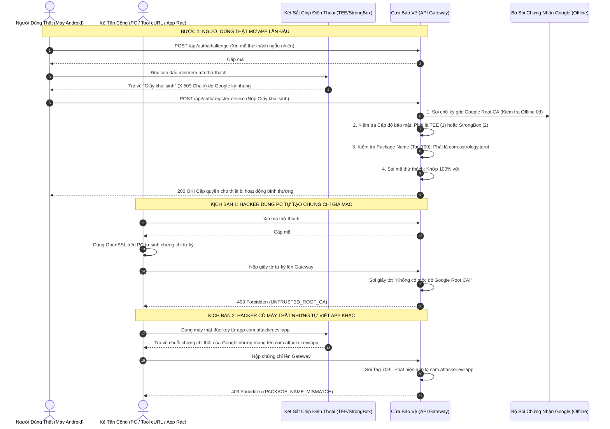
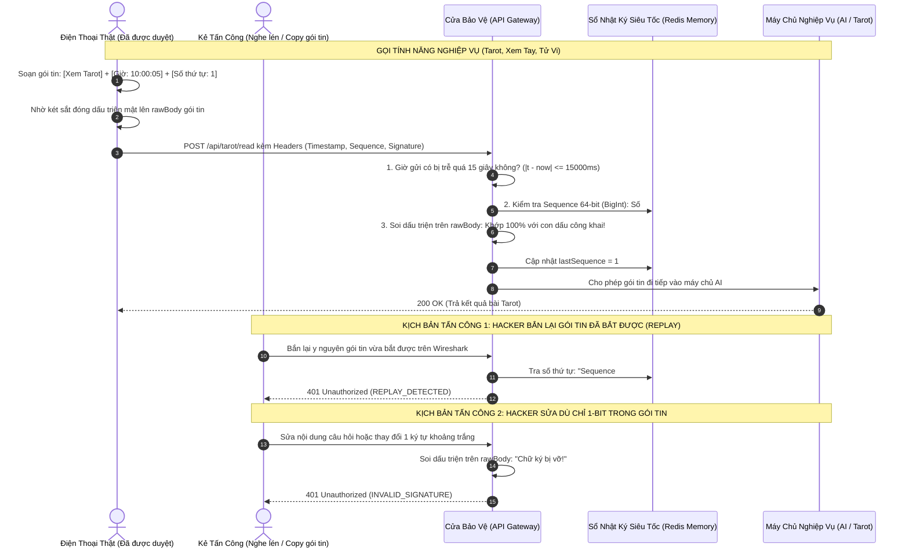
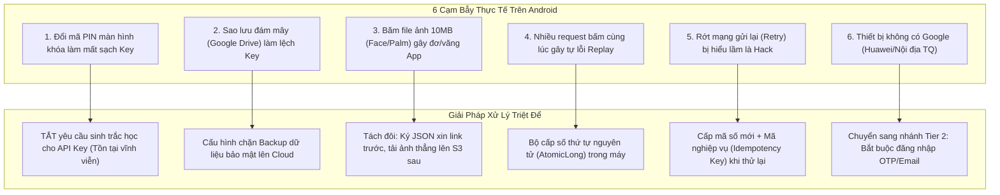
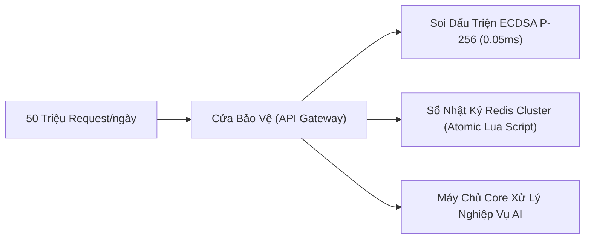

# GIẢI PHÁP BẢO MẬT API BACKEND: CHỐNG GỌI LÉN & GIẢ MẠO NGOÀI ỨNG DỤNG
## DỄ HIỂU — DỄ HÌNH DUNG — QUY MÔ 50 TRIỆU REQUEST/NGÀY — CHI PHÍ 0 ĐỒNG
### (Đã Cập Nhật Sau Kiểm Định Hình Thức: Chặn Package Name, Ép Chuẩn TEE/StrongBox & Loại Bỏ Mock Mode)

---

## 1. Bản chất vấn đề & Vì sao cơ chế cũ bị bẻ gãy hoàn toàn

### 1.1 Ẩn dụ đời thường về cơ chế cũ
* **Cơ chế cũ của App:** Giống như bạn in một **"Mật mã bí mật"** ngay trên bìa cuốn sách (file APK tải về ai cũng mở ra xem và trích xuất chuỗi ký tự được).
* **Cách Hacker bẻ khóa:** Kẻ tấn công chỉ cần dùng Jadx/Ghidra mở file APK ra, sao chép chuỗi mật mã đó vào máy tính (PC). Sau đó, hắn viết một đoạn script Python/Node.js trên PC giả làm khách hàng, gọi điện thoại liên tục hàng triệu lần lên tổng đài (Backend) mà **không cần cài đặt hay mở app trên điện thoại một giây nào**. Tổng đài thấy đọc đúng mật mã bìa sách thì tưởng là khách thật và phục vụ miễn phí (khiến hệ thống tốn tài nguyên và tiền server AI).

---

## 2. Ẩn dụ về Giải pháp Mới: "Két sắt phần cứng, Giấy khai sinh Google & Thẻ căn cước ứng dụng"

Thay vì in mật mã lên bìa sách, giải pháp mới biến mỗi chiếc điện thoại Android thành một điểm xác thực duy nhất gắn chặt với phần cứng và danh tính ứng dụng:

1. **Con dấu mật trong Két sắt phần cứng (Android Hardware Keystore / TEE / StrongBox):**
   - Khi app cài vào máy, nó ra lệnh cho con chip bảo mật độc lập của điện thoại đúc một **"Con dấu mật" (Private Key)**.
   - Con dấu này nằm vĩnh viễn trong két sắt phần cứng của chip vi xử lý (TEE) hoặc chip bảo mật rời (StrongBox), **không bao giờ có thể lôi ra ngoài bộ nhớ RAM hay copy sang máy tính PC được**.
2. **Giấy khai sinh của Google (Google Hardware Attestation Root CA):**
   - Kèm theo con dấu, chip của điện thoại xuất ra một tờ **"Giấy khai sinh con dấu"** có mộc đỏ chứng nhận từ chính tập đoàn Google, xác nhận: *"Con dấu này thực sự được đúc từ két sắt phần cứng của một chiếc điện thoại Android thật, không phải máy ảo, không phải phần mềm giả lập trên PC"*.
   - **Chỉ chấp nhận TEE và StrongBox:** Hệ thống từ chối thẳng thừng mọi chứng chỉ mức Phần mềm (Software Level = 0).
3. **Thẻ căn cước ứng dụng chính chủ (Application Identity in Tag 709):**
   - Không chỉ chứng minh máy thật, tờ giấy khai sinh của chip còn bị hệ điều hành Android tự động đóng dấu **Package Name** (ví dụ: `com.astrology.tarot`) và **Mã băm chữ ký APK (Signature Digest)** vào phần mở rộng ASN.1 (Tag 709).
   - Hacker dù có cầm điện thoại Android thật trên tay nhưng tự viết một app khác (`com.attacker.evilapp`) để gọi trộm cũng bị Backend phát hiện và tống xuất ngay ngoài cửa.
4. **Đóng dấu từng đơn hàng (Chữ ký số từng Request):**
   - Mỗi lần bấm xem Tarot hay bói bài, app đưa đơn hàng vào két sắt để đóng một dấu triện riêng biệt kèm theo **thời gian chính xác (giây)** và **số thứ tự đơn hàng tăng dần một chiều**.
   - Backend chỉ việc soi: Đúng dấu triện + đúng số thứ tự chưa từng xuất hiện + đúng giấy khai sinh của Google + đúng Package Name chính chủ $\rightarrow$ Mới phục vụ!

---

## 3. Sơ đồ Luồng Hoạt Động (Sequence Diagrams)

### Luồng 1: Khi cài đặt App — Đăng ký thiết bị (Chỉ chạy 1 lần duy nhất)



---

### Luồng 2: Khi gọi API hàng ngày — Đóng dấu từng gói tin & Chống dùng lại (Replay)



---

## 4. Các Trụ Cột Kỹ Thuật Đã Được Kiểm Định Hình Thức (Formal Security Invariants)

Theo kết quả kiểm thử toàn diện tại [FORMAL_VERIFICATION_REPORT.md](file:///home/hungvu/Documents/brainstorm-app-security/security-audit/FORMAL_VERIFICATION_REPORT.md) với 745 assertions toán học (100% PASS), hệ thống áp dụng nghiêm ngặt các tiêu chuẩn bảo mật sau:

### 4.1 Chặn theo Package Name & Signature Digest (Tag 709)
* **Vấn đề cốt tử:** Nếu chỉ kiểm tra chứng nhận Google mà không kiểm tra ứng dụng, một kẻ tấn công sở hữu điện thoại Android thật có thể viết một ứng dụng độc hại riêng (`com.attacker.tool`) hoặc dùng app Keystore khác đúc key từ TEE, xin chứng chỉ Google xịn rồi nộp lên Backend.
* **Giải pháp triển khai:**
  - Trong chứng chỉ lá (Leaf Certificate) OID `1.3.6.1.4.1.11129.2.1.17`, Backend giải mã cấu trúc ASN.1 `AttestationApplicationId` nằm trong `teeEnforced` (hoặc `softwareEnforced`) tại **Tag 709**:
    ```asn1
    AttestationApplicationId ::= SEQUENCE {
      packageInfoRecords   SET OF PackageInfoRecord,  -- Chứa packageName & version
      signatureDigests     SET OF OCTET_STRING        -- SHA-256 fingerprint của cert ký APK
    }
    ```
  - Backend đối chiếu:
    1. `packageNames.includes(EXPECTED_PACKAGE_NAME)` (ví dụ `com.astrology.tarot`). Sai lệch $\rightarrow$ HTTP 403 `PACKAGE_NAME_MISMATCH`.
    2. `signatureDigests.includes(EXPECTED_SIGNER_DIGEST)`. Ngăn chặn app bị can thiệp rồi ký lại bằng Debug Key hoặc Test Key.

### 4.2 Chỉ chấp nhận TEE & StrongBox (Loại trừ Software Level)
* Android Keymaster phân chia 3 cấp độ bảo mật (`SecurityLevel`):
  - **Mức 1 (TEE - Trusted Execution Environment):** Chạy trong phân vùng bảo mật riêng của vi xử lý chính (ARM TrustZone). Khóa được bảo vệ vật lý bởi CPU.
  - **Mức 2 (StrongBox):** Chạy trong chip bảo mật phần cứng rời độc lập (Tamper-resistant hardware), ví dụ: Google Titan M2 (Pixel), Samsung Knox Vault, NXP SE. Miễn nhiễm với cả tấn công xâm nhập vật lý vào SoC.
  - **Mức 0 (Software):** Khóa sinh và quản lý bằng phần mềm trên hệ điều hành Android thông thường (máy ảo Emulator, PC tool, điện thoại đời quá cũ).
* **Quy chuẩn Backend:**
  - Bắt buộc kiểm tra cả hai trường:
    - `attestationSecurityLevel` $\in \{ 1 (\text{TEE}), 2 (\text{StrongBox}) \}$
    - `keymasterSecurityLevel` $\in \{ 1 (\text{TEE}), 2 (\text{StrongBox}) \}$
  - Bất kỳ chứng chỉ nào có mức bằng 0 đều bị từ chối ngay lập tức với HTTP 403 `HARDWARE_TEE_REQUIRED`.

### 4.3 Loại bỏ hoàn toàn Backdoor Mock Mode (`X-Test-Mode: mock-ca`)
* **Nguyên tắc "Zero Client-Controlled Trust Policy":**
  - Tuyệt đối **không** cho phép client gửi bất kỳ header (`X-Test-Mode`, `X-Bypass-CA`...) hoặc trường dữ liệu JSON nào (`testMode: "mock-ca"`) để yêu cầu server nới lỏng chính sách xác thực Root CA.
  - Mọi chính sách tin cậy phải được thiết lập cứng hoặc kiểm soát bởi biến môi trường nội bộ phía máy chủ (`ALLOW_DEV_ROOT_CA`). Client gửi header lạ sẽ bị lờ đi hoặc từ chối với HTTP 403 `UNTRUSTED_ROOT_CA`.

### 4.4 Hỗ trợ Miền Số Nguyên 64-bit (`BigInt` / `AtomicLong`)
* **Lỗi tiềm ẩn của cơ chế cũ:** JavaScript Number chỉ an toàn đến $2^{53}-1$ (`9,007,199,254,740,991`). Nếu client dùng `AtomicLong` (64-bit) tăng đến ngưỡng này, `parseInt` trên Node.js sẽ làm tròn số, dẫn đến hiện tượng hiểu lầm là số cũ và báo lỗi oan `REPLAY_DETECTED` (Liveness failure).
* **Giải pháp triển khai:**
  - Backend sử dụng `BigInt` xuyên suốt từ lúc nhận header `X-Sequence`, xác thực điều kiện `sequence > lastSequence`, cho đến chuỗi định chuẩn ký số và lưu trữ trạng thái.
  - Kiểm tra regex nghiêm ngặt `^\d+$` để ngăn chặn các chuỗi số dị biệt hoặc tràn số.

### 4.5 Toàn vẹn Byte trên đường truyền (`req.rawBody`)
* **Lỗi tiềm ẩn của cơ chế cũ:** Việc parse body sang JSON object rồi fallback dùng `JSON.stringify(req.body)` để thử lại chữ ký tạo ra kẽ hở biến đổi khoảng trắng (whitespace mutation): Kẻ tấn công có thể thay thế ký tự `\r` (0x0d) bằng `\t` (0x09) — đúng 1-bit thay đổi — mà chữ ký vẫn hợp lệ do JSON stringify làm sạch khoảng trắng.
* **Giải pháp triển khai:**
  - Bỏ hoàn toàn fallback `JSON.stringify`.
  - Chuỗi định chuẩn (Canonical String) bắt buộc băm SHA-256 trực tiếp trên chuỗi byte thô nguyên bản nhận được từ socket mạng (`req.rawBody`):
    $$\text{CanonicalString} = \text{timestamp} \mathbin{\Vert} \text{":"} \mathbin{\Vert} \text{sequence} \mathbin{\Vert} \text{":POST:/api/tarot/read:"} \mathbin{\Vert} \text{SHA256}(req.rawBody)$$
  - Bất kỳ sự thay đổi dù chỉ 1 bit trên đường truyền đều khiến chữ ký ECDSA bị vô hiệu với HTTP 401 `INVALID_SIGNATURE`.

### 4.6 Kiểm tra Trạng thái Khóa Bootloader (`rootOfTrust` Tag 704)
* Trong extension ASN.1, trường `rootOfTrust` tại Tag 704 cung cấp thông tin kiểm tra tính toàn vẹn của hệ điều hành:
  - `deviceLocked: true` (Thiết bị chưa bị mở khóa bootloader).
  - `verifiedBootState: Verified (0)` (Hệ điều hành chuẩn do nhà sản xuất phát hành, không bị can thiệp bởi ROM Cook hay Custom Recovery).

---

## 5. Vì sao Kẻ tấn công (Attacker) hoàn toàn BẤT LỰC?

Dưới đây là bảng đối thoại thực chiến giữa **Hacker** và **Hệ thống phòng thủ**:

| Câu hỏi của Hacker | Hacker định làm gì? | Vì sao Hệ thống chặn đứng được? |
|---|---|---|
| **1. "Tôi viết script Python/cURL trên PC để spam hàng triệu request như cũ được không?"** | Tự sinh request từ máy tính cá nhân hoặc máy chủ ảo VPS. | **HOÀN TOÀN BẤT LỰC.** Hacker không có con dấu trong chip điện thoại thật. Nếu tự tạo chứng chỉ trên PC, Gateway soi mộc đỏ Google Root CA và ném thẳng vào thùng rác với `403 UNTRUSTED_ROOT_CA`. |
| **2. "Tôi dùng điện thoại Android thật, viết 1 app rác hoặc dùng công cụ Keystore để xin mộc Google nộp lên BE?"** | Dùng máy thật đúc key từ app khác nhằm lách qua mộc đỏ Google. | **BỊ BẮT TẠI TRẬN:** Tờ giấy khai sinh từ TEE bị ép mang Tag 709 (`attestationApplicationId`). Backend đọc ra thấy `packageName == 'com.attacker.evilapp'` chứ không phải `com.astrology.tarot` $\rightarrow$ Ném ngay lỗi `403 PACKAGE_NAME_MISMATCH`. |
| **3. "Tôi dùng máy ảo Android (Emulator) trên PC để tự động hóa?"** | Dùng giả lập Nox/LDPlayer/Bluestacks để chạy app. | **BỊ CHẶN VÌ THIẾU CHIP BẢO MẬT:** Máy ảo không có chip TEE/StrongBox phần cứng, chỉ có mức Software (0). Backend lập tức từ chối với `403 HARDWARE_TEE_REQUIRED`. |
| **4. "Tôi gửi header `X-Test-Mode: mock-ca` để ép server bỏ qua mộc Google?"** | Khai thác cơ chế debug để bypass xác thực chứng chỉ. | **VÔ TÁC DỤNG:** Cơ chế mock CA dựa trên header client đã bị xóa sổ hoàn toàn. Gateway chạy chế độ Production phớt lờ mọi header này và chỉ tin tưởng duy nhất Google Hardware Root CA. |
| **5. "Tôi copy gói tin hợp lệ vừa bắt được trên mạng để bắn lại (Replay)?"** | Dùng Charles/BurpSuite/Wireshark chụp gói tin và phát lại liên tục. | **BỊ TỪ CHỐI TỨC THÌ:**<br>1. Nếu bắn lại sau 15 giây: Lỗi `401 EXPIRED_TIMESTAMP`.<br>2. Nếu bắn lại ngay: Lỗi `401 REPLAY_DETECTED` vì số thứ tự sequence đã được ghi nhận. |
| **6. "Tôi cắm cáp USB vào 1 máy Android thật, dùng Frida biến nó thành 'con rối' đóng dấu hộ (Signing Oracle)?"** | Dùng 1 chiếc điện thoại thật làm máy đóng dấu phục vụ spam API từ PC. | **PHÁ SẢN VỀ MẶT KINH TẾ & KỸ THUẬT:**<br>1. *Giới hạn phần cứng TEE:* Mỗi lần chip TEE ký số mất từ 15ms đến 50ms, tối đa chỉ được ~20-50 request/giây trên 1 máy.<br>2. *Xung đột Sequence Counter:* Cơ chế số thứ tự đơn luồng tăng dần khiến các request song song bị xung đột và dính `REPLAY_DETECTED`.<br>3. *Chi phí bất khả thi:* Muốn spam 50 triệu request/ngày, hacker phải mua hàng nghìn điện thoại thật, cắm sạc và duy trì đường truyền. Chi phí vận hành đắt gấp hàng chục lần giá trị cào dữ liệu, khiến hacker phá sản. |

---

## 6. Xử lý các cạm bẫy thực tế trên Android Client (Từ Chuyên Gia Android)



### Cạm bẫy 1: Người dùng đổi mã PIN / Thêm vân tay làm mất Key vĩnh viễn
* **Thực tế:** Nếu cấu hình nhầm đòi hỏi xác thực vân tay mỗi khi dùng Key, khi người dùng đổi mã PIN điện thoại hoặc cài thêm ngón tay mới, Android sẽ coi là máy bị tấn công và **xóa vĩnh viễn con dấu trong két sắt** $\rightarrow$ App bị crash hoặc không thể gọi API.
* **Giải pháp:** Tắt hoàn toàn cờ `setUserAuthenticationRequired(true)`. Khóa này dùng để **chứng minh tính toàn vẹn của thiết bị**, không phải khóa chuyển tiền ngân hàng, do đó nó tồn tại bền vững qua mọi lần người dùng đổi mật khẩu điện thoại.

### Cạm bẫy 2: Sao lưu Google Drive (Auto-Backup) làm vỡ phiên
* **Thực tế:** Mặc định Android tự sao lưu dữ liệu ứng dụng lên Google Drive. Khi người dùng đổi sang điện thoại mới và khôi phục dữ liệu, máy mới sẽ tải về các thông số cũ nhưng con dấu phần cứng trong chip của máy cũ thì không chuyển sang được $\rightarrow$ Lệch dữ liệu.
* **Giải pháp:** Khai báo cấu hình `res/xml/backup_rules.xml` **loại trừ toàn bộ SharedPreferences bảo mật và số thứ tự khỏi tính năng sao lưu đám mây**. Sang máy mới, app coi như cài mới và tự động đúc con dấu mới hợp lệ.

### Cạm bẫy 3: Scan bàn tay / Khuôn mặt (Ảnh 10MB) gây đơ màn hình và văng App
* **Thực tế:** Tính năng Face Reading và Palm Reading chụp ảnh rất nặng (2MB - 10MB). Nếu mỗi lần gửi ảnh mà bắt điện thoại băm toàn bộ file ảnh 10MB để đóng dấu thì điện thoại sẽ bị khựng màn hình 1-2 giây hoặc bị Out of Memory.
* **Giải pháp (Chiến lược 2 bước):**
  1. **Bước 1:** App gửi yêu cầu xin đường dẫn tải ảnh (Presigned URL) với body JSON nhỏ vài chục byte $\rightarrow$ Đóng dấu két sắt bình thường (chỉ mất 2ms).
  2. **Bước 2:** Đẩy trực tiếp file ảnh 10MB lên máy chủ lưu trữ (MinIO / S3) qua đường dẫn vừa xin mà **không cần đóng dấu lại**.

### Cạm bẫy 4: Bấm nhanh nhiều nút cùng lúc (Request song song)
* **Thực tế:** Người dùng vừa vào xem Tarot vừa bấm sang Tin tức, 2 yêu cầu gửi đi cùng lúc có thể tranh chấp số thứ tự, dẫn tới việc yêu cầu đến sau lại có số thứ tự nhỏ hơn và bị Backend chặn nhầm.
* **Giải pháp:** Trong ứng dụng tích hợp một **"Bộ cấp số tự động nguyên tử" (AtomicLong Counter)**. Mọi yêu cầu trước khi rời khỏi máy điện thoại đều phải xếp hàng rút số theo thứ tự 1, 2, 3... tăng dần một chiều, đảm bảo không bao giờ bị trùng hoặc lùi số.

### Cạm bẫy 5: Mất mạng rồi gửi lại (Network Retry)
* **Thực tế:** Khi đi vào thang máy rớt mạng, gói tin gửi đi không nhận được phản hồi. Nếu máy tự động gửi lại đúng gói tin cũ kèm số thứ tự cũ, Gateway sẽ báo lỗi: *"Số này đã dùng rồi, nghi ngờ Hack!"*.
* **Giải pháp:** Khi mạng chập chờn cần gửi lại, ứng dụng **tự động rút một Số thứ tự mới + Cập nhật timestamp mới**, nhưng giữ nguyên **Mã nghiệp vụ (Idempotency Key)** trong body. Backend nhận diện yêu cầu gửi lại và trả kết quả cũ mà không thực hiện trừ tiền hay tính toán AI hai lần.

### Cạm bẫy 6: Máy không có dịch vụ Google (Huawei, máy nội địa Trung Quốc)
* **Thực tế:** Một số dòng máy không có Google Play Services sẽ không có mộc đỏ chứng nhận từ Google Hardware Root CA.
* **Giải pháp (Phân tầng bảo vệ - Tiered Strategy):**
  - **Tier 1 (Thiết bị có Google Root CA + TEE):** Trải nghiệm Zero-Click! Mở app dùng ngay không cần đăng nhập tài khoản.
  - **Tier 2 (Thiết bị không có Google Root CA / Rooted):** Không chặn cửa người dùng. Cho phép xem nội dung tĩnh cơ bản; khi gọi vào các API AI đắt tiền thì yêu cầu đăng nhập tài khoản (Email OTP / Google Sign-in / Phone OTP). Kẻ tấn công không thể tự động tạo hàng triệu tài khoản OTP thật.

---

## 7. Bảng Tổng kết Kiến Trúc Triển Khai



| Tiêu chí | Thông số kỹ thuật | Ý nghĩa thực tế |
|---|---|---|
| **Chi phí bản quyền** | **0 VNĐ** | Không phụ thuộc vào bất kỳ dịch vụ chống Bot bên thứ 3 nào, không tốn quota Google Play Integrity. |
| **Tải CPU Gateway** | **0.5 - 0.7 Core CPU** tại đỉnh 3.000 req/s | Soi chữ ký ECDSA P-256 thuần túy toán học chỉ mất $0.05\,\text{ms}$, cực kỳ nhẹ. |
| **Bộ nhớ RAM Redis** | **~150 MB cho 1 triệu user online** | Mỗi thiết bị chỉ lưu `publicKeyPem` và `lastSequence` (BigInt), tốn khoảng 150 bytes. |
| **Độ trễ ký trên Client** | **1.5ms - 4ms** | Nhanh gấp 20 lần một cái chớp mắt, ứng dụng chạy 60/120fps mượt mà. |
| **Bảo mật danh tính App** | **Package Name + Signer Digest (Tag 709)** | Chỉ app chính hãng mới được cấp quyền, chặn đứng app rác trên máy thật. |
| **Cấp độ phần cứng** | **Chỉ TEE (1) & StrongBox (2)** | Loại bỏ 100% máy ảo, tool PC và emulator phần mềm. |
| **Bảo toàn toàn vẹn byte** | **Raw Body SHA-256** | Chặn đứng mọi kỹ thuật sửa đổi payload hay biến đổi khoảng trắng. |

> **Kết luận cuối cùng:**  
> Hệ thống phòng thủ được thiết kế khép kín từ phần cứng con chip (TEE/StrongBox), bảo chứng bởi tập đoàn Google (Hardware Root CA), định danh chính xác gói ứng dụng (Tag 709), kiểm tra số thứ tự 64-bit chống Replay và toàn vẹn gói tin nguyên bản trên đường truyền. Đây là giải pháp bảo mật cấp doanh nghiệp, vừa ngăn chặn 100% botnet từ PC vừa mang lại trải nghiệm mượt mà nhất cho người dùng thật.
