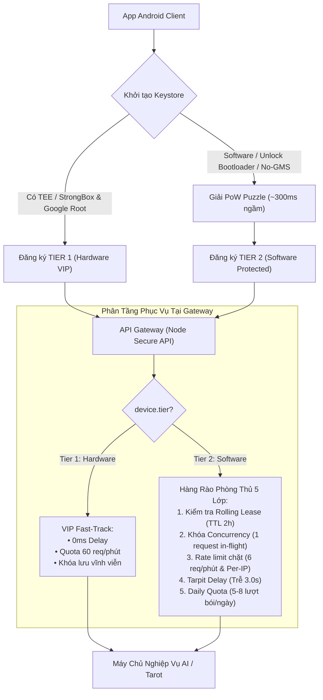
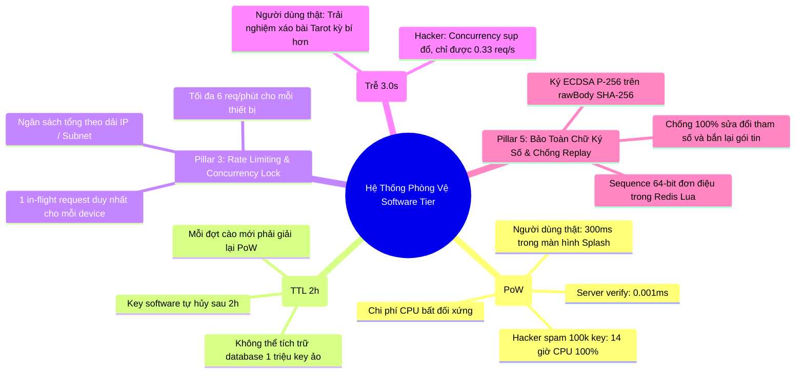

# Kế Hoạch Nâng Cao Tương Thích Tối Đa Thiết Bị Android & Cơ Chế Phòng Vệ Bất Đối Xứng (Không Cần Bắt Đăng Nhập)

Tài liệu này đặc tả chi tiết kế hoạch kỹ thuật mở rộng kiến trúc bảo mật của **Node Secure API**, nhằm hỗ trợ tương thích 100% thiết bị Android (bao gồm cả các thiết bị mức Software, Bootloader Unlocked, máy không có Google Play Services) mà **không cần bắt buộc người dùng đăng nhập tài khoản**, đồng thời kích hoạt hệ thống phòng vệ bất đối xứng để triệt hạ botnet và công cụ cào dữ liệu của hacker.

---

## 1. Bối Cảnh & Bài Toán Thực Tế

### 1.1 Điểm nghẽn của chính sách bảo mật hiện tại
Hệ thống hiện tại thực thi chính sách bảo mật phần cứng tuyệt đối:
* Bắt buộc khóa nằm trong **TEE (1)** hoặc **StrongBox (2)** (Client ưu tiên TEE trước để đạt tốc độ tối đa ~10–40ms thay vì 2–5s của chip rời StrongBox).
* Bắt buộc chuỗi chứng chỉ phải ký ngược về **Google Hardware Attestation Root CA**.
* Bắt buộc bootloader phải khóa (`deviceLocked = true`) và trạng thái boot chuẩn (`verifiedBootState = VERIFIED (0)`).

**Hệ quả thực tế:**
* Tại thị trường Việt Nam và châu Á, có khoảng **15% – 30%** thiết bị của người dùng chân chính không đáp ứng tiêu chuẩn khắt khe trên:
  1. Các dòng điện thoại giá rẻ hoặc đời cũ (Android 7.0 – 9.0) mà nhà sản xuất chipset chỉ triển khai Keystore mức phần mềm (`attestationSecurityLevel = 0`).
  2. Thiết bị xách tay (Xiaomi, Realme, OnePlus...) đã unlock bootloader để cài ROM tiếng Việt (`deviceLocked = false`).
  3. Thiết bị không có dịch vụ Google Play Services (như Huawei HarmonyOS hoặc máy nội địa Trung Quốc) không thể cấp chứng chỉ Google Root CA.
  4. Các thiết bị mà hàm sinh khóa `setAttestationChallenge` ném ngoại lệ do phần cứng chip không hỗ trợ Key Attestation.

### 1.2 Vì sao không thể bắt người dùng đăng nhập?
* Ứng dụng xem Tarot, bói toán, tử vi, horoscope là các tiện ích trải nghiệm tức thì (instant/guest utility).
* Nếu ép buộc người dùng nhập OTP SMS, đăng nhập Google hay Email khi dùng thiết bị cũ / unlock bootloader, tỷ lệ người dùng bỏ ứng dụng (churn rate) sẽ lên tới **60% – 80%**.
* Do đó, hệ thống cần một giải pháp bảo mật **Zero-Login Friction** nhưng vẫn bảo vệ được ngân sách máy chủ AI.

---

## 2. Kiến Trúc Tổng Thể: Phân Tầng Bất Đối Xứng (Dual-Tier Architecture)



### So Sánh Hai Tầng Bảo Mật

| Tiêu Chí | Tier 1: Hardware VIP | Tier 2: Software Protected |
|---|---|---|
| **Đối tượng thiết bị** | Máy có chip TEE / StrongBox, Google Root CA, bootloader khóa (ưu tiên TEE cho tốc độ 10–40ms) | Máy cũ, chip giá rẻ, unlock bootloader, không GMS |
| **Yêu cầu khi đăng ký** | Chuỗi chứng chỉ Google Hardware Attestation | Cặp khóa EC P-256 + Lời giải Proof of Work (PoW) |
| **Thời hạn khóa (Lease TTL)** | **Vĩnh viễn** (gắn chặt với chip phần cứng) | **2 giờ** (sau 2h tự hủy, app tự làm mới ngầm) |
| **Độ trễ xử lý (Latency)** | **Siêu tốc** (0ms delay bổ sung, phản hồi < 50ms) | **Tarpit Delay 3.0s** (chủ động làm chậm kết nối) |
| **Hạn mức thiết bị (RPM)** | 60 requests / phút | 6 requests / phút (tối đa 1 request in-flight) |
| **Giới hạn theo dải IP** | Tiêu chuẩn | Nghiêm ngặt (tối đa 5 đăng ký/giờ, 20 req/phút/IP) |
| **Toàn vẹn dữ liệu** | Ký ECDSA P-256 trên `req.rawBody` SHA-256 | Ký ECDSA P-256 trên `req.rawBody` SHA-256 |
| **Chống Replay** | Sequence 64-bit đơn điệu trong Redis Lua script | Sequence 64-bit đơn điệu trong Redis Lua script |

---

## 3. Chi Tiết 5 Trụ Cột "Làm Khó Hacker" Trên Tầng Software



### Trụ cột 1: Dynamic Proof of Work (PoW Challenge)
* **Nguyên lý bất đối xứng**:
  * Khi xin challenge (`POST /api/auth/challenge`), server trả về mã ngẫu nhiên kèm `pow` (`difficulty = 18`, `salt`).
  * Để đăng ký thiết bị Software, client phải tìm con số `nonce` sao cho:
    $$\text{SHA256}(\text{challenge} \mathbin{\Vert} \text{":"} \mathbin{\Vert} \text{salt} \mathbin{\Vert} \text{":"} \mathbin{\Vert} \text{nonce}) \text{ có 18 bit 0 dẫn đầu}$$
* **Hiệu quả thực tế**:
  * **Người dùng thật:** CPU điện thoại chỉ mất trung bình **300ms** để giải xong. Quá trình này diễn ra ngầm 1 lần duy nhất trong lúc hiển thị Splash Screen khi vừa cài app. Người dùng hoàn toàn không cảm nhận được độ trễ.
  * **Hacker chạy tool script trên PC:** Muốn sinh 100.000 thiết bị ảo để cào bài Tarot:
    $$100.000 \times 0.3\,\text{giây} = 30.000\,\text{giây CPU} \approx 8.3\,\text{giờ CPU 100\% liên tục}$$
    Chi phí tính toán tăng vọt, đập tan khả năng tạo hàng loạt key trong chớp mắt.
  * **Server xác thực:** Server chỉ băm đúng 1 lần duy nhất để kiểm tra, thời gian tốn chưa tới **$0.001\,\text{ms}$**.

### Trụ cột 2: Rolling Device Lease (Khóa Tự Hủy Sau 2 Giờ)
* **Khái niệm**: Thiết bị Software chỉ được cấp phép hoạt động trong vòng **2 giờ** (`expiresAt = now + 7200000`).
* **Hiệu quả ngăn chặn**:
  * Ngăn chặn hoàn toàn việc hacker dùng siêu máy tính "đào" sẵn 1 triệu key ảo lưu vào database để đem bán hoặc dùng dần quanh năm.
  * Hết 2 giờ, toàn bộ key cũ trở thành rác vô giá trị. Muốn cào tiếp trong các khung giờ sau, hacker lại phải bật máy tính đốt thêm 8.3 giờ CPU.
  * Với người dùng thật: SDK trong app tự động làm mới ngầm (silent renewal) khi mở app ở các phiên tiếp theo, không gây gián đoạn.

### Trụ cột 3: Khóa Concurrency & Rate Limit Đa Chiều
* **Khóa Concurrency (Single In-flight Request Lock)**:
  * Một thiết bị Software chỉ được phép có **tối đa 1 request đang được xử lý** tại một thời điểm (kiểm soát bằng atomic key trong Redis).
  * Nếu bot script bắn 20 request song song trên cùng 1 key: 19 request sẽ nhận ngay HTTP `429 CONCURRENT_REQUEST_DISALLOWED`.
* **Rate Limit cục bộ theo thiết bị**: Tối đa 6 request/phút.
* **Rate Limit tổng hợp theo địa chỉ IP**:
  * Giới hạn tổng số request và số lượt đăng ký Software xuất phát từ cùng một địa chỉ IP (tối đa 5 đăng ký/giờ, tối đa 20 request/phút trên toàn bộ các key software thuộc IP đó).
  * Chặn đứng chiêu trò tạo nhiều key rồi luân phiên gọi từ một máy tính cá nhân.

### Trụ cột 4: Trễ Có Chủ Đích (Intentional Tarpit Latency)
* Gateway chủ động giữ kết nối và tạo độ trễ nhân tạo **3.0 giây** trước khi trả kết quả Tarot cho thiết bị Software.
* **Ý nghĩa kép**:
  * **Trải nghiệm người dùng:** Trong ứng dụng bói bài Tarot, việc kết quả xuất hiện sau 3 giây (đi kèm hoạt ảnh xáo bài và lật bài huyền bí) tạo cảm giác AI đang suy ngẫm chân thật và linh thiêng hơn là văng kết quả ra trong 0.01 giây.
  * **Bóp nghẹt Hacker:** Kết hợp giữa Tarpit 3.0 giây và Single in-flight request, một thiết bị Software bị khống chế cứng:
    $$\text{Tốc độ tối đa} = \frac{60\,\text{giây}}{3.0\,\text{giây}} = 20\,\text{request / phút} \approx 0.33\,\text{req/s}$$
    Để cào được 100.000 quẻ bài, hacker phải mất hơn **83.3 giờ liên tục (~3.5 ngày)** cho mỗi thread!

### Trụ cột 5: Bảo Toàn Chữ Ký Số & Chống Replay Tuyệt Đối
* Dù ở mức Software, client vẫn tạo cặp khóa EC P-256 chuẩn và ký số lên toàn bộ payload:
  $$\text{CanonicalString} = \text{timestamp} \mathbin{\Vert} \text{":"} \mathbin{\Vert} \text{sequence} \mathbin{\Vert} \text{":POST:/api/tarot/read:"} \mathbin{\Vert} \text{SHA256}(req.rawBody)$$
* **Bất biến bảo mật:**
  * Hacker **không thể sửa đổi dù chỉ 1-bit** nội dung câu hỏi hay tham số bói bài (`INVALID_SIGNATURE`).
  * Hacker **không thể bắt gói tin trên Wireshark để bắn lại** (`REPLAY_DETECTED` qua sequence 64-bit đơn điệu trong Redis Lua).

---

## 4. Đặc Tả Thay Đổi Trong Codebase

```
src/
├── config.ts               # Thêm cấu hình biến môi trường cho Software Tier
├── contracts.ts            # Bổ sung kiểu DeviceTier, powNonce, softwareKeyPem
├── core/
│   ├── canonical.ts
│   ├── device-id.ts
│   ├── pow.ts              # [NEW] Thuật toán sinh đề bài & xác thực PoW
│   ├── rate-limiter.ts     # [NEW] Quản lý rate limit & concurrency lock
│   └── security-service.ts # Xử lý phân tầng cấp challenge, verify PoW & tarpit
├── http/
│   └── server.ts           # Mở rộng endpoint /api/auth/challenge và register-device
├── platform/
│   ├── android.ts          # Thêm nhánh chấp nhận Software Keystore khi có PoW
│   └── ios.ts
└── store/
    ├── memory.ts           # Lưu trữ tier và expiresAt trong RAM
    ├── redis.ts            # Lưu trữ tier, expiresAt và TTL trong Redis
    └── validation.ts       # Validate DeviceRecord mở rộng
```

### 4.1 Cấu hình môi trường (`src/config.ts`)
```bash
# Bật/tắt tầng Software (mặc định: true)
ANDROID_ALLOW_SOFTWARE_TIER=true

# Độ khó Proof of Work (số bit 0 dẫn đầu, mặc định: 18)
POW_DIFFICULTY_BITS=18

# Thời hạn hiệu lực của thiết bị Software (giây, mặc định 2h = 7200)
SOFTWARE_DEVICE_TTL_SECONDS=7200

# Tarpit Delay có chủ đích cho Software Tier (ms, mặc định: 3000)
SOFTWARE_TARPIT_DELAY_MS=3000

# Giới hạn số request/phút cho thiết bị Software (mặc định: 6)
SOFTWARE_RATE_LIMIT_RPM=6
```

### 4.2 Hợp đồng dữ liệu (`src/contracts.ts`)
```typescript
export type DeviceTier = 'hardware' | 'software';

export interface RegistrationInput {
  challenge: string;
  certificateChain?: string[];
  attestationObject?: string;
  keyId?: string;
  publicKeyPem?: string;  // Cho thiết bị không hỗ trợ attestation chain
  powNonce?: string;      // Lời giải PoW
}

export interface VerifiedRegistration {
  publicKeyPem: string;
  keyId?: string;
  signCount?: number;
  tier: DeviceTier;
  expiresAt?: number;
  metadata: Record<string, unknown>;
}

export interface DeviceRecord extends VerifiedRegistration {
  deviceId: string;
  platform: Platform;
  lastSequence: string;
  registeredAt: number;
}
```

---

## 5. Hướng Dẫn Tích Hợp Phía Android Client (Kotlin)

Dưới đây là mẫu code tham khảo cho ứng dụng Android để tự động xử lý chuyển tầng mượt mà:

```kotlin
class DeviceSecurityManager(private val context: Context) {

    suspend fun registerDevice(): Boolean {
        // 1. Xin challenge và thông số PoW từ server
        val challengeResponse = api.getChallenge(Platform.ANDROID)
        val challenge = challengeResponse.challenge
        val powInfo = challengeResponse.pow

        return try {
            // 2. Thử sinh khóa có Hardware Attestation (Tier 1)
            val keyPair = generateHardwareAttestedKey(challenge)
            val chain = getCertificateChainBase64()
            api.registerDevice(RegisterPayload(challenge = challenge, certificateChain = chain))
        } catch (e: Exception) {
            // 3. Fallback: Phần cứng không hỗ trợ TEE/Google Root -> Chuyển sang Tier 2
            Log.w("Security", "Hardware attestation failed, falling back to Software Tier with PoW", e)
            
            // Sinh khóa EC P-256 thông thường
            val softwareKeyPair = generateSoftwareKey()
            val publicKeyPem = exportSpkiPem(softwareKeyPair.public)
            
            // Giải bài toán Proof of Work trong background
            val nonce = solveProofOfWork(
                challenge = challenge,
                salt = powInfo.salt,
                difficulty = powInfo.difficulty
            )
            
            // Đăng ký Tier 2
            api.registerDevice(
                RegisterPayload(
                    challenge = challenge,
                    publicKeyPem = publicKeyPem,
                    powNonce = nonce
                )
            )
        }
    }

    // Thuật toán giải PoW tối ưu trên Android
    private fun solveProofOfWork(challenge: String, salt: String, difficulty: Int): String {
        val md = MessageDigest.getInstance("SHA-256")
        val prefix = "$challenge:$salt:"
        var nonce = 0L

        while (true) {
            val input = (prefix + nonce).toByteArray(Charsets.UTF_8)
            val hash = md.digest(input)
            if (checkLeadingZeroBits(hash, difficulty)) {
                return nonce.toString()
            }
            nonce++
        }
    }
}
```

---

## 6. Lộ Trình Triển Khai & Kiểm Thử

1. **Bước 1: Core PoW Module**
   - Viết `src/core/pow.ts` với đầy đủ unit test: kiểm tra độ khó 16, 18, 20 bit, kiểm tra nonce sai, đo tốc độ verify ($< 0.005\,\text{ms}$).
2. **Bước 2: Cập nhật Contracts & Store**
   - Mở rộng `DeviceRecord` hỗ trợ `tier` và `expiresAt`. Cập nhật `RedisSecurityStore`, `MemorySecurityStore`, và Lua script.
3. **Bước 3: Nâng cấp Android Security Provider**
   - Bổ sung logic phân tầng trong `src/platform/android.ts`:
     - Nếu chuỗi chứng chỉ đạt chuẩn Google Hardware $\rightarrow$ cấp `tier: 'hardware'`.
     - Nếu chứng chỉ là Software (0) / Bootloader unlock $\rightarrow$ kiểm tra PoW $\rightarrow$ cấp `tier: 'software'`.
     - Nếu không có chứng chỉ nhưng có `publicKeyPem` hợp lệ $\rightarrow$ kiểm tra PoW $\rightarrow$ cấp `tier: 'software'`.
4. **Bước 4: Nâng cấp Gateway & Security Service**
   - Bổ sung thông số PoW vào `/api/auth/challenge`.
   - Bổ sung kiểm tra Lease 2h, khóa Concurrency 1 in-flight request, Rate Limiting và Tarpit Delay 3.0s cho Software Tier.
5. **Bước 5: Toàn bộ Bộ Test Tự Động**
   - Viết test suite chuyên biệt `test/android-software-tier.test.ts`.
   - Chạy toàn bộ 198 tests hiện có để bảo đảm 100% PASS không có lỗi hồi quy.
