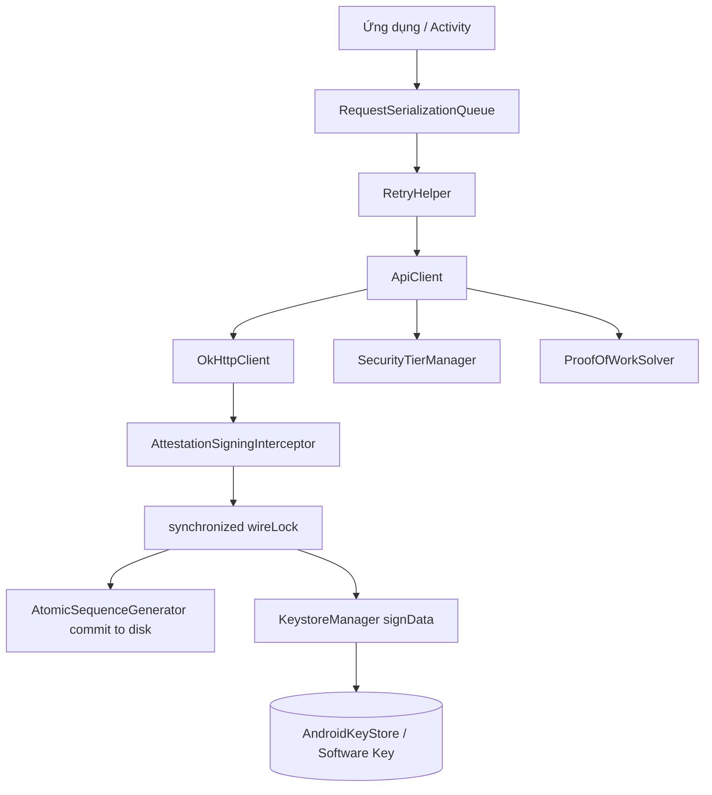
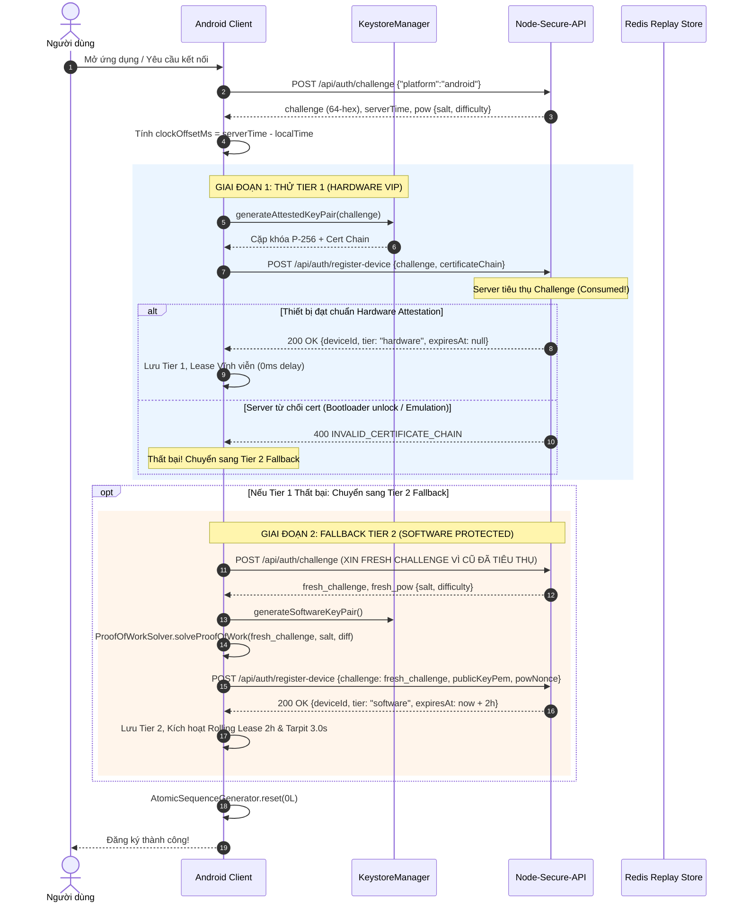
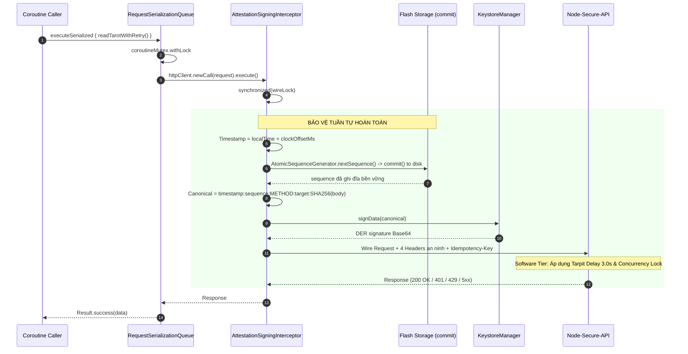
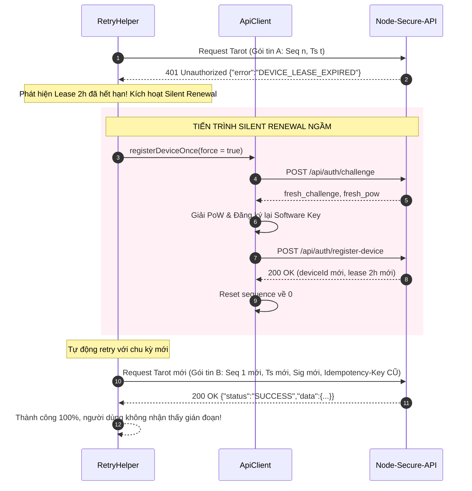

# Hướng dẫn tích hợp Client Android và iOS

Tài liệu này hướng dẫn tích hợp toàn diện giao thức xác thực thiết bị và chữ ký mật mã của hệ thống **Node-Secure-API** từ góc nhìn của ứng dụng di động Android Kotlin và iOS Swift. Nội dung được chuẩn hóa và đối chiếu trực tiếp với codebase backend (`src/core/`, `src/platform/`, `src/http/server.ts`) và bộ mã nguồn hoàn chỉnh của Client Demo (`demo/client/src/main/kotlin/com/astrology/tarot/security/*` cùng bộ simulator `demo/client/simulator/client_simulator.ts`).

> [!IMPORTANT]
> Chỉ gọi API qua HTTPS trong môi trường production. Tuyệt đối không nhúng private key hoặc shared secret vào mã nguồn client (APK/IPA). Server thực thi chính sách an ninh dựa trên hồ sơ thiết bị đã đăng ký tại backend, không dựa vào bất kỳ header tier nào do client tự khai báo.

---

## 1. Bất biến giao thức & Kiến trúc Dual-Tier

### 1.1 Byte, canonical string và chữ ký số

Mọi request nghiệp vụ được bảo vệ đều phải ký một chuỗi canonical định dạng UTF-8 chính xác, không Byte Order Mark (BOM), không chứa ký tự newline ở cuối:

```text
timestamp:sequence:METHOD:request-target:bodySha256Hex
```

Trong đó các trường tuân thủ quy tắc nghiêm ngặt:

| Trường | Định dạng & Quy tắc |
|---|---|
| `timestamp` | Unix epoch **milliseconds**, chuỗi decimal dương chuẩn (`/^[1-9]\d{0,15}$/`). Server cho phép độ lệch đồng hồ tối đa ±15.000 ms (15 giây). Cần áp dụng cơ chế bù lệch đồng hồ động (Dynamic Clock Offset). |
| `sequence` | Chuỗi decimal từ `1` đến `9223372036854775807` (signed int64, `/^[1-9]\d{0,18}$/`). Lưu trữ và xử lý bằng kiểu dữ liệu số nguyên 64-bit (`Long`/`BigInt`), không ép sang kiểu số thực (Double/Number) và không chứa leading zero. |
| `METHOD` | Tên phương thức HTTP viết hoa hoàn toàn (ví dụ: `POST`, `GET`, `PUT`, `DELETE`). |
| `request-target` | Encoded path kèm query string nguyên trạng (ví dụ: `/api/tarot/read?special=%2F&z=2&a=1`). Tuyệt đối không sắp xếp lại tham số (sort), không decode `%2F`, và không re-encode query string. |
| `bodySha256Hex` | Băm SHA-256 trên mảng byte nguyên bản của body thực gửi, hiển thị dưới dạng chuỗi hex chữ thường (lowercase hex 64 ký tự). Nếu request không có body hoặc body rỗng (0 bytes), sử dụng SHA-256 của mảng byte rỗng: `e3b0c44298fc1c149afbf4c8996fb92427ae41e4649b934ca495991b7852b855`. |

#### Headers an ninh bắt buộc

Mọi request gửi tới endpoint nghiệp vụ phải đính kèm tập headers sau:

- `X-Device-Id`: Mã định danh thiết bị duy nhất do server cấp sau khi đăng ký thành công.
- `X-Timestamp`: Giá trị timestamp milliseconds đã dùng trong chuỗi canonical.
- `X-Sequence`: Giá trị sequence decimal đã dùng trong chuỗi canonical.
- `X-Signature` (dành cho Android): Chữ ký số `SHA256withECDSA` dạng DER ASN.1 `(r, s)` được mã hóa Base64 chuẩn (NO_WRAP).
- `X-Assertion` (dành cho iOS): Chuỗi assertion Base64 do `DCAppAttestService.generateAssertion` tạo ra từ `SHA256(canonical UTF-8)`.
- `Idempotency-Key` (dành cho nghiệp vụ có side-effect): Khóa chống trùng lặp nghiệp vụ dạng UUID, giữ bất biến qua các lần retry.

> [!WARNING]
> Mảng byte của body phải được serialize đúng một lần, giữ nguyên vẹn để vừa tính băm SHA-256 vừa gửi ra wire. Không dùng interceptor tự ý re-serialize body hoặc qua các reverse proxy tự ý giải nén/nén lại dữ liệu làm thay đổi byte wire. Server từ chối mọi body nén để bảo vệ tính toàn vẹn của chuỗi canonical.

---

### 1.2 Kiến trúc phân tầng bất đối xứng (Dual-Tier Architecture)

Nhằm vừa đảm bảo an ninh tối đa cho các thiết bị cao cấp, vừa giữ tương thích 100% với các thiết bị Android cũ, chip giá rẻ, máy đã unlock bootloader hoặc máy chạy ROM tùy biến không có Google Play Services, hệ thống áp dụng cơ chế **Dual-Tier bất đối xứng**:

| Thuộc tính | Tier 1: Hardware VIP | Tier 2: Software Protected |
|---|---|---|
| **Cơ chế xác thực khóa** | Android Key Attestation (Hardware TEE / StrongBox) | Proof of Work (PoW) + EC P-256 SPKI PEM |
| **Chuỗi chứng chỉ** | X.509 Certificate Chain tới Google Hardware Root | SPKI PEM Public Key chuẩn |
| **Độ trễ xử lý (Tarpit Delay)** | **0 ms** (VIP Fast-Track) | **3.000 ms** (3.0s Tarpit Delay) |
| **Thời hạn Lease** | **Vĩnh viễn** (Permanent Lease, `expiresAt = 0L`) | **Rolling Lease 2 giờ** (`softwareDeviceTtlSeconds = 7200`) |
| **Giới hạn đồng thời** | Xử lý đa luồng theo queue | **Single In-Flight Lock** (tối đa 1 request/thiết bị tại một thời điểm) |
| **Hạn mức tần suất (Rate Limit)** | Hạn mức tiêu chuẩn VIP | Giới hạn 6 RPM/thiết bị và giới hạn theo IP |
| **Cơ chế phục hồi** | Duy trì khóa trong KeyStore | **Silent Renewal** tự động khi sắp hết hạn hoặc hết hạn |

---

### 1.3 Cơ chế bù lệch đồng hồ động (Dynamic Clock Offset Compensation)

Server từ chối thẳng thừng với mã lỗi `401 EXPIRED_TIMESTAMP` nếu timestamp của request lệch quá ±15 giây so với đồng hồ của server. Để giải quyết triệt để tình trạng thiết bị người dùng bị lệch giờ hệ thống:

1. Trong response của `POST /api/auth/challenge`, server luôn trả về trường `serverTime` (Unix epoch milliseconds) và `expiresAt`.
2. Client tính toán độ lệch:
   $$\text{clockOffsetMs} = \text{serverTime} - \text{System.currentTimeMillis()}$$
3. Lưu `clockOffsetMs` vào vùng nhớ bền vững (`SharedPreferences` / Keychain).
4. Mọi request ký dữ liệu sử dụng timestamp đã được bù lệch:
   $$\text{adjustedTimestamp} = \text{System.currentTimeMillis()} + \text{clockOffsetMs}$$
5. Khi nhận phản hồi `401 EXPIRED_TIMESTAMP`, client tự động kích hoạt tiến trình làm mới challenge ngầm để đồng bộ lại `clockOffsetMs` và retry request.

---

### 1.4 Quy tắc tiêu thụ Challenge và giải thuật PoW

- Endpoint `POST /api/auth/challenge` trả về:
  - `challenge`: Chuỗi 64 ký tự hex ngẫu nhiên (hoặc HMAC stateless).
  - `serverTime`: Mốc thời gian hiện tại của server.
  - `expiresAt`: Mốc hết hạn của challenge (thời hạn 60 giây).
  - `pow`: Bộ tham số giải toán gồm `salt` (chuỗi hex) và `difficulty` (số bit 0 đầu, mặc định 18 bit trong production, 14 bit trong test).
- **Quy tắc tiêu thụ Challenge (Challenge Consumption)**:
  > [!IMPORTANT]
  > Một challenge chỉ được sử dụng đúng một lần. Khi client gửi challenge lên `POST /api/auth/register-device`, server sẽ tiêu thụ challenge đó ngay lập tức (dù đăng ký thành công hay thất bại do chứng chỉ không hợp lệ).
  >
  > Do đó, khi client thử đăng ký **Tier 1 (Hardware)** nhưng bị server từ chối chính sách (ví dụ thiết bị unlock bootloader bị lỗi cert), client **BẮT BUỘC PHẢI XIN MỘT FRESH CHALLENGE MỚI** từ `/api/auth/challenge` trước khi giải PoW để đăng ký **Tier 2 (Software)**.

- **Thuật toán giải PoW (Software Tier)**:
  Thử lần lượt các số nguyên dương $nonce \ge 0$ dạng chuỗi decimal (`"0"`, `"1"`, `"2"`, ...), tìm hash:
  $$\text{SHA256}(\text{UTF8}(challenge + ":" + salt + ":" + nonce))$$
  sao cho hash có ít nhất `difficulty` bit 0 liên tiếp tính từ bit có trọng số lớn nhất (MSB) của byte đầu tiên. Client giải bài toán trên background thread (`Dispatchers.IO`), có giới hạn số vòng lặp an toàn (ví dụ: 50.000.000 iterations).

---

### 1.5 Cơ chế Redis Timestamp Quarantine (Boot-time Safety)

Khi dịch vụ backend hoặc cụm Redis khởi động lại, server áp dụng cơ chế cách ly **Redis Timestamp Quarantine** trong vòng 15 giây.
- Mọi request có timestamp cũ hơn mốc server boot sẽ bị từ chối với mã lỗi `401 RETRY_WITH_FRESH_TIMESTAMP`.
- Điều này ngăn chặn việc replay các gói tin cũ khi trạng thái replay cache bị rớt về quá khứ do sự cố khôi phục Redis.
- **Hành động client**: Khi gặp lỗi này, client **không được gửi lại gói tin cũ**. Client phải lấy timestamp hiện tại mới, rút sequence mới, tính lại canonical, ký chữ ký mới và retry ngay lập tức (giữ nguyên `idempotencyKey`).

---

## 2. Đặc tả Endpoint và Định dạng Payload

### 2.1 Yêu cầu Challenge: `POST /api/auth/challenge`

#### Request Body
```json
{
  "platform": "android"
}
```
*(Với iOS, truyền `"platform": "ios"`)*.

#### Response Body (HTTP 200 OK)
```json
{
  "status": "SUCCESS",
  "challenge": "a1b2c3d4e5f67890123456789abcdef0123456789abcdef0123456789abcdef0",
  "expiresAt": 1730000060000,
  "serverTime": 1730000000000,
  "pow": {
    "salt": "7f8e9d0a1b2c3d4e",
    "difficulty": 18
  }
}
```

---

### 2.2 Đăng ký thiết bị: `POST /api/auth/register-device`

#### Trường hợp 1: Đăng ký Tier 1 (Hardware Attestation)
```json
{
  "challenge": "a1b2c3d4e5f67890123456789abcdef0123456789abcdef0123456789abcdef0",
  "certificateChain": [
    "MIIC...", 
    "MIIC...", 
    "MIIC..."
  ]
}
```
*Ghi chú: `certificateChain` là mảng các chuỗi Base64 của chứng chỉ DER, sắp xếp từ Leaf Certificate đến Root Certificate.*

#### Trường hợp 2: Đăng ký Tier 2 (Software Protected với PoW)
```json
{
  "challenge": "fresh_challenge_64_hex_value_here...",
  "publicKeyPem": "-----BEGIN PUBLIC KEY-----\nMFkwEwYHKoZIzj0CAQYIKoZIzj0DAQcDQgAE...\n-----END PUBLIC KEY-----",
  "powNonce": "48291"
}
```

#### Trường hợp 3: Đăng ký iOS (Apple App Attest)
```json
{
  "challenge": "a1b2c3d4e5f67890123456789abcdef0123456789abcdef0123456789abcdef0",
  "keyId": "Base64(utf8(keyId))",
  "attestationObject": "Base64(attestationObject)"
}
```

#### Response Thành công (HTTP 200 OK)
```json
{
  "status": "SUCCESS",
  "deviceId": "dev_a1b2c3d4e5f67890",
  "tier": "hardware",
  "expiresAt": null,
  "message": "Device registered successfully"
}
```
*(Nếu là Software Tier, `tier` sẽ là `"software"` và `expiresAt` là timestamp hết hạn của lease 2 giờ, ví dụ: `1730007200000`)*.

---

### 2.3 Gọi API nghiệp vụ được bảo vệ (Ví dụ: `POST /api/tarot/read`)

#### Headers
```http
POST /api/tarot/read HTTP/1.1
Host: api.example.com
Content-Type: application/json; charset=utf-8
X-Device-Id: dev_a1b2c3d4e5f67890
X-Timestamp: 1730000005120
X-Sequence: 1
X-Signature: MEQCID9x1... (Android) hoặc X-Assertion: MIIC... (iOS)
Idempotency-Key: c9a3b8d4-5e6f-4a1b-8c2d-9e0f1a2b3c4d
```

#### Body
```json
{
  "question": "Vận mệnh sự nghiệp và lộ trình an ninh số",
  "idempotencyKey": "c9a3b8d4-5e6f-4a1b-8c2d-9e0f1a2b3c4d"
}
```

---

## 3. Kiến trúc Client Android Kotlin (Đối chiếu `demo/client`)

Client Android được thiết kế theo cấu trúc mô-đun hóa, bảo vệ đa tầng và chống chịu lỗi cao:



---

### 3.1 Quản lý Khóa Dual-Tier: `KeystoreManager.kt`

`KeystoreManager` quản lý vòng đời của 2 cặp khóa độc lập:
1. `HARDWARE_KEY_ALIAS = "NodeSecureHardwareKey"`: Cặp khóa phần cứng EC P-256 gắn attestation challenge, ưu tiên StrongBox, fallback TEE.
2. `SOFTWARE_KEY_ALIAS = "NodeSecureSoftwareKey"`: Cặp khóa phần mềm EC P-256 tạo trong AndroidKeyStore (không challenge) hoặc fallback Java EC in-memory.

> [!TIP]
> **Xóa alias mồ côi (Orphan Key Cleanup)**: Khi tạo khóa Hardware, xóa sạch cả hardware alias và software alias cũ. Tương tự khi tạo khóa Software, xóa sạch cả 2 alias cũ. Điều này đảm bảo trạng thái khóa cục bộ luôn nhất quán và triệt tiêu xung đột dữ liệu.

```kotlin
package com.astrology.tarot.security

import android.content.Context
import android.content.pm.PackageManager
import android.os.Build
import android.security.keystore.KeyGenParameterSpec
import android.security.keystore.KeyInfo
import android.security.keystore.KeyProperties
import android.util.Base64
import java.security.*
import java.security.spec.ECGenParameterSpec

object KeystoreManager {
    const val HARDWARE_KEY_ALIAS = "NodeSecureHardwareKey"
    const val SOFTWARE_KEY_ALIAS = "NodeSecureSoftwareKey"
    private const val PREFS_NAME = "app_secure_prefs"
    private const val KEY_ACTIVE_TIER = "ACTIVE_KEY_TIER"

    private val keyStore: KeyStore
        get() = KeyStore.getInstance("AndroidKeyStore").apply { load(null) }

    private var softwareFallbackKeyPair: KeyPair? = null

    var activeTier: String = "hardware"
        get() {
            // Auto-heal nếu trạng thái là hardware nhưng chỉ có khóa software
            if (field == "hardware" && !keyStore.containsAlias(HARDWARE_KEY_ALIAS) &&
                (keyStore.containsAlias(SOFTWARE_KEY_ALIAS) || softwareFallbackKeyPair != null)) {
                return "software"
            }
            return field
        }
        internal set

    @Synchronized
    fun generateAttestedKeyPair(challengeHex: String, context: Context? = null): KeyPair {
        require(challengeHex.length == 64) { "Challenge must be a 64-character hex string" }

        // Dọn dẹp alias cũ
        if (keyStore.containsAlias(HARDWARE_KEY_ALIAS)) keyStore.deleteEntry(HARDWARE_KEY_ALIAS)
        if (keyStore.containsAlias(SOFTWARE_KEY_ALIAS)) keyStore.deleteEntry(SOFTWARE_KEY_ALIAS)
        softwareFallbackKeyPair = null

        val hasStrongBox = if (Build.VERSION.SDK_INT >= Build.VERSION_CODES.P && context != null) {
            context.packageManager.hasSystemFeature(PackageManager.FEATURE_STRONGBOX_KEYSTORE)
        } else false

        val challengeBytes = challengeHex.toByteArray(Charsets.UTF_8)

        fun createSpec(useStrongBox: Boolean): KeyGenParameterSpec {
            val builder = KeyGenParameterSpec.Builder(HARDWARE_KEY_ALIAS, KeyProperties.PURPOSE_SIGN)
                .setAlgorithmParameterSpec(ECGenParameterSpec("secp256r1"))
                .setDigests(KeyProperties.DIGEST_SHA256)
                .setAttestationChallenge(challengeBytes)
                .setUserAuthenticationRequired(false)
            if (Build.VERSION.SDK_INT >= Build.VERSION_CODES.P) {
                builder.setIsStrongBoxBacked(useStrongBox)
            }
            return builder.build()
        }

        fun generate(useStrongBox: Boolean): KeyPair {
            val kpg = KeyPairGenerator.getInstance(KeyProperties.KEY_ALGORITHM_EC, "AndroidKeyStore")
            kpg.initialize(createSpec(useStrongBox))
            return kpg.generateKeyPair()
        }

        // Ưu tiên StrongBox, tự động fallback TEE nếu StrongBox ném lỗi
        val keyPair = if (hasStrongBox) {
            try { generate(useStrongBox = true) } catch (_: Throwable) { generate(useStrongBox = false) }
        } else {
            generate(useStrongBox = false)
        }

        activeTier = "hardware"
        context?.applicationContext?.getSharedPreferences(PREFS_NAME, Context.MODE_PRIVATE)
            ?.edit()?.putString(KEY_ACTIVE_TIER, "hardware")?.apply()
        return keyPair
    }

    @Synchronized
    fun generateSoftwareKeyPair(context: Context? = null): KeyPair {
        if (keyStore.containsAlias(HARDWARE_KEY_ALIAS)) keyStore.deleteEntry(HARDWARE_KEY_ALIAS)
        if (keyStore.containsAlias(SOFTWARE_KEY_ALIAS)) keyStore.deleteEntry(SOFTWARE_KEY_ALIAS)

        val keyPair = try {
            val spec = KeyGenParameterSpec.Builder(SOFTWARE_KEY_ALIAS, KeyProperties.PURPOSE_SIGN)
                .setAlgorithmParameterSpec(ECGenParameterSpec("secp256r1"))
                .setDigests(KeyProperties.DIGEST_SHA256)
                .setUserAuthenticationRequired(false)
                .build()
            val kpg = KeyPairGenerator.getInstance(KeyProperties.KEY_ALGORITHM_EC, "AndroidKeyStore")
            kpg.initialize(spec)
            kpg.generateKeyPair()
        } catch (_: Throwable) {
            // Fallback sang Java in-memory EC key nếu AndroidKeyStore hoàn toàn lỗi
            val standardKpg = KeyPairGenerator.getInstance("EC")
            standardKpg.initialize(ECGenParameterSpec("secp256r1"))
            val pair = standardKpg.generateKeyPair()
            softwareFallbackKeyPair = pair
            pair
        }

        activeTier = "software"
        context?.applicationContext?.getSharedPreferences(PREFS_NAME, Context.MODE_PRIVATE)
            ?.edit()?.putString(KEY_ACTIVE_TIER, "software")?.apply()
        return keyPair
    }

    @Synchronized
    fun getCertificateChainBase64(): List<String> {
        val chain = keyStore.getCertificateChain(HARDWARE_KEY_ALIAS)
            ?: throw IllegalStateException("Missing certificate chain for $HARDWARE_KEY_ALIAS")
        return chain.map { Base64.encodeToString(it.encoded, Base64.NO_WRAP) }
    }

    fun exportSpkiPem(publicKey: PublicKey): String {
        val derBytes = publicKey.encoded
        val b64 = Base64.encodeToString(derBytes, Base64.NO_WRAP)
        val wrapped = b64.chunked(64).joinToString("\n")
        return "-----BEGIN PUBLIC KEY-----\n$wrapped\n-----END PUBLIC KEY-----"
    }

    @Synchronized
    fun getSoftwarePublicKeyPem(): String {
        val pubKey: PublicKey = if (keyStore.containsAlias(SOFTWARE_KEY_ALIAS)) {
            keyStore.getCertificate(SOFTWARE_KEY_ALIAS)?.publicKey
                ?: error("Cannot retrieve public key for $SOFTWARE_KEY_ALIAS")
        } else {
            softwareFallbackKeyPair?.public ?: error("No software key available")
        }
        return exportSpkiPem(pubKey)
    }

    @Synchronized
    fun signData(canonicalString: String): String {
        val privateKey: PrivateKey = if (activeTier == "hardware") {
            keyStore.getKey(HARDWARE_KEY_ALIAS, null) as? PrivateKey
                ?: throw IllegalStateException("Hardware private key not found")
        } else {
            if (keyStore.containsAlias(SOFTWARE_KEY_ALIAS)) {
                keyStore.getKey(SOFTWARE_KEY_ALIAS, null) as? PrivateKey
                    ?: softwareFallbackKeyPair?.private
                    ?: throw IllegalStateException("Software private key not found")
            } else {
                softwareFallbackKeyPair?.private ?: throw IllegalStateException("Software private key not found")
            }
        }

        val signer = Signature.getInstance("SHA256withECDSA")
        signer.initSign(privateKey)
        signer.update(canonicalString.toByteArray(Charsets.UTF_8))
        val derBytes = signer.sign()
        return Base64.encodeToString(derBytes, Base64.NO_WRAP)
    }

    @Synchronized
    fun isDeviceKeyReady(): Boolean = if (activeTier == "hardware") {
        keyStore.containsAlias(HARDWARE_KEY_ALIAS)
    } else {
        keyStore.containsAlias(SOFTWARE_KEY_ALIAS) || softwareFallbackKeyPair != null
    }
}
```

---

### 3.2 Bộ đếm Sequence bền vững: `AtomicSequenceGenerator.kt`

Để triệt tiêu lỗi Replay khi ứng dụng bị force-kill hoặc crash đột ngột, giá trị sequence mới **phải được ghi đồng bộ xuống đĩa trước khi gửi request ra wire**.

> [!CAUTION]
> Luôn dùng `commit()` (đồng bộ ghi đĩa ngay lập tức), **không bao giờ dùng `apply()`** (ghi bất đồng bộ trên RAM) khi lưu sequence. Nếu dùng `apply()`, trường hợp crash ngay sau khi gửi gói tin sẽ khiến sequence bị rollback trên đĩa, dẫn đến tái sử dụng sequence cũ và bị server chặn vĩnh viễn với lỗi `401 REPLAY_DETECTED`.

```kotlin
package com.astrology.tarot.security

import android.content.Context
import android.content.SharedPreferences
import java.util.concurrent.atomic.AtomicLong

object AtomicSequenceGenerator {
    private const val PREFS_NAME = "security_demo_prefs"
    private const val KEY_SEQUENCE = "sequence"

    private val counter = AtomicLong(0)
    private var preferences: SharedPreferences? = null

    @Synchronized
    fun configure(context: Context) {
        if (preferences == null) {
            preferences = context.applicationContext.getSharedPreferences(PREFS_NAME, Context.MODE_PRIVATE)
            val savedSeq = preferences!!.getLong(KEY_SEQUENCE, 0L)
            initialize(savedSeq)
        }
    }

    @Synchronized
    fun initialize(lastSavedSeq: Long) {
        require(lastSavedSeq >= 0L) { "Initial sequence must be non-negative" }
        counter.set(maxOf(counter.get(), lastSavedSeq))
    }

    @Synchronized
    fun reset(newSeq: Long = 0L) {
        require(newSeq >= 0L) { "Reset sequence must be non-negative" }
        preferences?.let { prefs ->
            check(prefs.edit().putLong(KEY_SEQUENCE, newSeq).commit()) { "Failed to commit sequence reset" }
        }
        counter.set(newSeq)
    }

    @Synchronized
    fun nextSequence(): Long {
        check(counter.get() < Long.MAX_VALUE) { "Sequence number exhausted" }
        val next = counter.incrementAndGet()
        preferences?.let { prefs ->
            // BẮT BUỘC dùng .commit() đồng bộ
            check(prefs.edit().putLong(KEY_SEQUENCE, next).commit()) { "Failed to commit sequence counter" }
        }
        return next
    }

    @Synchronized
    fun nextSequenceString(): String = nextSequence().toString()
}
```

---

### 3.3 Bộ giải Proof of Work: `ProofOfWorkSolver.kt`

```kotlin
package com.astrology.tarot.security

import java.security.MessageDigest

object ProofOfWorkSolver {
    fun countLeadingZeroBits(bytes: ByteArray): Int {
        var zeros = 0
        for (b in bytes) {
            val unsignedByte = b.toInt() and 0xFF
            if (unsignedByte == 0) {
                zeros += 8
            } else {
                zeros += Integer.numberOfLeadingZeros(unsignedByte) - 24
                break
            }
        }
        return zeros
    }

    fun solveProofOfWork(
        challenge: String,
        salt: String,
        difficulty: Int,
        maxIterations: Long = 50_000_000L
    ): String {
        require(challenge.isNotEmpty() && salt.isNotEmpty())
        require(difficulty in 1..256)

        val prefixBytes = "$challenge:$salt:".toByteArray(Charsets.UTF_8)
        val md = MessageDigest.getInstance("SHA-256")
        var nonce = 0L

        while (nonce < maxIterations) {
            val nonceBytes = nonce.toString().toByteArray(Charsets.UTF_8)
            md.reset()
            md.update(prefixBytes)
            md.update(nonceBytes)
            val hash = md.digest()

            if (countLeadingZeroBits(hash) >= difficulty) {
                return nonce.toString()
            }
            nonce++
        }
        throw IllegalStateException("PoW solver exceeded max iterations ($maxIterations)")
    }
}
```

---

### 3.4 OkHttp Interceptor & Wire Serialization: `AttestationSigningInterceptor.kt`

Interceptor phụ trách trích xuất canonical, băm body byte, ký số và gắn 4 headers. Toàn bộ chu kỳ từ lấy sequence đến khi nhận response được bảo vệ bởi khóa đồng bộ `wireLock` để đảm bảo thứ tự tuyệt đối trên đường truyền:

```kotlin
package com.astrology.tarot.security

import okhttp3.Interceptor
import okhttp3.Response
import okio.Buffer
import java.security.MessageDigest

class AttestationSigningInterceptor(
    private val deviceIdProvider: () -> String?
) : Interceptor {

    companion object {
        const val HEADER_DEVICE_ID = "X-Device-Id"
        const val HEADER_TIMESTAMP = "X-Timestamp"
        const val HEADER_SEQUENCE = "X-Sequence"
        const val HEADER_SIGNATURE = "X-Signature"

        // Wire Lock đảm bảo thứ tự tuyệt đối trên đường truyền
        val wireLock = Any()

        fun computeSha256Hex(bytes: ByteArray): String {
            val digest = MessageDigest.getInstance("SHA-256").digest(bytes)
            val sb = StringBuilder(digest.size * 2)
            for (b in digest) {
                sb.append(String.format("%02x", b.toInt() and 0xff))
            }
            return sb.toString()
        }

        fun buildCanonicalString(
            timestamp: String, sequence: String, method: String,
            requestTarget: String, bodySha256Hex: String
        ): String = "$timestamp:$sequence:${method.uppercase()}:$requestTarget:$bodySha256Hex"
    }

    override fun intercept(chain: Interceptor.Chain): Response {
        val request = chain.request()
        val path = request.url.encodedPath

        // Chỉ ký các protected endpoint (bỏ qua /api/auth/*, /health, /ready)
        if (!path.startsWith("/api/tarot")) {
            return chain.proceed(request)
        }

        synchronized(wireLock) {
            val deviceId = deviceIdProvider()
                ?: throw IllegalStateException("Device ID not registered yet")

            // 1. Trích xuất Request Target: encodedPath + query nguyên trạng
            val target = request.url.encodedPath + (request.url.encodedQuery?.let { "?$it" } ?: "")

            // 2. Trích xuất body byte an toàn
            val body = request.body
            val rawBodyBytes = if (body != null) {
                require(!body.isOneShot() && !body.isDuplex()) {
                    "Cannot sign streaming or one-shot request body"
                }
                val buffer = Buffer()
                body.writeTo(buffer)
                buffer.readByteArray()
            } else {
                ByteArray(0)
            }
            val bodyHash = computeSha256Hex(rawBodyBytes)

            // 3. Rút sequence và timestamp bù lệch đồng hồ bên trong wireLock
            val timestamp = (ApiClient.currentAdjustedTime?.invoke() ?: System.currentTimeMillis()).toString()
            val sequence = AtomicSequenceGenerator.nextSequenceString()

            // 4. Dựng canonical string và ký số
            val canonical = buildCanonicalString(timestamp, sequence, request.method, target, bodyHash)
            val signature = KeystoreManager.signData(canonical)

            // 5. Gắn 4 headers an ninh và truyền gói tin
            val signedRequest = request.newBuilder()
                .header(HEADER_DEVICE_ID, deviceId)
                .header(HEADER_TIMESTAMP, timestamp)
                .header(HEADER_SEQUENCE, sequence)
                .header(HEADER_SIGNATURE, signature)
                .build()

            return chain.proceed(signedRequest)
        }
    }
}
```

---

### 3.5 Tuần tự hóa tác vụ: `RequestSerializationQueue.kt`

Cung cấp Mutex ở tầng coroutine kết hợp với `wireLock` ở tầng OkHttp interceptor:

```kotlin
package com.astrology.tarot.security

import kotlinx.coroutines.sync.Mutex
import kotlinx.coroutines.sync.withLock

object RequestSerializationQueue {
    private val coroutineMutex = Mutex()

    suspend fun <T> executeSerialized(action: suspend () -> T): T {
        return coroutineMutex.withLock {
            action()
        }
    }

    fun <T> executeBlockingSerialized(action: () -> T): T {
        return synchronized(AttestationSigningInterceptor.wireLock) {
            action()
        }
    }
}
```

---

### 3.6 Máy trạng thái đăng ký và Quản lý Lease: `ApiClient.kt` & `SecurityTierManager.kt`

Quy trình đăng ký Dual-Tier của `ApiClient` giải quyết bài toán tiêu thụ challenge (Challenge Consumption) và chuyển tầng mượt mà:

```kotlin
package com.astrology.tarot.security

import android.content.Context
import com.google.gson.Gson
import com.google.gson.JsonParser
import kotlinx.coroutines.Dispatchers
import kotlinx.coroutines.sync.Mutex
import kotlinx.coroutines.sync.withLock
import kotlinx.coroutines.withContext
import okhttp3.*
import okhttp3.MediaType.Companion.toMediaType
import okhttp3.RequestBody.Companion.toRequestBody
import java.io.IOException
import java.util.concurrent.TimeUnit

class HardwareAttestationRejectedException(message: String) : Exception(message)

class ApiClient(private val context: Context, customBaseUrl: String? = null) {
    private val prefs = context.applicationContext.getSharedPreferences("app_secure_prefs", Context.MODE_PRIVATE)
    private val gson = Gson()
    private val jsonMediaType = "application/json; charset=utf-8".toMediaType()

    val baseUrl: String = customBaseUrl ?: prefs.getString("SERVER_BASE_URL", "http://10.40.40.2:3000")!!
    var deviceId: String? = prefs.getString("DEVICE_ID", null)
        private set
    var tier: String = prefs.getString("device_tier", "hardware") ?: "hardware"
        private set
    var leaseExpiresAt: Long = prefs.getLong("lease_expires_at", 0L)
        private set
    var clockOffsetMs: Long = prefs.getLong("clock_offset_ms", 0L)
        internal set

    // Control client cho challenge/register (không interceptor)
    private val controlClient = OkHttpClient.Builder()
        .connectTimeout(15, TimeUnit.SECONDS)
        .readTimeout(30, TimeUnit.SECONDS)
        .writeTimeout(30, TimeUnit.SECONDS)
        .retryOnConnectionFailure(false)
        .build()

    // Protected client cho API nghiệp vụ (chứa interceptor, readTimeout 30s chịu được Tarpit 3.0s)
    val httpClient = OkHttpClient.Builder()
        .connectTimeout(15, TimeUnit.SECONDS)
        .readTimeout(30, TimeUnit.SECONDS)
        .writeTimeout(30, TimeUnit.SECONDS)
        .retryOnConnectionFailure(false) // BẮT BUỘC: Không để OkHttp tự retry gói tin cũ
        .addInterceptor(AttestationSigningInterceptor { this.deviceId })
        .build()

    init {
        currentAdjustedTime = { this.getAdjustedTimestamp() }
        KeystoreManager.activeTier = this.tier
        AtomicSequenceGenerator.configure(context)
    }

    fun getAdjustedTimestamp(): Long = System.currentTimeMillis() + clockOffsetMs

    fun isDeviceRegistered(): Boolean {
        val registered = prefs.getBoolean("registered", false)
        if (!registered || deviceId.isNullOrEmpty() || !KeystoreManager.isDeviceKeyReady()) return false
        if (tier == "software" && leaseExpiresAt > 0 && System.currentTimeMillis() >= leaseExpiresAt) return false
        return true
    }

    suspend fun registerDeviceOnce(force: Boolean = false): Result<String> = registrationMutex.withLock {
        withContext(Dispatchers.IO) {
            try {
                if (!force && isDeviceRegistered()) return@withContext Result.success(deviceId!!)

                // Bước 1: Xin challenge và đồng bộ độ lệch thời gian
                fun fetchChallenge(): Triple<String, String, Int> {
                    val req = Request.Builder().url("$baseUrl/api/auth/challenge")
                        .post(gson.toJson(mapOf("platform" to "android")).toRequestBody(jsonMediaType)).build()
                    return controlClient.newCall(req).execute().use { res ->
                        val body = res.body?.string().orEmpty()
                        val json = JsonParser.parseString(body).asJsonObject
                        val ch = json.get("challenge").asString
                        val serverTime = if (json.has("serverTime")) json.get("serverTime").asLong else System.currentTimeMillis()
                        clockOffsetMs = serverTime - System.currentTimeMillis()
                        prefs.edit().putLong("clock_offset_ms", clockOffsetMs).apply()

                        val powObj = json.getAsJsonObject("pow") ?: json.getAsJsonObject("powInfo")
                        val salt = powObj?.get("salt")?.asString ?: ""
                        val diff = powObj?.get("difficulty")?.asInt ?: 18
                        Triple(ch, salt, diff)
                    }
                }

                var (challenge, powSalt, powDifficulty) = fetchChallenge()
                var assignedDeviceId: String? = null
                var assignedTier = "hardware"
                var assignedExpiresAt = 0L

                // Bước 2: Thử Tier 1 (Hardware Attestation)
                var hardwareSuccess = false
                var challengeConsumed = false
                try {
                    KeystoreManager.generateAttestedKeyPair(challenge, context)
                    val chain = KeystoreManager.getCertificateChainBase64()
                    val payload = gson.toJson(mapOf("challenge" to challenge, "certificateChain" to chain))
                    val regReq = Request.Builder().url("$baseUrl/api/auth/register-device")
                        .post(payload.toRequestBody(jsonMediaType)).build()

                    challengeConsumed = true // Challenge đã gửi lên server -> đã bị tiêu thụ
                    controlClient.newCall(regReq).execute().use { res ->
                        val body = res.body?.string().orEmpty()
                        if (res.isSuccessful) {
                            val json = JsonParser.parseString(body).asJsonObject
                            assignedDeviceId = json.get("deviceId").asString
                            assignedTier = json.get("tier")?.asString ?: "hardware"
                            assignedExpiresAt = 0L
                            hardwareSuccess = true
                        } else {
                            throw HardwareAttestationRejectedException("Server rejected hardware: $body")
                        }
                    }
                } catch (_: Exception) {
                    hardwareSuccess = false
                }

                // Bước 3: Fallback Tier 2 (Software + PoW)
                if (!hardwareSuccess) {
                    // Nếu challenge đã bị server tiêu thụ ở Bước 2, BẮT BUỘC xin challenge mới
                    if (challengeConsumed) {
                        val fresh = fetchChallenge()
                        challenge = fresh.first
                        powSalt = fresh.second
                        powDifficulty = fresh.third
                    }

                    KeystoreManager.generateSoftwareKeyPair(context)
                    val publicKeyPem = KeystoreManager.getSoftwarePublicKeyPem()
                    val nonce = ProofOfWorkSolver.solveProofOfWork(challenge, powSalt, powDifficulty)

                    val payload = gson.toJson(mapOf(
                        "challenge" to challenge,
                        "publicKeyPem" to publicKeyPem,
                        "powNonce" to nonce
                    ))
                    val regReq = Request.Builder().url("$baseUrl/api/auth/register-device")
                        .post(payload.toRequestBody(jsonMediaType)).build()

                    controlClient.newCall(regReq).execute().use { res ->
                        val body = res.body?.string().orEmpty()
                        if (!res.isSuccessful) throw IOException("Software registration failed: $body")
                        val json = JsonParser.parseString(body).asJsonObject
                        assignedDeviceId = json.get("deviceId").asString
                        assignedTier = json.get("tier")?.asString ?: "software"
                        assignedExpiresAt = json.get("expiresAt")?.asLong ?: (System.currentTimeMillis() + 7200_000L)
                    }
                }

                val finalId = assignedDeviceId ?: error("Registration failed to return deviceId")
                AtomicSequenceGenerator.reset(0L) // Reset sequence về 0 cho vòng đời mới

                deviceId = finalId
                tier = assignedTier
                leaseExpiresAt = assignedExpiresAt
                KeystoreManager.activeTier = assignedTier

                prefs.edit()
                    .putString("DEVICE_ID", finalId)
                    .putString("device_tier", assignedTier)
                    .putLong("lease_expires_at", assignedExpiresAt)
                    .putBoolean("registered", true)
                    .commit()

                Result.success(finalId)
            } catch (e: Exception) {
                Result.failure(e)
            }
        }
    }

    companion object {
        var currentAdjustedTime: (() -> Long)? = null
        private val registrationMutex = Mutex()
    }
}
```

#### Quản lý trạng thái Tier: `SecurityTierManager.kt`
```kotlin
package com.astrology.tarot.security

import android.content.Context

enum class DeviceSecurityTier(val displayName: String) {
    TIER_1_HARDWARE("Tier 1: Hardware VIP (0ms Delay, Permanent)"),
    TIER_2_SOFTWARE("Tier 2: Software Protected (3.0s Tarpit, 2h Lease)"),
    UNREGISTERED("Chưa đăng ký (Unregistered)")
}

object SecurityTierManager {
    fun determineSecurityTier(context: Context): DeviceSecurityTier {
        val prefs = context.applicationContext.getSharedPreferences("app_secure_prefs", Context.MODE_PRIVATE)
        if (!prefs.getBoolean("registered", false) || !KeystoreManager.isDeviceKeyReady()) {
            return DeviceSecurityTier.UNREGISTERED
        }
        val tier = prefs.getString("device_tier", "hardware")
        if (tier == "software") {
            val expiresAt = prefs.getLong("lease_expires_at", 0L)
            if (expiresAt > 0 && System.currentTimeMillis() >= expiresAt) {
                return DeviceSecurityTier.UNREGISTERED
            }
            return DeviceSecurityTier.TIER_2_SOFTWARE
        }
        return DeviceSecurityTier.TIER_1_HARDWARE
    }

    fun isLeaseExpiringSoon(context: Context, bufferMinutes: Long = 5): Boolean {
        val prefs = context.applicationContext.getSharedPreferences("app_secure_prefs", Context.MODE_PRIVATE)
        if (prefs.getString("device_tier", null) != "software") return false
        val expiresAt = prefs.getLong("lease_expires_at", 0L)
        if (expiresAt <= 0L) return true
        return System.currentTimeMillis() >= (expiresAt - bufferMinutes * 60 * 1000L)
    }

    fun getLeaseRemainingMinutes(context: Context): Long {
        val prefs = context.applicationContext.getSharedPreferences("app_secure_prefs", Context.MODE_PRIVATE)
        if (prefs.getString("device_tier", null) == "hardware") return -1L
        val diff = prefs.getLong("lease_expires_at", 0L) - System.currentTimeMillis()
        return if (diff > 0) diff / 60000L else 0L
    }
}
```

---

### 3.7 Chiến lược Retry an toàn & Tự động phục hồi (Silent Renewal): `RetryHelper.kt`

Khi gặp lỗi, client không bao giờ phát lại gói tin cũ. Mọi retry qua OkHttpClient đều tự động được Interceptor cấp sequence mới, timestamp bù lệch mới và signature mới.

```kotlin
package com.astrology.tarot.security

import com.google.gson.Gson
import com.google.gson.JsonParser
import kotlinx.coroutines.*
import okhttp3.MediaType.Companion.toMediaType
import okhttp3.Request
import okhttp3.RequestBody.Companion.toRequestBody
import java.io.IOException
import java.util.UUID

class ApiResponseException(val statusCode: Int, val errorCode: String?, val responseBody: String) :
    Exception("HTTP $statusCode: $responseBody")

class RetryHelper(private val api: ApiClient) {
    private val gson = Gson()
    private val jsonMediaType = "application/json; charset=utf-8".toMediaType()

    suspend fun readTarotWithRetry(
        question: String,
        maxRetries: Int = 3,
        idempotencyKey: String = UUID.randomUUID().toString(),
        onSuccess: (Request, String) -> Unit = { _, _ -> }
    ): Result<String> {
        require(maxRetries > 0)

        // Idempotency key bất biến xuyên suốt các lần retry
        val payload = gson.toJson(mapOf("question" to question, "idempotencyKey" to idempotencyKey))

        repeat(maxRetries) { attempt ->
            try {
                val result = RequestSerializationQueue.executeSerialized {
                    withContext(Dispatchers.IO) {
                        // Tạo Request mới -> Interceptor sẽ tự cấp sequence, timestamp, signature mới
                        val request = Request.Builder()
                            .url("${api.baseUrl}/api/tarot/read")
                            .header("Idempotency-Key", idempotencyKey)
                            .post(payload.toRequestBody(jsonMediaType))
                            .build()

                        api.httpClient.newCall(request).execute().use { response ->
                            val bodyStr = response.body?.string().orEmpty()

                            // Lỗi server tạm thời (5xx, 429) -> kích hoạt retry có backoff
                            if (response.code >= 500 || response.code == 429) {
                                throw IOException("Transient error ${response.code}: $bodyStr")
                            }

                            if (!response.isSuccessful) {
                                val errorCode = runCatching {
                                    JsonParser.parseString(bodyStr).asJsonObject.get("error")?.asString
                                }.getOrNull()

                                // Tự động phục hồi ngầm (Silent Renewal) khi lease hết hạn, mất đăng ký, hoặc lệch giờ
                                if (response.code == 401 &&
                                    errorCode in setOf("DEVICE_LEASE_EXPIRED", "DEVICE_NOT_REGISTERED", "LEASE_EXPIRED", "EXPIRED_TIMESTAMP") &&
                                    attempt < maxRetries - 1
                                ) {
                                    val renewResult = api.registerDeviceOnce(force = true)
                                    if (renewResult.isSuccess) {
                                        throw IOException("Silent renewal succeeded after $errorCode, retrying...")
                                    }
                                }

                                throw ApiResponseException(response.code, errorCode, bodyStr)
                            }

                            onSuccess(response.request, bodyStr)
                            bodyStr
                        }
                    }
                }
                return Result.success(result)
            } catch (e: IOException) {
                if (attempt == maxRetries - 1) return Result.failure(e)
                delay(1000L * (attempt + 1)) // Linear backoff
            } catch (e: CancellationException) {
                throw e
            } catch (e: Exception) {
                return Result.failure(e)
            }
        }
        return Result.failure(IllegalStateException("Exhausted all $maxRetries retry attempts"))
    }
}
```

---

## 4. Kiến trúc Client iOS Swift (Apple App Attest)

Trên iOS, Apple App Attest sử dụng Secure Enclave để chứng thực tính toàn vẹn của ứng dụng.

```swift
import DeviceCheck
import Foundation
import CryptoKit

struct ChallengeDTO: Decodable {
    let challenge: String
    let expiresAt: Int64
    let serverTime: Int64?
}

struct RegistrationDTO: Decodable {
    let deviceId: String
    let tier: String?
}

actor AppAttestClient {
    private let service = DCAppAttestService.shared
    private let baseURL: URL
    private var deviceId: String?
    private var keyId: String?
    private var sequence: Int64 = 0
    private var clockOffsetMs: Int64 = 0

    init(baseURL: URL) {
        self.baseURL = baseURL
    }

    private func sha256Hex(_ data: Data) -> String {
        SHA256.hash(data: data).map { String(format: "%02x", $0) }.joined()
    }

    private func makeCanonical(timestamp: String, sequence: String, method: String, target: String, rawBody: Data) -> Data {
        Data("\(timestamp):\(sequence):\(method.uppercased()):\(target):\(sha256Hex(rawBody))".utf8)
    }

    func register() async throws -> String {
        guard service.isSupported else { throw NSError(domain: "AppAttest", code: 1, userInfo: [NSLocalizedDescriptionKey: "App Attest not supported"]) }

        // 1. Request challenge
        var chalReq = URLRequest(url: baseURL.appendingPathComponent("api/auth/challenge"))
        chalReq.httpMethod = "POST"
        chalReq.setValue("application/json", forHTTPHeaderField: "Content-Type")
        chalReq.httpBody = try JSONSerialization.data(withJSONObject: ["platform": "ios"])
        let (chalData, _) = try await URLSession.shared.data(for: chalReq)
        let chalDto = try JSONDecoder().decode(ChallengeDTO.self, from: chalData)

        if let sTime = chalDto.serverTime {
            clockOffsetMs = sTime - Int64(Date().timeIntervalSince1970 * 1000)
        }

        // 2. Generate Key & Attest
        let kId = try await service.generateKey()
        let challengeHash = Data(SHA256.hash(data: Data(chalDto.challenge.utf8)))
        let attestation = try await service.attestKey(kId, clientDataHash: challengeHash)

        // 3. Register with backend
        let payload: [String: Any] = [
            "challenge": chalDto.challenge,
            "keyId": Data(kId.utf8).base64EncodedString(),
            "attestationObject": attestation.base64EncodedString()
        ]
        var regReq = URLRequest(url: baseURL.appendingPathComponent("api/auth/register-device"))
        regReq.httpMethod = "POST"
        regReq.setValue("application/json", forHTTPHeaderField: "Content-Type")
        regReq.httpBody = try JSONSerialization.data(withJSONObject: payload)
        let (regData, _) = try await URLSession.shared.data(for: regReq)
        let regDto = try JSONDecoder().decode(RegistrationDTO.self, from: regData)

        self.deviceId = regDto.deviceId
        self.keyId = kId
        self.sequence = 0
        return regDto.deviceId
    }

    func executeRequest(path: String, body: Data, idempotencyKey: String = UUID().uuidString) async throws -> (Data, HTTPURLResponse) {
        guard let dId = deviceId, let kId = keyId else {
            throw NSError(domain: "Auth", code: 401, userInfo: [NSLocalizedDescriptionKey: "Unregistered"])
        }
        guard sequence < Int64.max else { throw NSError(domain: "Sequence", code: 400) }

        sequence += 1
        // Ghi bền vững sequence xuống Keychain trước khi gửi ra wire

        let timestamp = String(Int64(Date().timeIntervalSince1970 * 1000) + clockOffsetMs)
        let canonical = makeCanonical(timestamp: timestamp, sequence: String(sequence), method: "POST", target: path, rawBody: body)
        let clientDataHash = Data(SHA256.hash(data: canonical))
        let assertion = try await service.generateAssertion(kId, clientDataHash: clientDataHash)

        var request = URLRequest(url: baseURL.appendingPathComponent(path))
        request.httpMethod = "POST"
        request.httpBody = body
        request.setValue("application/json; charset=utf-8", forHTTPHeaderField: "Content-Type")
        request.setValue(dId, forHTTPHeaderField: "X-Device-Id")
        request.setValue(timestamp, forHTTPHeaderField: "X-Timestamp")
        request.setValue(String(sequence), forHTTPHeaderField: "X-Sequence")
        request.setValue(assertion.base64EncodedString(), forHTTPHeaderField: "X-Assertion")
        request.setValue(idempotencyKey, forHTTPHeaderField: "Idempotency-Key")

        let (data, response) = try await URLSession.shared.data(for: request)
        guard let http = response as? HTTPURLResponse else { throw NSError(domain: "Network", code: -1) }
        return (data, http)
    }
}
```

---

## 5. Bảng mã lỗi toàn diện và Hướng dẫn xử lý phía Client

Đối chiếu 100% với các mã lỗi định nghĩa trong `src/core/security-service.ts` và `src/http/server.ts`:

| Mã HTTP | Error Code | Ý nghĩa bản chất | Hành động chuẩn mực của Client |
|---|---|---|---|
| `401` | `RETRY_WITH_FRESH_TIMESTAMP` | Redis vừa khởi động lại (trong cửa sổ cách ly 15s quarantine). Timestamp request trước thời điểm boot. | **Không gửi lại gói cũ**. Lấy timestamp hiện tại mới, rút sequence mới, ký mới và retry ngay lập tức. |
| `401` | `REPLAY_DETECTED` | Sequence $\le$ sequence đã ghi nhận trong cơ sở dữ liệu, hoặc request bị trùng lặp/đến sai thứ tự. | Không gửi lại gói cũ. Nếu nghiệp vụ cần retry: cấp sequence mới, timestamp mới, chữ ký mới, giữ nguyên `Idempotency-Key`. |
| `401` | `INVALID_SIGNATURE` | Chữ ký số không khớp với chuỗi canonical (sai lệch byte body, sửa đổi query, hoặc sai khóa). | Kiểm tra tính toàn vẹn byte wire. Không retry mù quáng nếu dữ liệu body bị chỉnh sửa. |
| `401` | `EXPIRED_TIMESTAMP` | Timestamp lệch quá ±15 giây so với giờ server hoặc không đúng định dạng. | Tự động kích hoạt luồng Silent Renewal / Fresh Challenge để đồng bộ lại `clockOffsetMs` và retry request. |
| `401` | `DEVICE_NOT_REGISTERED` | Thiết bị không tồn tại trong database (hoặc đã bị xóa/reset). | Gọi `registerDeviceOnce(force = true)` ngầm để đăng ký lại từ đầu, sau đó retry request. |
| `401` | `DEVICE_LEASE_EXPIRED` / `LEASE_EXPIRED` | Lease 2 giờ của Software Tier đã hết hạn. | Tự động kích hoạt Silent Renewal (xin challenge mới, giải PoW, đăng ký lại) và retry request tự động. |
| `429` | `CONCURRENT_REQUEST_DISALLOWED` | Software Tier chặn gửi song song (đang có 1 request in-flight cùng device). | Sử dụng `RequestSerializationQueue` để tuần tự hóa; áp dụng backoff 1s–3s rồi thử lại request mới. |
| `429` | `RATE_LIMIT_EXCEEDED` | Thiết bị hoặc địa chỉ IP vượt quá tần suất cho phép (Software Tier tối đa 6 RPM). | Backoff với exponential delay có jitter; thông báo giao diện nếu vượt ngưỡng quá lớn. |
| `400` | `INVALID_CHALLENGE` | Challenge không hợp lệ, đã hết hạn 60s, hoặc đã bị tiêu thụ trước đó. | Bắt buộc gọi `POST /api/auth/challenge` để lấy challenge mới; không dùng lại payload cũ. |
| `400` | `INVALID_SEQUENCE` | Sequence không đúng định dạng decimal, chứa số 0, leading zero, hoặc vượt quá signed int64 MAX. | Kiểm tra bộ sinh sequence; reset bộ đếm nếu cần thiết theo chính sách re-attestation. |
| `400` | `INVALID_SIGN_COUNT` | (iOS) Apple App Attest signCount không tăng hoặc bị rollback. | Khởi động luồng Re-attest lại khóa mới theo chính sách Apple. |
| `401` | `MISSING_SECURITY_HEADERS` | Thiếu một trong các headers: `X-Device-Id`, `X-Timestamp`, `X-Sequence`. | Kiểm tra cấu hình OkHttp Interceptor. |
| `401` | `MISSING_SIGNATURE` / `MISSING_ASSERTION` | Thiếu chữ ký `X-Signature` (Android) hoặc assertion `X-Assertion` (iOS). | Kiểm tra `KeystoreManager` và quá trình tạo assertion. |
| `400` | `INVALID_CERTIFICATE_CHAIN` / `INVALID_ATTESTATION` / `INVALID_PUBLIC_KEY` / `INVALID_POW` | Payload đăng ký không thỏa mãn định dạng hoặc sai giải thuật PoW. | Kiểm tra lại logic giải PoW và xuất chứng chỉ leaf-to-root. |
| `503` | `STORE_ERROR` / `STORE_DOWN` | Replay engine (Redis / DB) tạm thời mất kết nối. | Exponential backoff có jitter; tạo proof mới cho mỗi lần retry; giữ nguyên `idempotencyKey`. |

---

## 6. Sơ đồ luồng giao thức (Mermaid Sequence Diagrams)

### 6.1 Luồng Đăng ký Dual-Tier & Chuyển tầng khi Tiêu thụ Challenge



---

### 6.2 Chu kỳ Gọi Request Nghiệp vụ & Khóa Đường Truyền Wire Lock



---

### 6.3 Luồng Tự động Phục hồi Ngầm (Silent Renewal Recovery)



---

## 7. Ma trận Kiểm thử Tự động Toàn diện (Simulator & Unit Tests)

Bộ kiểm thử giả lập `demo/client/simulator/client_simulator.ts` và 4 bộ unit test Kotlin xác minh toàn diện 100% các điều kiện biên:

| Test ID | Hạng mục | Tình huống kiểm thử | Thiết lập & Hành động | Kết quả mong đợi |
|---|---|---|---|---|
| **SIM-01** | Hardware VIP | Lấy Challenge & Metadata PoW | `POST /api/auth/challenge` với `platform: "android"` | HTTP 200, nhận `challenge` 64-hex, `serverTime`, và object `pow` (difficulty, salt). |
| **SIM-02** | Hardware VIP | Đăng ký thiết bị VIP (Permanent) | Gửi `certificateChain` X.509 hợp lệ gắn với challenge UTF-8 | HTTP 200, `tier: "hardware"`, `expiresAt: null`. |
| **SIM-03** | Hardware VIP | Request nhanh không trễ (Fast-Track) | Gửi request Tarot có chữ ký hợp lệ trên Hardware Tier | HTTP 200, độ trễ xử lý < 400ms (0ms tarpit delay). |
| **SIM-04** | An ninh Replay | Chặn Replay tấn công gói cũ | Phát lại nguyên vẹn gói tin ở SIM-03 (cùng Sequence 1, Timestamp, Chữ ký) | **HTTP 401 REPLAY_DETECTED**. Sequence không bị commit lặp lại. |
| **SIM-05** | Toàn vẹn Body | Chặn gói tin bị sửa đổi (Tamper) | Giữ nguyên 4 headers an ninh nhưng thay đổi nội dung JSON body | **HTTP 401 INVALID_SIGNATURE**. Băm SHA256 không khớp canonical. |
| **SIM-06** | Timestamp Skew | Chặn Timestamp quá hạn (>15s) | Gửi timestamp = `serverTime - 30.000ms` | **HTTP 401 EXPIRED_TIMESTAMP**. Request bị chặn trước khi commit sequence. |
| **SIM-07** | Sequence Monotony | Chặn Sequence đi lùi / Out-of-Order | Gửi Sequence 1 khi database server đã ghi nhận Sequence $\ge 2$ | **HTTP 401 REPLAY_DETECTED**. Server yêu cầu sequence strictly increasing. |
| **SIM-08** | Idempotency | Safe Retry bảo toàn Idempotency Key | Mô phỏng retry: cấp sequence mới, timestamp mới, giữ nguyên `Idempotency-Key` | HTTP 200. Server nhận diện cùng thao tác nghiệp vụ, không sinh tác vụ phụ. |
| **SIM-09** | Software PoW | Giải thuật PoW & Sinh SPKI PEM | Sinh EC P-256 SPKI PEM, giải PoW theo salt & difficulty trả về | Tìm được `powNonce` hợp lệ thỏa mãn số leading zero bits. |
| **SIM-10** | Software Tier | Đăng ký Software Tier (2h Lease) | Gửi `challenge`, `publicKeyPem`, `powNonce` | HTTP 200, `tier: "software"`, `expiresAt` là mốc 2 giờ tiếp theo. |
| **SIM-11** | Software Defense | Thực thi Hàng rào Tarpit Delay | Gửi request Tarot trên Software Tier | HTTP 200, thời gian phản hồi thực tế $\ge 3.000$ms (hoặc $\ge 600$ms trong test). |
| **SIM-12** | Software Security | Chống Replay & Tamper trên Software Tier | Thử nghiệm replay sequence và sửa đổi body trên Software Tier | **HTTP 401 REPLAY_DETECTED** và **HTTP 401 INVALID_SIGNATURE**. |
| **SIM-13** | Software Defense | Khóa đồng thời Concurrency Lock | Phát 2 request song song đồng thời từ cùng một `deviceId` | Request 1 trả về HTTP 200; Request 2 bị chặn: **HTTP 429 CONCURRENT_REQUEST_DISALLOWED**. |
| **SIM-14** | Software Lifecycle | Hết hạn Lease 2h & Silent Renewal | Giả lập thời gian trôi qua 3 giờ (vượt lease TTL); sau đó kích hoạt Silent Renewal | Gói tin cũ trả về **HTTP 401 DEVICE_LEASE_EXPIRED**; Silent Renewal giải PoW mới, tái đăng ký và request phục hồi thành công HTTP 200. |
| **UNIT-01** | Canonical Format | Bảo toàn Query nguyên trạng | Query chứa `%2F`, tham số lộn xộn `q=%2F&z=2&a=1` | Chuỗi canonical giữ nguyên `%2F`, không sort thứ tự query, method viết hoa. |
| **UNIT-02** | PoW Counting | Đếm Leading Zero Bits chính xác | Kiểm tra byte array từ 0 đến 18 bit 0 đầu | Kết quả đếm bit khớp tuyệt đối với giải thuật MSB. |
| **UNIT-03** | Sequence Concurrency | Đa luồng 16 threads ghi đĩa | 16 threads chạy đồng thời sinh 1.600 sequence liên tiếp | Tất cả 1.600 sequence đều độc nhất (no duplicates), không đứt đoạn (no gaps), lưu bền vững. |
| **UNIT-04** | Recovery Logic | Phục hồi ngầm sau lỗi EXPIRED_TIMESTAMP | Giả lập server trả lỗi 401 EXPIRED_TIMESTAMP | Client tự động re-sync offset thời gian và hoàn thành request trong lần thử thứ 2. |

---

## 8. Hướng dẫn Triển khai & Vận hành

### 8.1 Chạy toàn bộ Unit Tests Kotlin
```bash
cd demo/client
./gradlew testDebugUnitTest
```

### 8.2 Chạy bộ Simulator Verification Suite (14 Tests)
```bash
cd demo/client/simulator
chmod +x run_simulation.sh
./run_simulation.sh
```

---

## 9. Tham khảo liên kết

- [CLIENT_PROTOCOL.md](CLIENT_PROTOCOL.md) — Đặc tả giao thức Wire Format chi tiết.
- [ANDROID_COMPATIBILITY_PLAN.md](ANDROID_COMPATIBILITY_PLAN.md) — Kế hoạch tương thích và phòng thủ Dual-Tier.
- [SCALING_AND_RESILIENCE_PLAN.md](SCALING_AND_RESILIENCE_PLAN.md) — Thiết kế Replay Cache 2 tầng và Timestamp Quarantine.
- [demo/client/README.md](../demo/client/README.md) — Hướng dẫn cài đặt và cấu trúc mã nguồn ứng dụng Demo Android.
