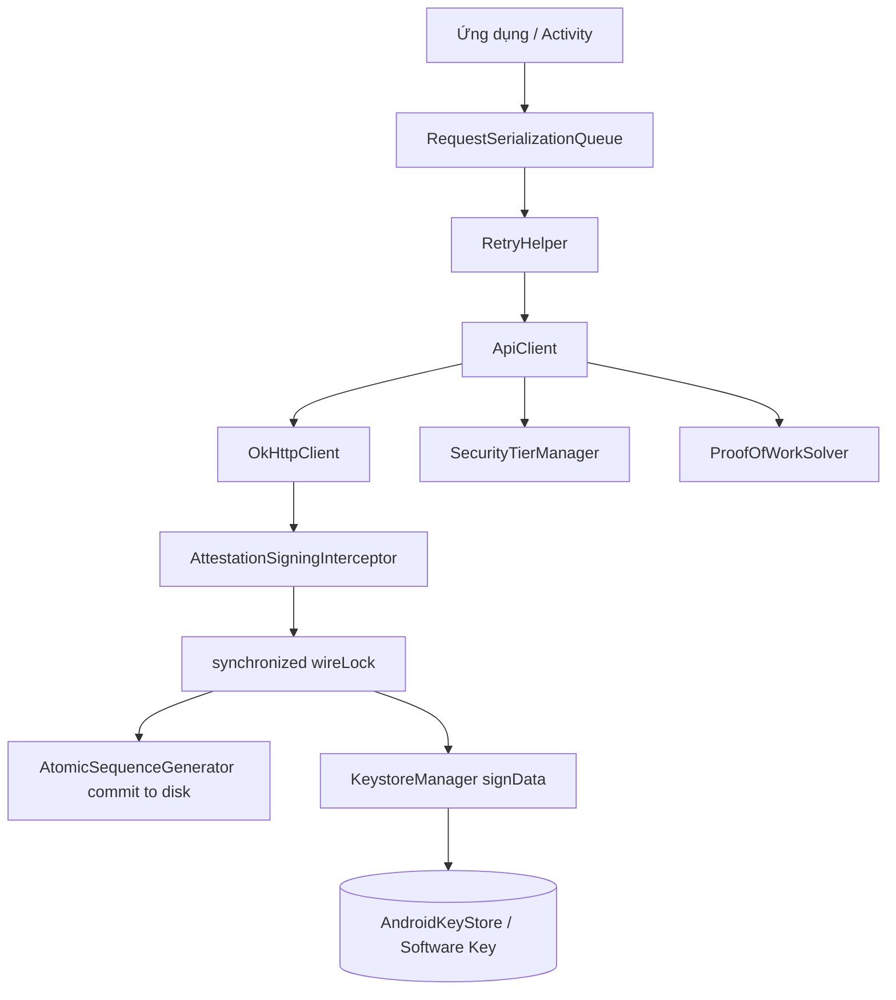
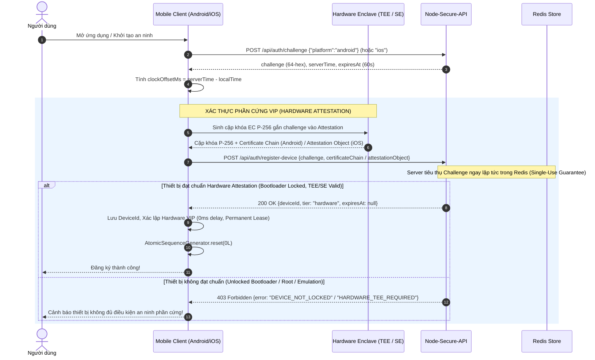
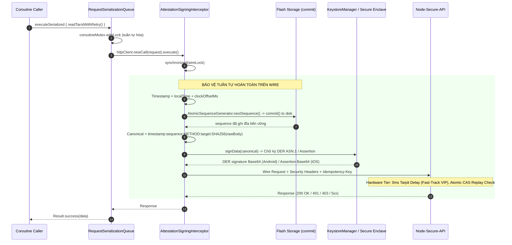
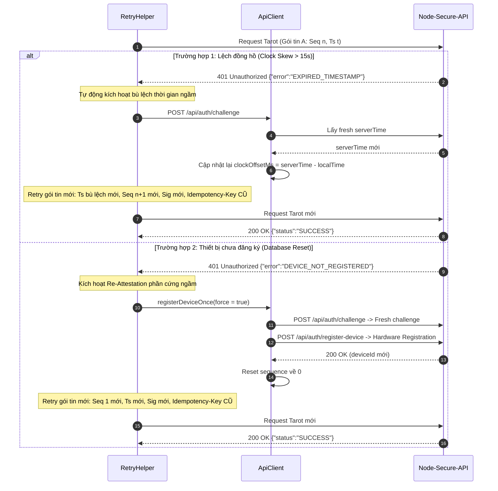

# Hướng dẫn tích hợp Client Android và iOS

Tài liệu này hướng dẫn tích hợp toàn diện giao thức xác thực thiết bị và chữ ký mật mã của hệ thống **Node-Secure-API** từ góc nhìn của ứng dụng di động Android Kotlin và iOS Swift. Nội dung được chuẩn hóa và đối chiếu trực tiếp với codebase backend (`src/core/`, `src/platform/`, `src/http/server.ts`) và bộ mã nguồn hoàn chỉnh của Client Demo (`demo/client/src/main/kotlin/com/astrology/tarot/security/*` cùng bộ simulator `demo/client/simulator/client_simulator.ts`).

> [!IMPORTANT]
> Chỉ gọi API qua HTTPS trong môi trường production. Tuyệt đối không nhúng private key hoặc shared secret vào mã nguồn client (APK/IPA). Server thực thi chính sách an ninh dựa trên hồ sơ thiết bị đã đăng ký tại backend, không dựa vào bất kỳ header tier nào do client tự khai báo.

---

## 1. Bất biến giao thức & Kiến trúc Dual-Tier

### 1.1 Byte, canonical string và chữ ký số

Mọi request nghiệp vụ được bảo vệ đều phải ký một chuỗi canonical định dạng UTF-8 chính xác, không Byte Order Mark (BOM), không chứa ký tự newline ở cuối:

```text
timestamp:sequence:METHOD:request-target:bodySha256Hex
```

Trong đó các trường tuân thủ quy tắc nghiêm ngặt:

| Trường | Định dạng & Quy tắc |
|---|---|
| `timestamp` | Unix epoch **milliseconds**, chuỗi decimal dương chuẩn (`/^[1-9]\d{0,15}$/`). Server cho phép độ lệch đồng hồ tối đa ±15.000 ms (15 giây). Cần áp dụng cơ chế bù lệch đồng hồ động (Dynamic Clock Offset). |
| `sequence` | Chuỗi decimal từ `1` đến `9223372036854775807` (signed int64, `/^[1-9]\d{0,18}$/`). Lưu trữ và xử lý bằng kiểu dữ liệu số nguyên 64-bit (`Long`/`BigInt`), không ép sang kiểu số thực (Double/Number) và không chứa leading zero. |
| `METHOD` | Tên phương thức HTTP viết hoa hoàn toàn (ví dụ: `POST`, `GET`, `PUT`, `DELETE`). |
| `request-target` | Encoded path kèm query string nguyên trạng (ví dụ: `/api/tarot/read?special=%2F&z=2&a=1`). Tuyệt đối không sắp xếp lại tham số (sort), không decode `%2F`, và không re-encode query string. |
| `bodySha256Hex` | Băm SHA-256 trên mảng byte nguyên bản của body thực gửi, hiển thị dưới dạng chuỗi hex chữ thường (lowercase hex 64 ký tự). Nếu request không có body hoặc body rỗng (0 bytes), sử dụng SHA-256 của mảng byte rỗng: `e3b0c44298fc1c149afbf4c8996fb92427ae41e4649b934ca495991b7852b855`. |

#### Headers an ninh bắt buộc

Mọi request gửi tới endpoint nghiệp vụ phải đính kèm tập headers sau:

- `X-Device-Id`: Mã định danh thiết bị duy nhất do server cấp sau khi đăng ký thành công.
- `X-Timestamp`: Giá trị timestamp milliseconds đã dùng trong chuỗi canonical.
- `X-Sequence`: Giá trị sequence decimal đã dùng trong chuỗi canonical.
- `X-Signature` (dành cho Android): Chữ ký số `SHA256withECDSA` dạng DER ASN.1 `(r, s)` được mã hóa Base64 chuẩn (NO_WRAP).
- `X-Assertion` (dành cho iOS): Chuỗi assertion Base64 do `DCAppAttestService.generateAssertion` tạo ra từ `SHA256(canonical UTF-8)`.
- `Idempotency-Key` (dành cho nghiệp vụ có side-effect): Khóa chống trùng lặp nghiệp vụ dạng UUID, giữ bất biến qua các lần retry.

> [!WARNING]
> Mảng byte của body phải được serialize đúng một lần, giữ nguyên vẹn để vừa tính băm SHA-256 vừa gửi ra wire. Không dùng interceptor tự ý re-serialize body hoặc qua các reverse proxy tự ý giải nén/nén lại dữ liệu làm thay đổi byte wire. Server từ chối mọi body nén để bảo vệ tính toàn vẹn của chuỗi canonical.

---

### 1.2 Kiến trúc phân tầng bất đối xứng (Dual-Tier Architecture)

> [!NOTE]
> **Trạng thái cấu hình hiện tại**: Cơ chế **Tier 2: Software Protected** (giải thuật PoW, khóa phần mềm EC P-256 SPKI PEM, rolling lease 2 giờ, tarpit delay 3.000ms và in-flight concurrency lock) hiện đã **tạm thời ẩn / vô hiệu hóa** ở phía Client Integration để tập trung an ninh tuyệt đối vào cơ chế chứng thực phần cứng **Tier 1: Hardware VIP** (Android Key Attestation qua TEE / StrongBox và iOS Apple App Attest qua Secure Enclave). Toàn bộ luồng nghiệp vụ client hiện tại vận hành theo chuẩn Hardware VIP với độ trễ 0ms (Fast-Track) và lease vĩnh viễn (`expiresAt = null`).

| Thuộc tính | Tier 1: Hardware VIP (Hiện hành) | Tier 2: Software Protected (Tạm ẩn phía Client) |
|---|---|---|
| **Cơ chế xác thực khóa** | Android Key Attestation (TEE / StrongBox) / iOS App Attest | Proof of Work (PoW) + EC P-256 SPKI PEM |
| **Chuỗi chứng chỉ** | X.509 Certificate Chain tới Google Hardware Root / Apple CA | SPKI PEM Public Key chuẩn |
| **Độ trễ xử lý (Tarpit Delay)** | **0 ms** (VIP Fast-Track) | **3.000 ms** (3.0s Tarpit Delay) |
| **Thời hạn Lease** | **Vĩnh viễn** (Permanent Lease, `expiresAt = null`) | **Rolling Lease 2 giờ** (`softwareDeviceTtlSeconds = 7200`) |
| **Giới hạn đồng thời** | Xử lý đa luồng theo queue | **Single In-Flight Lock** (tối đa 1 request/thiết bị tại một thời điểm) |
| **Hạn mức tần suất (Rate Limit)** | Hạn mức tiêu chuẩn VIP | Giới hạn 6 RPM/thiết bị và giới hạn theo IP |
| **Cơ chế phục hồi** | Duy trì khóa trong KeyStore / Re-attest khi cần | **Silent Renewal** tự động khi sắp hết hạn hoặc hết hạn |

---

### 1.3 Cơ chế bù lệch đồng hồ động (Dynamic Clock Offset Compensation)

Server từ chối thẳng thừng với mã lỗi `401 EXPIRED_TIMESTAMP` nếu timestamp của request lệch quá ±15 giây so với đồng hồ của server. Để giải quyết triệt để tình trạng thiết bị người dùng bị lệch giờ hệ thống:

1. Trong response của `POST /api/auth/challenge`, server luôn trả về trường `serverTime` (Unix epoch milliseconds) và `expiresAt`.
2. Client tính toán độ lệch:
   $$\text{clockOffsetMs} = \text{serverTime} - \text{System.currentTimeMillis()}$$
3. Lưu `clockOffsetMs` vào vùng nhớ bền vững (`SharedPreferences` / Keychain).
4. Mọi request ký dữ liệu sử dụng timestamp đã được bù lệch:
   $$\text{adjustedTimestamp} = \text{System.currentTimeMillis()} + \text{clockOffsetMs}$$
5. Khi nhận phản hồi `401 EXPIRED_TIMESTAMP`, client tự động kích hoạt tiến trình làm mới challenge ngầm để đồng bộ lại `clockOffsetMs` và retry request.

---

### 1.4 Quy tắc tiêu thụ Challenge và giải thuật PoW

- Endpoint `POST /api/auth/challenge` trả về:
  - `challenge`: Chuỗi 64 ký tự hex ngẫu nhiên (hoặc HMAC stateless).
  - `serverTime`: Mốc thời gian hiện tại của server.
  - `expiresAt`: Mốc hết hạn của challenge (thời hạn 60 giây).
  - `pow`: Bộ tham số giải toán gồm `salt` (chuỗi hex) và `difficulty` (chỉ dùng cho Software Tier, hiện client bỏ qua trường này).
- **Quy tắc tiêu thụ Challenge (Challenge Consumption)**:
  > [!IMPORTANT]
  > Một challenge chỉ được sử dụng đúng một lần (**Single-Use Guarantee**). Khi client gửi challenge lên `POST /api/auth/register-device`, server sẽ tiêu thụ challenge đó ngay lập tức trong Redis (dù đăng ký thành công hay thất bại do chứng chỉ không hợp lệ).
  >
  > Do đó, mỗi lần thử đăng ký hoặc tái đăng ký thiết bị phần cứng (Hardware Attestation), client **BẮT BUỘC PHẢI XIN MỘT FRESH CHALLENGE MỚI** từ `/api/auth/challenge`.
  >
  > *(Ghi chú: Cơ chế giải PoW thuộc Software Tier hiện tạm ẩn ở phía client. Client chỉ sử dụng challenge hex cho Hardware Key Attestation).*

---

### 1.5 Cơ chế Redis Timestamp Quarantine (Boot-time Safety)

Khi dịch vụ backend hoặc cụm Redis khởi động lại, server áp dụng cơ chế cách ly **Redis Timestamp Quarantine** trong vòng 15 giây.
- Mọi request có timestamp cũ hơn mốc server boot sẽ bị từ chối với mã lỗi `401 RETRY_WITH_FRESH_TIMESTAMP`.
- Điều này ngăn chặn việc replay các gói tin cũ khi trạng thái replay cache bị rớt về quá khứ do sự cố khôi phục Redis.
- **Hành động client**: Khi gặp lỗi này, client **không được gửi lại gói tin cũ**. Client phải lấy timestamp hiện tại mới, rút sequence mới, tính lại canonical, ký chữ ký mới và retry ngay lập tức (giữ nguyên `idempotencyKey`).

---

## 2. Đặc tả Endpoint và Định dạng Payload

### 2.1 Yêu cầu Challenge: `POST /api/auth/challenge`

#### Request Body
```json
{
  "platform": "android"
}
```
*(Với iOS, truyền `"platform": "ios"`)*.

#### Response Body (HTTP 200 OK)
```json
{
  "status": "SUCCESS",
  "challenge": "a1b2c3d4e5f67890123456789abcdef0123456789abcdef0123456789abcdef0",
  "expiresAt": 1730000060000,
  "serverTime": 1730000000000,
  "pow": {
    "salt": "7f8e9d0a1b2c3d4e",
    "difficulty": 18
  }
}
```

---

### 2.2 Đăng ký thiết bị: `POST /api/auth/register-device`

#### Trường hợp 1: Đăng ký Tier 1 (Hardware Attestation)
```json
{
  "challenge": "a1b2c3d4e5f67890123456789abcdef0123456789abcdef0123456789abcdef0",
  "certificateChain": [
    "MIIC...", 
    "MIIC...", 
    "MIIC..."
  ]
}
```
*Ghi chú: `certificateChain` là mảng các chuỗi Base64 của chứng chỉ DER, sắp xếp từ Leaf Certificate đến Root Certificate.*

#### Trường hợp 2: Đăng ký Tier 2 (Software Protected với PoW) — *[Tạm thời ẩn phía Client]*
```json
{
  "challenge": "fresh_challenge_64_hex_value_here...",
  "publicKeyPem": "-----BEGIN PUBLIC KEY-----\nMFkwEwYHKoZIzj0CAQYIKoZIzj0DAQcDQgAE...\n-----END PUBLIC KEY-----",
  "powNonce": "48291"
}
```
*(Lưu ý: Luồng đăng ký phần mềm qua PoW này hiện đã tạm ẩn ở ứng dụng client, server vẫn duy trì tương thích ngược nếu bật cờ cấu hình).*

#### Trường hợp 3: Đăng ký iOS (Apple App Attest)
```json
{
  "challenge": "a1b2c3d4e5f67890123456789abcdef0123456789abcdef0123456789abcdef0",
  "keyId": "Base64(utf8(keyId))",
  "attestationObject": "Base64(attestationObject)"
}
```

#### Response Thành công (HTTP 200 OK)
```json
{
  "status": "SUCCESS",
  "deviceId": "dev_a1b2c3d4e5f67890",
  "tier": "hardware",
  "expiresAt": null,
  "message": "Device registered successfully"
}
```
*(Nếu là Software Tier, `tier` sẽ là `"software"` và `expiresAt` là timestamp hết hạn của lease 2 giờ, ví dụ: `1730007200000`)*.

---

### 2.3 Gọi API nghiệp vụ được bảo vệ (Ví dụ: `POST /api/tarot/read`)

#### Headers
```http
POST /api/tarot/read HTTP/1.1
Host: api.example.com
Content-Type: application/json; charset=utf-8
X-Device-Id: dev_a1b2c3d4e5f67890
X-Timestamp: 1730000005120
X-Sequence: 1
X-Signature: MEQCID9x1... (Android) hoặc X-Assertion: MIIC... (iOS)
Idempotency-Key: c9a3b8d4-5e6f-4a1b-8c2d-9e0f1a2b3c4d
```

#### Body
```json
{
  "question": "Vận mệnh sự nghiệp và lộ trình an ninh số",
  "idempotencyKey": "c9a3b8d4-5e6f-4a1b-8c2d-9e0f1a2b3c4d"
}
```

---

## 3. Kiến trúc Client Android Kotlin (Đối chiếu `demo/client`)

Client Android được thiết kế theo cấu trúc mô-đun hóa, bảo vệ đa tầng và chống chịu lỗi cao:



---

### 3.1 Quản lý Khóa Dual-Tier: `KeystoreManager.kt`

`KeystoreManager` quản lý vòng đời của 2 cặp khóa độc lập:
1. `HARDWARE_KEY_ALIAS = "NodeSecureHardwareKey"`: Cặp khóa phần cứng EC P-256 gắn attestation challenge, ưu tiên StrongBox, fallback TEE.
2. `SOFTWARE_KEY_ALIAS = "NodeSecureSoftwareKey"`: Cặp khóa phần mềm EC P-256 tạo trong AndroidKeyStore (không challenge) hoặc fallback Java EC in-memory.

> [!TIP]
> **Xóa alias mồ côi (Orphan Key Cleanup)**: Khi tạo khóa Hardware, xóa sạch cả hardware alias và software alias cũ. Tương tự khi tạo khóa Software, xóa sạch cả 2 alias cũ. Điều này đảm bảo trạng thái khóa cục bộ luôn nhất quán và triệt tiêu xung đột dữ liệu.

```kotlin
package com.astrology.tarot.security

import android.content.Context
import android.content.pm.PackageManager
import android.os.Build
import android.security.keystore.KeyGenParameterSpec
import android.security.keystore.KeyInfo
import android.security.keystore.KeyProperties
import android.util.Base64
import java.security.*
import java.security.spec.ECGenParameterSpec

object KeystoreManager {
    const val HARDWARE_KEY_ALIAS = "NodeSecureHardwareKey"
    const val SOFTWARE_KEY_ALIAS = "NodeSecureSoftwareKey"
    private const val PREFS_NAME = "app_secure_prefs"
    private const val KEY_ACTIVE_TIER = "ACTIVE_KEY_TIER"

    private val keyStore: KeyStore
        get() = KeyStore.getInstance("AndroidKeyStore").apply { load(null) }

    private var softwareFallbackKeyPair: KeyPair? = null

    var activeTier: String = "hardware"
        get() {
            // Auto-heal nếu trạng thái là hardware nhưng chỉ có khóa software
            if (field == "hardware" && !keyStore.containsAlias(HARDWARE_KEY_ALIAS) &&
                (keyStore.containsAlias(SOFTWARE_KEY_ALIAS) || softwareFallbackKeyPair != null)) {
                return "software"
            }
            return field
        }
        internal set

    @Synchronized
    fun generateAttestedKeyPair(challengeHex: String, context: Context? = null): KeyPair {
        require(challengeHex.length == 64) { "Challenge must be a 64-character hex string" }

        // Dọn dẹp alias cũ
        if (keyStore.containsAlias(HARDWARE_KEY_ALIAS)) keyStore.deleteEntry(HARDWARE_KEY_ALIAS)
        if (keyStore.containsAlias(SOFTWARE_KEY_ALIAS)) keyStore.deleteEntry(SOFTWARE_KEY_ALIAS)
        softwareFallbackKeyPair = null

        val hasStrongBox = if (Build.VERSION.SDK_INT >= Build.VERSION_CODES.P && context != null) {
            context.packageManager.hasSystemFeature(PackageManager.FEATURE_STRONGBOX_KEYSTORE)
        } else false

        val challengeBytes = challengeHex.toByteArray(Charsets.UTF_8)

        fun createSpec(useStrongBox: Boolean): KeyGenParameterSpec {
            val builder = KeyGenParameterSpec.Builder(HARDWARE_KEY_ALIAS, KeyProperties.PURPOSE_SIGN)
                .setAlgorithmParameterSpec(ECGenParameterSpec("secp256r1"))
                .setDigests(KeyProperties.DIGEST_SHA256)
                .setAttestationChallenge(challengeBytes)
                .setUserAuthenticationRequired(false)
            if (Build.VERSION.SDK_INT >= Build.VERSION_CODES.P) {
                builder.setIsStrongBoxBacked(useStrongBox)
            }
            return builder.build()
        }

        fun generate(useStrongBox: Boolean): KeyPair {
            val kpg = KeyPairGenerator.getInstance(KeyProperties.KEY_ALGORITHM_EC, "AndroidKeyStore")
            kpg.initialize(createSpec(useStrongBox))
            return kpg.generateKeyPair()
        }

        // Ưu tiên StrongBox, tự động fallback TEE nếu StrongBox ném lỗi
        val keyPair = if (hasStrongBox) {
            try { generate(useStrongBox = true) } catch (_: Throwable) { generate(useStrongBox = false) }
        } else {
            generate(useStrongBox = false)
        }

        activeTier = "hardware"
        context?.applicationContext?.getSharedPreferences(PREFS_NAME, Context.MODE_PRIVATE)
            ?.edit()?.putString(KEY_ACTIVE_TIER, "hardware")?.apply()
        return keyPair
    }

    @Synchronized
    fun generateSoftwareKeyPair(context: Context? = null): KeyPair {
        if (keyStore.containsAlias(HARDWARE_KEY_ALIAS)) keyStore.deleteEntry(HARDWARE_KEY_ALIAS)
        if (keyStore.containsAlias(SOFTWARE_KEY_ALIAS)) keyStore.deleteEntry(SOFTWARE_KEY_ALIAS)

        val keyPair = try {
            val spec = KeyGenParameterSpec.Builder(SOFTWARE_KEY_ALIAS, KeyProperties.PURPOSE_SIGN)
                .setAlgorithmParameterSpec(ECGenParameterSpec("secp256r1"))
                .setDigests(KeyProperties.DIGEST_SHA256)
                .setUserAuthenticationRequired(false)
                .build()
            val kpg = KeyPairGenerator.getInstance(KeyProperties.KEY_ALGORITHM_EC, "AndroidKeyStore")
            kpg.initialize(spec)
            kpg.generateKeyPair()
        } catch (_: Throwable) {
            // Fallback sang Java in-memory EC key nếu AndroidKeyStore hoàn toàn lỗi
            val standardKpg = KeyPairGenerator.getInstance("EC")
            standardKpg.initialize(ECGenParameterSpec("secp256r1"))
            val pair = standardKpg.generateKeyPair()
            softwareFallbackKeyPair = pair
            pair
        }

        activeTier = "software"
        context?.applicationContext?.getSharedPreferences(PREFS_NAME, Context.MODE_PRIVATE)
            ?.edit()?.putString(KEY_ACTIVE_TIER, "software")?.apply()
        return keyPair
    }

    @Synchronized
    fun getCertificateChainBase64(): List<String> {
        val chain = keyStore.getCertificateChain(HARDWARE_KEY_ALIAS)
            ?: throw IllegalStateException("Missing certificate chain for $HARDWARE_KEY_ALIAS")
        return chain.map { Base64.encodeToString(it.encoded, Base64.NO_WRAP) }
    }

    fun exportSpkiPem(publicKey: PublicKey): String {
        val derBytes = publicKey.encoded
        val b64 = Base64.encodeToString(derBytes, Base64.NO_WRAP)
        val wrapped = b64.chunked(64).joinToString("\n")
        return "-----BEGIN PUBLIC KEY-----\n$wrapped\n-----END PUBLIC KEY-----"
    }

    @Synchronized
    fun getSoftwarePublicKeyPem(): String {
        val pubKey: PublicKey = if (keyStore.containsAlias(SOFTWARE_KEY_ALIAS)) {
            keyStore.getCertificate(SOFTWARE_KEY_ALIAS)?.publicKey
                ?: error("Cannot retrieve public key for $SOFTWARE_KEY_ALIAS")
        } else {
            softwareFallbackKeyPair?.public ?: error("No software key available")
        }
        return exportSpkiPem(pubKey)
    }

    @Synchronized
    fun signData(canonicalString: String): String {
        val privateKey: PrivateKey = if (activeTier == "hardware") {
            keyStore.getKey(HARDWARE_KEY_ALIAS, null) as? PrivateKey
                ?: throw IllegalStateException("Hardware private key not found")
        } else {
            if (keyStore.containsAlias(SOFTWARE_KEY_ALIAS)) {
                keyStore.getKey(SOFTWARE_KEY_ALIAS, null) as? PrivateKey
                    ?: softwareFallbackKeyPair?.private
                    ?: throw IllegalStateException("Software private key not found")
            } else {
                softwareFallbackKeyPair?.private ?: throw IllegalStateException("Software private key not found")
            }
        }

        val signer = Signature.getInstance("SHA256withECDSA")
        signer.initSign(privateKey)
        signer.update(canonicalString.toByteArray(Charsets.UTF_8))
        val derBytes = signer.sign()
        return Base64.encodeToString(derBytes, Base64.NO_WRAP)
    }

    @Synchronized
    fun isDeviceKeyReady(): Boolean = if (activeTier == "hardware") {
        keyStore.containsAlias(HARDWARE_KEY_ALIAS)
    } else {
        keyStore.containsAlias(SOFTWARE_KEY_ALIAS) || softwareFallbackKeyPair != null
    }
}
```

---

### 3.2 Bộ đếm Sequence bền vững: `AtomicSequenceGenerator.kt`

Để triệt tiêu lỗi Replay khi ứng dụng bị force-kill hoặc crash đột ngột, giá trị sequence mới **phải được ghi đồng bộ xuống đĩa trước khi gửi request ra wire**.

> [!CAUTION]
> Luôn dùng `commit()` (đồng bộ ghi đĩa ngay lập tức), **không bao giờ dùng `apply()`** (ghi bất đồng bộ trên RAM) khi lưu sequence. Nếu dùng `apply()`, trường hợp crash ngay sau khi gửi gói tin sẽ khiến sequence bị rollback trên đĩa, dẫn đến tái sử dụng sequence cũ và bị server chặn vĩnh viễn với lỗi `401 REPLAY_DETECTED`.

```kotlin
package com.astrology.tarot.security

import android.content.Context
import android.content.SharedPreferences
import java.util.concurrent.atomic.AtomicLong

object AtomicSequenceGenerator {
    private const val PREFS_NAME = "security_demo_prefs"
    private const val KEY_SEQUENCE = "sequence"

    private val counter = AtomicLong(0)
    private var preferences: SharedPreferences? = null

    @Synchronized
    fun configure(context: Context) {
        if (preferences == null) {
            preferences = context.applicationContext.getSharedPreferences(PREFS_NAME, Context.MODE_PRIVATE)
            val savedSeq = preferences!!.getLong(KEY_SEQUENCE, 0L)
            initialize(savedSeq)
        }
    }

    @Synchronized
    fun initialize(lastSavedSeq: Long) {
        require(lastSavedSeq >= 0L) { "Initial sequence must be non-negative" }
        counter.set(maxOf(counter.get(), lastSavedSeq))
    }

    @Synchronized
    fun reset(newSeq: Long = 0L) {
        require(newSeq >= 0L) { "Reset sequence must be non-negative" }
        preferences?.let { prefs ->
            check(prefs.edit().putLong(KEY_SEQUENCE, newSeq).commit()) { "Failed to commit sequence reset" }
        }
        counter.set(newSeq)
    }

    @Synchronized
    fun nextSequence(): Long {
        check(counter.get() < Long.MAX_VALUE) { "Sequence number exhausted" }
        val next = counter.incrementAndGet()
        preferences?.let { prefs ->
            // BẮT BUỘC dùng .commit() đồng bộ
            check(prefs.edit().putLong(KEY_SEQUENCE, next).commit()) { "Failed to commit sequence counter" }
        }
        return next
    }

    @Synchronized
    fun nextSequenceString(): String = nextSequence().toString()
}
```

---

### 3.3 Bộ giải Proof of Work: `ProofOfWorkSolver.kt`

```kotlin
package com.astrology.tarot.security

import java.security.MessageDigest

object ProofOfWorkSolver {
    fun countLeadingZeroBits(bytes: ByteArray): Int {
        var zeros = 0
        for (b in bytes) {
            val unsignedByte = b.toInt() and 0xFF
            if (unsignedByte == 0) {
                zeros += 8
            } else {
                zeros += Integer.numberOfLeadingZeros(unsignedByte) - 24
                break
            }
        }
        return zeros
    }

    fun solveProofOfWork(
        challenge: String,
        salt: String,
        difficulty: Int,
        maxIterations: Long = 50_000_000L
    ): String {
        require(challenge.isNotEmpty() && salt.isNotEmpty())
        require(difficulty in 1..256)

        val prefixBytes = "$challenge:$salt:".toByteArray(Charsets.UTF_8)
        val md = MessageDigest.getInstance("SHA-256")
        var nonce = 0L

        while (nonce < maxIterations) {
            val nonceBytes = nonce.toString().toByteArray(Charsets.UTF_8)
            md.reset()
            md.update(prefixBytes)
            md.update(nonceBytes)
            val hash = md.digest()

            if (countLeadingZeroBits(hash) >= difficulty) {
                return nonce.toString()
            }
            nonce++
        }
        throw IllegalStateException("PoW solver exceeded max iterations ($maxIterations)")
    }
}
```

---

### 3.4 OkHttp Interceptor & Wire Serialization: `AttestationSigningInterceptor.kt`

Interceptor phụ trách trích xuất canonical, băm body byte, ký số và gắn 4 headers. Toàn bộ chu kỳ từ lấy sequence đến khi nhận response được bảo vệ bởi khóa đồng bộ `wireLock` để đảm bảo thứ tự tuyệt đối trên đường truyền:

```kotlin
package com.astrology.tarot.security

import okhttp3.Interceptor
import okhttp3.Response
import okio.Buffer
import java.security.MessageDigest

class AttestationSigningInterceptor(
    private val deviceIdProvider: () -> String?
) : Interceptor {

    companion object {
        const val HEADER_DEVICE_ID = "X-Device-Id"
        const val HEADER_TIMESTAMP = "X-Timestamp"
        const val HEADER_SEQUENCE = "X-Sequence"
        const val HEADER_SIGNATURE = "X-Signature"

        // Wire Lock đảm bảo thứ tự tuyệt đối trên đường truyền
        val wireLock = Any()

        fun computeSha256Hex(bytes: ByteArray): String {
            val digest = MessageDigest.getInstance("SHA-256").digest(bytes)
            val sb = StringBuilder(digest.size * 2)
            for (b in digest) {
                sb.append(String.format("%02x", b.toInt() and 0xff))
            }
            return sb.toString()
        }

        fun buildCanonicalString(
            timestamp: String, sequence: String, method: String,
            requestTarget: String, bodySha256Hex: String
        ): String = "$timestamp:$sequence:${method.uppercase()}:$requestTarget:$bodySha256Hex"
    }

    override fun intercept(chain: Interceptor.Chain): Response {
        val request = chain.request()
        val path = request.url.encodedPath

        // Chỉ ký các protected endpoint (bỏ qua /api/auth/*, /health, /ready)
        if (!path.startsWith("/api/tarot")) {
            return chain.proceed(request)
        }

        synchronized(wireLock) {
            val deviceId = deviceIdProvider()
                ?: throw IllegalStateException("Device ID not registered yet")

            // 1. Trích xuất Request Target: encodedPath + query nguyên trạng
            val target = request.url.encodedPath + (request.url.encodedQuery?.let { "?$it" } ?: "")

            // 2. Trích xuất body byte an toàn
            val body = request.body
            val rawBodyBytes = if (body != null) {
                require(!body.isOneShot() && !body.isDuplex()) {
                    "Cannot sign streaming or one-shot request body"
                }
                val buffer = Buffer()
                body.writeTo(buffer)
                buffer.readByteArray()
            } else {
                ByteArray(0)
            }
            val bodyHash = computeSha256Hex(rawBodyBytes)

            // 3. Rút sequence và timestamp bù lệch đồng hồ bên trong wireLock
            val timestamp = (ApiClient.currentAdjustedTime?.invoke() ?: System.currentTimeMillis()).toString()
            val sequence = AtomicSequenceGenerator.nextSequenceString()

            // 4. Dựng canonical string và ký số
            val canonical = buildCanonicalString(timestamp, sequence, request.method, target, bodyHash)
            val signature = KeystoreManager.signData(canonical)

            // 5. Gắn 4 headers an ninh và truyền gói tin
            val signedRequest = request.newBuilder()
                .header(HEADER_DEVICE_ID, deviceId)
                .header(HEADER_TIMESTAMP, timestamp)
                .header(HEADER_SEQUENCE, sequence)
                .header(HEADER_SIGNATURE, signature)
                .build()

            return chain.proceed(signedRequest)
        }
    }
}
```

---

### 3.5 Tuần tự hóa tác vụ: `RequestSerializationQueue.kt`

Cung cấp Mutex ở tầng coroutine kết hợp với `wireLock` ở tầng OkHttp interceptor:

```kotlin
package com.astrology.tarot.security

import kotlinx.coroutines.sync.Mutex
import kotlinx.coroutines.sync.withLock

object RequestSerializationQueue {
    private val coroutineMutex = Mutex()

    suspend fun <T> executeSerialized(action: suspend () -> T): T {
        return coroutineMutex.withLock {
            action()
        }
    }

    fun <T> executeBlockingSerialized(action: () -> T): T {
        return synchronized(AttestationSigningInterceptor.wireLock) {
            action()
        }
    }
}
```

---

### 3.6 Máy trạng thái đăng ký và Quản lý Lease: `ApiClient.kt` & `SecurityTierManager.kt`

Quy trình đăng ký Dual-Tier của `ApiClient` giải quyết bài toán tiêu thụ challenge (Challenge Consumption) và chuyển tầng mượt mà:

```kotlin
package com.astrology.tarot.security

import android.content.Context
import com.google.gson.Gson
import com.google.gson.JsonParser
import kotlinx.coroutines.Dispatchers
import kotlinx.coroutines.sync.Mutex
import kotlinx.coroutines.sync.withLock
import kotlinx.coroutines.withContext
import okhttp3.*
import okhttp3.MediaType.Companion.toMediaType
import okhttp3.RequestBody.Companion.toRequestBody
import java.io.IOException
import java.util.concurrent.TimeUnit

class HardwareAttestationRejectedException(message: String) : Exception(message)

class ApiClient(private val context: Context, customBaseUrl: String? = null) {
    private val prefs = context.applicationContext.getSharedPreferences("app_secure_prefs", Context.MODE_PRIVATE)
    private val gson = Gson()
    private val jsonMediaType = "application/json; charset=utf-8".toMediaType()

    val baseUrl: String = customBaseUrl ?: prefs.getString("SERVER_BASE_URL", "http://10.40.40.2:3000")!!
    var deviceId: String? = prefs.getString("DEVICE_ID", null)
        private set
    var tier: String = prefs.getString("device_tier", "hardware") ?: "hardware"
        private set
    var leaseExpiresAt: Long = prefs.getLong("lease_expires_at", 0L)
        private set
    var clockOffsetMs: Long = prefs.getLong("clock_offset_ms", 0L)
        internal set

    // Control client cho challenge/register (không interceptor)
    private val controlClient = OkHttpClient.Builder()
        .connectTimeout(15, TimeUnit.SECONDS)
        .readTimeout(30, TimeUnit.SECONDS)
        .writeTimeout(30, TimeUnit.SECONDS)
        .retryOnConnectionFailure(false)
        .build()

    // Protected client cho API nghiệp vụ (chứa interceptor, readTimeout 30s chịu được Tarpit 3.0s)
    val httpClient = OkHttpClient.Builder()
        .connectTimeout(15, TimeUnit.SECONDS)
        .readTimeout(30, TimeUnit.SECONDS)
        .writeTimeout(30, TimeUnit.SECONDS)
        .retryOnConnectionFailure(false) // BẮT BUỘC: Không để OkHttp tự retry gói tin cũ
        .addInterceptor(AttestationSigningInterceptor { this.deviceId })
        .build()

    init {
        currentAdjustedTime = { this.getAdjustedTimestamp() }
        KeystoreManager.activeTier = this.tier
        AtomicSequenceGenerator.configure(context)
    }

    fun getAdjustedTimestamp(): Long = System.currentTimeMillis() + clockOffsetMs

    fun isDeviceRegistered(): Boolean {
        val registered = prefs.getBoolean("registered", false)
        if (!registered || deviceId.isNullOrEmpty() || !KeystoreManager.isDeviceKeyReady()) return false
        if (tier == "software" && leaseExpiresAt > 0 && System.currentTimeMillis() >= leaseExpiresAt) return false
        return true
    }

    suspend fun registerDeviceOnce(force: Boolean = false): Result<String> = registrationMutex.withLock {
        withContext(Dispatchers.IO) {
            try {
                if (!force && isDeviceRegistered()) return@withContext Result.success(deviceId!!)

                // Bước 1: Xin challenge và đồng bộ độ lệch thời gian
                fun fetchChallenge(): Triple<String, String, Int> {
                    val req = Request.Builder().url("$baseUrl/api/auth/challenge")
                        .post(gson.toJson(mapOf("platform" to "android")).toRequestBody(jsonMediaType)).build()
                    return controlClient.newCall(req).execute().use { res ->
                        val body = res.body?.string().orEmpty()
                        val json = JsonParser.parseString(body).asJsonObject
                        val ch = json.get("challenge").asString
                        val serverTime = if (json.has("serverTime")) json.get("serverTime").asLong else System.currentTimeMillis()
                        clockOffsetMs = serverTime - System.currentTimeMillis()
                        prefs.edit().putLong("clock_offset_ms", clockOffsetMs).apply()

                        val powObj = json.getAsJsonObject("pow") ?: json.getAsJsonObject("powInfo")
                        val salt = powObj?.get("salt")?.asString ?: ""
                        val diff = powObj?.get("difficulty")?.asInt ?: 18
                        Triple(ch, salt, diff)
                    }
                }

                var (challenge, powSalt, powDifficulty) = fetchChallenge()
                var assignedDeviceId: String? = null
                var assignedTier = "hardware"
                var assignedExpiresAt = 0L

                // Bước 2: Thử Tier 1 (Hardware Attestation)
                var hardwareSuccess = false
                var challengeConsumed = false
                try {
                    KeystoreManager.generateAttestedKeyPair(challenge, context)
                    val chain = KeystoreManager.getCertificateChainBase64()
                    val payload = gson.toJson(mapOf("challenge" to challenge, "certificateChain" to chain))
                    val regReq = Request.Builder().url("$baseUrl/api/auth/register-device")
                        .post(payload.toRequestBody(jsonMediaType)).build()

                    challengeConsumed = true // Challenge đã gửi lên server -> đã bị tiêu thụ
                    controlClient.newCall(regReq).execute().use { res ->
                        val body = res.body?.string().orEmpty()
                        if (res.isSuccessful) {
                            val json = JsonParser.parseString(body).asJsonObject
                            assignedDeviceId = json.get("deviceId").asString
                            assignedTier = json.get("tier")?.asString ?: "hardware"
                            assignedExpiresAt = 0L
                            hardwareSuccess = true
                        } else {
                            throw HardwareAttestationRejectedException("Server rejected hardware: $body")
                        }
                    }
                } catch (_: Exception) {
                    hardwareSuccess = false
                }

                // Bước 3: Fallback Tier 2 (Software + PoW)
                if (!hardwareSuccess) {
                    // Nếu challenge đã bị server tiêu thụ ở Bước 2, BẮT BUỘC xin challenge mới
                    if (challengeConsumed) {
                        val fresh = fetchChallenge()
                        challenge = fresh.first
                        powSalt = fresh.second
                        powDifficulty = fresh.third
                    }

                    KeystoreManager.generateSoftwareKeyPair(context)
                    val publicKeyPem = KeystoreManager.getSoftwarePublicKeyPem()
                    val nonce = ProofOfWorkSolver.solveProofOfWork(challenge, powSalt, powDifficulty)

                    val payload = gson.toJson(mapOf(
                        "challenge" to challenge,
                        "publicKeyPem" to publicKeyPem,
                        "powNonce" to nonce
                    ))
                    val regReq = Request.Builder().url("$baseUrl/api/auth/register-device")
                        .post(payload.toRequestBody(jsonMediaType)).build()

                    controlClient.newCall(regReq).execute().use { res ->
                        val body = res.body?.string().orEmpty()
                        if (!res.isSuccessful) throw IOException("Software registration failed: $body")
                        val json = JsonParser.parseString(body).asJsonObject
                        assignedDeviceId = json.get("deviceId").asString
                        assignedTier = json.get("tier")?.asString ?: "software"
                        assignedExpiresAt = json.get("expiresAt")?.asLong ?: (System.currentTimeMillis() + 7200_000L)
                    }
                }

                val finalId = assignedDeviceId ?: error("Registration failed to return deviceId")
                AtomicSequenceGenerator.reset(0L) // Reset sequence về 0 cho vòng đời mới

                deviceId = finalId
                tier = assignedTier
                leaseExpiresAt = assignedExpiresAt
                KeystoreManager.activeTier = assignedTier

                prefs.edit()
                    .putString("DEVICE_ID", finalId)
                    .putString("device_tier", assignedTier)
                    .putLong("lease_expires_at", assignedExpiresAt)
                    .putBoolean("registered", true)
                    .commit()

                Result.success(finalId)
            } catch (e: Exception) {
                Result.failure(e)
            }
        }
    }

    companion object {
        var currentAdjustedTime: (() -> Long)? = null
        private val registrationMutex = Mutex()
    }
}
```

#### Quản lý trạng thái Tier: `SecurityTierManager.kt`
```kotlin
package com.astrology.tarot.security

import android.content.Context

enum class DeviceSecurityTier(val displayName: String) {
    TIER_1_HARDWARE("Tier 1: Hardware VIP (0ms Delay, Permanent)"),
    TIER_2_SOFTWARE("Tier 2: Software Protected (3.0s Tarpit, 2h Lease)"),
    UNREGISTERED("Chưa đăng ký (Unregistered)")
}

object SecurityTierManager {
    fun determineSecurityTier(context: Context): DeviceSecurityTier {
        val prefs = context.applicationContext.getSharedPreferences("app_secure_prefs", Context.MODE_PRIVATE)
        if (!prefs.getBoolean("registered", false) || !KeystoreManager.isDeviceKeyReady()) {
            return DeviceSecurityTier.UNREGISTERED
        }
        val tier = prefs.getString("device_tier", "hardware")
        if (tier == "software") {
            val expiresAt = prefs.getLong("lease_expires_at", 0L)
            if (expiresAt > 0 && System.currentTimeMillis() >= expiresAt) {
                return DeviceSecurityTier.UNREGISTERED
            }
            return DeviceSecurityTier.TIER_2_SOFTWARE
        }
        return DeviceSecurityTier.TIER_1_HARDWARE
    }

    fun isLeaseExpiringSoon(context: Context, bufferMinutes: Long = 5): Boolean {
        val prefs = context.applicationContext.getSharedPreferences("app_secure_prefs", Context.MODE_PRIVATE)
        if (prefs.getString("device_tier", null) != "software") return false
        val expiresAt = prefs.getLong("lease_expires_at", 0L)
        if (expiresAt <= 0L) return true
        return System.currentTimeMillis() >= (expiresAt - bufferMinutes * 60 * 1000L)
    }

    fun getLeaseRemainingMinutes(context: Context): Long {
        val prefs = context.applicationContext.getSharedPreferences("app_secure_prefs", Context.MODE_PRIVATE)
        if (prefs.getString("device_tier", null) == "hardware") return -1L
        val diff = prefs.getLong("lease_expires_at", 0L) - System.currentTimeMillis()
        return if (diff > 0) diff / 60000L else 0L
    }
}
```

---

### 3.7 Chiến lược Retry an toàn & Tự động phục hồi (Silent Renewal): `RetryHelper.kt`

Khi gặp lỗi, client không bao giờ phát lại gói tin cũ. Mọi retry qua OkHttpClient đều tự động được Interceptor cấp sequence mới, timestamp bù lệch mới và signature mới.

```kotlin
package com.astrology.tarot.security

import com.google.gson.Gson
import com.google.gson.JsonParser
import kotlinx.coroutines.*
import okhttp3.MediaType.Companion.toMediaType
import okhttp3.Request
import okhttp3.RequestBody.Companion.toRequestBody
import java.io.IOException
import java.util.UUID

class ApiResponseException(val statusCode: Int, val errorCode: String?, val responseBody: String) :
    Exception("HTTP $statusCode: $responseBody")

class RetryHelper(private val api: ApiClient) {
    private val gson = Gson()
    private val jsonMediaType = "application/json; charset=utf-8".toMediaType()

    suspend fun readTarotWithRetry(
        question: String,
        maxRetries: Int = 3,
        idempotencyKey: String = UUID.randomUUID().toString(),
        onSuccess: (Request, String) -> Unit = { _, _ -> }
    ): Result<String> {
        require(maxRetries > 0)

        // Idempotency key bất biến xuyên suốt các lần retry
        val payload = gson.toJson(mapOf("question" to question, "idempotencyKey" to idempotencyKey))

        repeat(maxRetries) { attempt ->
            try {
                val result = RequestSerializationQueue.executeSerialized {
                    withContext(Dispatchers.IO) {
                        // Tạo Request mới -> Interceptor sẽ tự cấp sequence, timestamp, signature mới
                        val request = Request.Builder()
                            .url("${api.baseUrl}/api/tarot/read")
                            .header("Idempotency-Key", idempotencyKey)
                            .post(payload.toRequestBody(jsonMediaType))
                            .build()

                        api.httpClient.newCall(request).execute().use { response ->
                            val bodyStr = response.body?.string().orEmpty()

                            // Lỗi server tạm thời (5xx, 429) -> kích hoạt retry có backoff
                            if (response.code >= 500 || response.code == 429) {
                                throw IOException("Transient error ${response.code}: $bodyStr")
                            }

                            if (!response.isSuccessful) {
                                val errorCode = runCatching {
                                    JsonParser.parseString(bodyStr).asJsonObject.get("error")?.asString
                                }.getOrNull()

                                // Tự động phục hồi ngầm (Silent Renewal) khi lease hết hạn, mất đăng ký, hoặc lệch giờ
                                if (response.code == 401 &&
                                    errorCode in setOf("DEVICE_LEASE_EXPIRED", "DEVICE_NOT_REGISTERED", "LEASE_EXPIRED", "EXPIRED_TIMESTAMP") &&
                                    attempt < maxRetries - 1
                                ) {
                                    val renewResult = api.registerDeviceOnce(force = true)
                                    if (renewResult.isSuccess) {
                                        throw IOException("Silent renewal succeeded after $errorCode, retrying...")
                                    }
                                }

                                throw ApiResponseException(response.code, errorCode, bodyStr)
                            }

                            onSuccess(response.request, bodyStr)
                            bodyStr
                        }
                    }
                }
                return Result.success(result)
            } catch (e: IOException) {
                if (attempt == maxRetries - 1) return Result.failure(e)
                delay(1000L * (attempt + 1)) // Linear backoff
            } catch (e: CancellationException) {
                throw e
            } catch (e: Exception) {
                return Result.failure(e)
            }
        }
        return Result.failure(IllegalStateException("Exhausted all $maxRetries retry attempts"))
    }
}
```

---

## 4. Kiến trúc Client iOS Swift (Apple App Attest)

Trên iOS, Apple App Attest sử dụng Secure Enclave để chứng thực tính toàn vẹn của ứng dụng.

```swift
import DeviceCheck
import Foundation
import CryptoKit

struct ChallengeDTO: Decodable {
    let challenge: String
    let expiresAt: Int64
    let serverTime: Int64?
}

struct RegistrationDTO: Decodable {
    let deviceId: String
    let tier: String?
}

actor AppAttestClient {
    private let service = DCAppAttestService.shared
    private let baseURL: URL
    private var deviceId: String?
    private var keyId: String?
    private var sequence: Int64 = 0
    private var clockOffsetMs: Int64 = 0

    init(baseURL: URL) {
        self.baseURL = baseURL
    }

    private func sha256Hex(_ data: Data) -> String {
        SHA256.hash(data: data).map { String(format: "%02x", $0) }.joined()
    }

    private func makeCanonical(timestamp: String, sequence: String, method: String, target: String, rawBody: Data) -> Data {
        Data("\(timestamp):\(sequence):\(method.uppercased()):\(target):\(sha256Hex(rawBody))".utf8)
    }

    func register() async throws -> String {
        guard service.isSupported else { throw NSError(domain: "AppAttest", code: 1, userInfo: [NSLocalizedDescriptionKey: "App Attest not supported"]) }

        // 1. Request challenge
        var chalReq = URLRequest(url: baseURL.appendingPathComponent("api/auth/challenge"))
        chalReq.httpMethod = "POST"
        chalReq.setValue("application/json", forHTTPHeaderField: "Content-Type")
        chalReq.httpBody = try JSONSerialization.data(withJSONObject: ["platform": "ios"])
        let (chalData, _) = try await URLSession.shared.data(for: chalReq)
        let chalDto = try JSONDecoder().decode(ChallengeDTO.self, from: chalData)

        if let sTime = chalDto.serverTime {
            clockOffsetMs = sTime - Int64(Date().timeIntervalSince1970 * 1000)
        }

        // 2. Generate Key & Attest
        let kId = try await service.generateKey()
        let challengeHash = Data(SHA256.hash(data: Data(chalDto.challenge.utf8)))
        let attestation = try await service.attestKey(kId, clientDataHash: challengeHash)

        // 3. Register with backend
        let payload: [String: Any] = [
            "challenge": chalDto.challenge,
            "keyId": Data(kId.utf8).base64EncodedString(),
            "attestationObject": attestation.base64EncodedString()
        ]
        var regReq = URLRequest(url: baseURL.appendingPathComponent("api/auth/register-device"))
        regReq.httpMethod = "POST"
        regReq.setValue("application/json", forHTTPHeaderField: "Content-Type")
        regReq.httpBody = try JSONSerialization.data(withJSONObject: payload)
        let (regData, _) = try await URLSession.shared.data(for: regReq)
        let regDto = try JSONDecoder().decode(RegistrationDTO.self, from: regData)

        self.deviceId = regDto.deviceId
        self.keyId = kId
        self.sequence = 0
        return regDto.deviceId
    }

    func executeRequest(path: String, body: Data, idempotencyKey: String = UUID().uuidString) async throws -> (Data, HTTPURLResponse) {
        guard let dId = deviceId, let kId = keyId else {
            throw NSError(domain: "Auth", code: 401, userInfo: [NSLocalizedDescriptionKey: "Unregistered"])
        }
        guard sequence < Int64.max else { throw NSError(domain: "Sequence", code: 400) }

        sequence += 1
        // Ghi bền vững sequence xuống Keychain trước khi gửi ra wire

        let timestamp = String(Int64(Date().timeIntervalSince1970 * 1000) + clockOffsetMs)
        let canonical = makeCanonical(timestamp: timestamp, sequence: String(sequence), method: "POST", target: path, rawBody: body)
        let clientDataHash = Data(SHA256.hash(data: canonical))
        let assertion = try await service.generateAssertion(kId, clientDataHash: clientDataHash)

        var request = URLRequest(url: baseURL.appendingPathComponent(path))
        request.httpMethod = "POST"
        request.httpBody = body
        request.setValue("application/json; charset=utf-8", forHTTPHeaderField: "Content-Type")
        request.setValue(dId, forHTTPHeaderField: "X-Device-Id")
        request.setValue(timestamp, forHTTPHeaderField: "X-Timestamp")
        request.setValue(String(sequence), forHTTPHeaderField: "X-Sequence")
        request.setValue(assertion.base64EncodedString(), forHTTPHeaderField: "X-Assertion")
        request.setValue(idempotencyKey, forHTTPHeaderField: "Idempotency-Key")

        let (data, response) = try await URLSession.shared.data(for: request)
        guard let http = response as? HTTPURLResponse else { throw NSError(domain: "Network", code: -1) }
        return (data, http)
    }
}
```

---

## 5. Bảng mã lỗi toàn diện và Hướng dẫn xử lý phía Client

Đối chiếu 100% với các mã lỗi định nghĩa trong `src/core/errors.ts`, `src/core/security-service.ts`, `src/http/server.ts`, `src/platform/android.ts`, và `src/platform/ios.ts`:

| Mã HTTP | Error Code | Ý nghĩa bản chất | Hành động chuẩn mực của Client |
|---|---|---|---|
| **400** | `DUPLICATE_HEADER` | Phát hiện trùng lặp header an ninh trên wire (`X-Device-Id`, `X-Timestamp`, `X-Sequence`, `X-Signature`, `X-Assertion`). | Kiểm tra pipeline OkHttp/URLSession; đảm bảo interceptor không bị add lặp lại nhiều lần. |
| **400** | `INVALID_JSON` | Payload gửi lên control endpoint không phải JSON hợp lệ (parse syntax error). | Kiểm tra chuỗi JSON trước khi gửi, tránh nối chuỗi thủ công gây lỗi cú pháp. |
| **400** | `INVALID_REQUEST_BODY` | Body JSON là Array `[]` hoặc giá trị nguyên thủy thay vì Object `{}`. | Bọc payload trong một JSON Object chuẩn (`{ ... }`). |
| **400** | `INVALID_PLATFORM` | Trường `platform` khác `"android"` hoặc `"ios"`. | Chỉ truyền giá trị `"android"` hoặc `"ios"`. |
| **400** | `INVALID_CHALLENGE` | Định dạng hex challenge không đúng 64 ký tự hex. | Sử dụng chuỗi hex 64 ký tự nguyên bản nhận từ `/api/auth/challenge`. |
| **400** | `INVALID_CERTIFICATE_CHAIN` | `certificateChain` không phải mảng chuỗi Base64 hợp lệ hoặc bị rỗng. | Đảm bảo mảng chứng chỉ DER X.509 được encode Base64 chuẩn và không rỗng. |
| **400** | `INVALID_ATTESTATION` | Thiếu chứng thực đăng ký phần cứng (`certificateChain` hoặc `attestationObject`). | Cung cấp đầy đủ payload attestation theo từng nền tảng. |
| **400** | `KEY_ID_MISMATCH` | (iOS) `keyId` không khớp SHA-256 của uncompressed EC public key trong attestation. | Kiểm tra lại logic sinh `keyId = SHA256(leafPublicKeyPoint).base64`. |
| **400** | `ATTESTED_CREDENTIAL_DATA_FLAG_MISSING` | (iOS) Cờ AT (0x40) trong `authData` bị thiếu khi đăng ký. | Đảm bảo sử dụng đối tượng attestation sinh ra từ hàm `attestKey`. |
| **400** | `INVALID_SIGN_COUNT` | (iOS) `signCount != 0` khi đăng ký; hoặc (Nghiệp vụ) `signCount` không phải số nguyên $1 \le x \le 2^{32}-1$. | Reset hoặc tạo mới cặp khóa trên iOS nếu `signCount` ban đầu không hợp lệ. |
| **400** | `AAGUID_MISMATCH` | (iOS) AAGUID không khớp môi trường App Attest (`"appattest"` trên production, `"appattestdevelop"` trên test). | Kiểm tra môi trường build ứng dụng (App Store vs Development). |
| **400** | `INVALID_SEQUENCE` | Sequence không đúng định dạng decimal (`^[1-9]\d{0,18}$`), chứa số 0 đầu, số âm, hoặc vượt quá signed int64 MAX ($2^{63}-1$). | Kiểm tra `AtomicSequenceGenerator`, đảm bảo sequence là số nguyên dương strictly increasing dạng chuỗi decimal. |
| **400** | `INVALID_TIMESTAMP` | Timestamp không đúng định dạng decimal nguyên dương milliseconds (`^[1-9]\d{0,15}$`). | Sử dụng Unix epoch milliseconds nguyên bản dạng chuỗi số. |
| **400** | `REQUEST_ABORTED` | Kết nối bị ngắt đột ngột giữa chừng từ phía client trong khi truyền tải body. | Kiểm tra độ ổn định kết nối mạng, tránh ngắt stream sớm. |
| **401** | `INVALID_CHALLENGE` | Challenge HMAC không hợp lệ, sai chữ ký, hết hạn 60s, hoặc đã bị tiêu thụ (**Single-Use Violation**). | Bắt buộc gọi `POST /api/auth/challenge` lấy challenge mới trước khi đăng ký lại. |
| **401** | `EXPIRED_TIMESTAMP` | Timestamp lệch quá $\pm 15.000$ms (15s) so với đồng hồ Server. | Tự động kích hoạt cơ chế bù lệch đồng hồ động (Dynamic Clock Offset Compensation) và retry request. |
| **401** | `RETRY_WITH_FRESH_TIMESTAMP` | Redis vừa khởi động lại (trong cửa sổ cách ly 15s quarantine). Timestamp request trước thời điểm boot. | **Không gửi lại gói cũ**. Lấy timestamp hiện tại mới, rút sequence mới, ký mới và retry ngay lập tức (giữ nguyên `Idempotency-Key`). |
| **401** | `REPLAY_DETECTED` | Sequence $\le$ sequence đã ghi nhận trong database, hoặc request bị trùng lặp/đến sai thứ tự. | Không gửi lại gói cũ. Nếu nghiệp vụ cần retry: cấp sequence mới, timestamp mới, chữ ký mới, giữ nguyên `Idempotency-Key`. |
| **401** | `INVALID_SIGNATURE` | Chữ ký số không khớp với chuỗi canonical (sai lệch byte body, sửa đổi query, hoặc sai khóa). | Kiểm tra tính toàn vẹn byte wire. Đảm bảo serialize body đúng 1 lần và không format lại query string. |
| **401** | `DEVICE_NOT_REGISTERED` | Thiết bị không tồn tại trong database (hoặc đã bị xóa/reset). | Tự động gọi `registerDeviceOnce(force = true)` ngầm để đăng ký lại từ đầu, sau đó retry request. |
| **401** | `MISSING_SECURITY_HEADERS` | Thiếu một trong các headers bắt buộc: `X-Device-Id`, `X-Timestamp`, `X-Sequence`. | Kiểm tra cấu hình OkHttp Interceptor hoặc URLSession request headers. |
| **401** | `MISSING_SIGNATURE` | (Android) Thiếu chữ ký `X-Signature`. | Kiểm tra `KeystoreManager.signData` và đính kèm header `X-Signature`. |
| **401** | `MISSING_ASSERTION` | (iOS) Thiếu assertion `X-Assertion`. | Kiểm tra `DCAppAttestService.generateAssertion` và đính kèm header `X-Assertion`. |
| **401** | `MALFORMED_DER_SIGNATURE` / `INVALID_SIGNATURE_LENGTH` | Chữ ký Android sai độ dài hoặc không đúng cấu trúc DER ASN.1 `SEQUENCE { r, s }`. | Bắt buộc định dạng DER ASN.1 chuẩn `(r, s)` được Base64 NO_WRAP. |
| **401** | `SIGN_COUNT_NOT_INCREASED` / `COUNTER_ROLLBACK` | (iOS) `signCount` trong assertion không lớn hơn `signCount` đã lưu hoặc bị giảm. | Khởi động luồng re-attestation tạo cặp khóa mới theo chính sách Apple. |
| **401** | `ASSERTION_TOO_LARGE` | (iOS) Header `X-Assertion` vượt quá hạn mức 8KB. | Kiểm tra lại đối tượng assertion CBOR được sinh ra từ hệ điều hành. |
| **401** | `UNEXPECTED_ATTESTED_CREDENTIAL_DATA` | (iOS) Cờ AT xuất hiện trong assertion gọi API nghiệp vụ (chỉ được phép khi đăng ký). | Sử dụng đúng hàm `generateAssertion` thay vì gửi lại `attestationObject`. |
| **401** | `RP_ID_MISMATCH` | (iOS) `rpIdHash` trong authData không khớp với `appId` (`TEAMID.bundleId`). | Kiểm tra cấu hình App Attest entitlements và App ID trên Apple Developer portal. |
| **401** | `DEVICE_LEASE_EXPIRED` | *(Chỉ thuộc Software Tier cũ)* Lease 2 giờ đã hết hạn. | Hardware VIP có lease vĩnh viễn (`expiresAt = null`), không phát sinh mã lỗi này. |
| **403** | `HARDWARE_TEE_REQUIRED` | Khóa KeyMint có cấp độ an ninh Software (0) thay vì TEE (1) hoặc StrongBox (2). | Thiết bị không đạt chuẩn phần cứng hoặc chạy trong môi trường giả lập không được hỗ trợ. |
| **403** | `DEVICE_NOT_LOCKED` | Android Bootloader chưa khóa (`deviceLocked = false` trong RootOfTrust Tag 704). | Thiết bị đã mở khóa bootloader / can thiệp kernel, bị từ chối truy cập vì rủi ro an ninh. |
| **403** | `BOOT_NOT_VERIFIED` | Trạng thái Android Verified Boot không phải `VERIFIED (0)`. | Hệ điều hành trên thiết bị đã bị chỉnh sửa (custom ROM hoặc root). |
| **403** | `PACKAGE_NAME_MISMATCH` | Tên package trong Tag 709 không khớp `expectedPackageName`. | Khóa được tạo từ ứng dụng giả mạo tên package. |
| **403** | `PACKAGE_VERSION_TOO_LOW` | Phiên bản app trong Tag 709 nhỏ hơn `minimumVersion`. | Yêu cầu người dùng nâng cấp ứng dụng lên phiên bản mới nhất. |
| **403** | `SIGNER_DIGEST_MISMATCH` | Mã băm chứng chỉ ký APK trong Tag 709 không khớp cấu hình server. | Ứng dụng đã bị can thiệp và ký lại (repackaged APK). |
| **403** | `ATTESTATION_CHALLENGE_MISMATCH` | Challenge trong chứng chỉ Android / iOS không khớp challenge do server cấp. | Chống Replay: Đảm bảo nhúng đúng chuỗi byte challenge UTF-8 vào KeyGenParameterSpec / clientDataHash. |
| **403** | `UNTRUSTED_ROOT_CA` | Root CA của chuỗi chứng chỉ không thuộc danh sách Google Hardware Roots hoặc Apple Root CA. | Chuỗi chứng chỉ giả mạo hoặc tự ký không hợp lệ. |
| **403** | `CHAIN_EXTENDED_WITH_FAKE_ATTESTATION_EXTENSION` | Phát hiện tấn công mở rộng chuỗi giả mạo (Anti-extension attack). | Extension Key Attestation chỉ được phép nằm duy nhất ở Leaf Certificate. |
| **403** | `CERTIFICATE_REVOKED` | Chứng chỉ nằm trong danh sách thu hồi CRL của Google hoặc Apple. | Khóa phần cứng của model thiết bị đã bị lộ lọt và nhà sản xuất đã thu hồi. |
| **403** | `CERTIFICATE_EXPIRED` | Chứng chỉ trung gian hoặc chứng chỉ leaf trong chuỗi đã hết hạn. | Kiểm tra đồng hồ hệ thống hoặc chuỗi chứng chỉ thiết bị. |
| **403** | `INVALID_APP_ATTEST_RECEIPT` / `RECEIPT_EXPIRED` / `RECEIPT_APP_ID_MISMATCH` | Biên lai Apple App Attest không hợp lệ, hết hạn hoặc sai App ID. | Thẩm tra biên lai Apple App Attest thất bại; yêu cầu khởi tạo lại khóa mới. |
| **403** | `BUNDLE_VERSION_TOO_LOW` | (iOS) Bundle version trong App Properties nhỏ hơn phiên bản yêu cầu. | Yêu cầu người dùng cập nhật ứng dụng iOS từ App Store. |
| **405** | `METHOD_NOT_ALLOWED` | Phương thức HTTP không được hỗ trợ (ví dụ dùng `GET` vào `/api/auth/challenge`). | Tuân thủ đặc tả: Sử dụng phương thức `POST` cho các control endpoints. |
| **409** | `DEVICE_ALREADY_REGISTERED` | Thiết bị (`deviceId`) đã được đăng ký trước đó (vi phạm cờ `createDeviceNX`). | Không đăng ký đè; giữ nguyên cặp khóa hiện tại để gọi API nghiệp vụ. |
| **413** | `PAYLOAD_TOO_LARGE` | Dung lượng body vượt quá hạn mức: 64KB (control endpoint) hoặc 1MB (business endpoint). | Tối ưu hóa kích thước dữ liệu gửi đi hoặc phân trang payload. |
| **415** | `UNSUPPORTED_MEDIA_TYPE` | Thiếu `Content-Type: application/json` tại các endpoint nhận body. | Đính kèm header `Content-Type: application/json; charset=utf-8`. |
| **415** | `UNSUPPORTED_ENCODING` | Request chứa `Content-Encoding: gzip/deflate/br` (bị từ chối để giữ toàn vẹn canonical wire). | Tắt tính năng nén HTTP body trên client đối với các request ký an ninh. |
| **429** | `CONCURRENT_REQUEST_DISALLOWED` / `RATE_LIMIT_EXCEEDED` | *(Chỉ thuộc Software Tier cũ)* Bị chặn concurrency lock hoặc rate limit. | Hardware VIP không áp dụng concurrency lock đơn luồng; hỗ trợ gọi đa luồng chuẩn. |
| **503** | `STORE_DOWN` / `STORE_ERROR` | Replay engine (Redis / DB) tạm thời mất kết nối hoặc quá hạn xử lý. | Exponential backoff có jitter; tạo sequence và timestamp mới cho lần retry; giữ nguyên `Idempotency-Key`. |
| **503** | `PLATFORM_TRUST_NOT_READY` | Server chưa hoàn thành đồng bộ cache chứng chỉ gốc hoặc danh sách CRL. | Chờ server sẵn sàng (poll `GET /ready`) rồi thực hiện đăng ký. |
| **503** | `REVOCATION_STATUS_UNAVAILABLE` | Danh sách thu hồi CRL Google bị stale mà không thể kết nối cập nhật (fail-closed). | Server fail-closed bảo vệ an ninh; thử lại sau ít phút khi mạng server ổn định. |

---

## 6. Sơ đồ luồng giao thức (Mermaid Sequence Diagrams)

### 6.1 Luồng Đăng ký Hardware Attestation & Tiêu thụ Challenge (Single-Use)



---

### 6.2 Chu kỳ Gọi Request Nghiệp vụ & Khóa Đường Truyền Wire Lock



---

### 6.3 Luồng Tự động Phục hồi Ngầm (Hardware Silent Recovery)



---

## 7. Ma trận Kiểm thử Tự động Toàn diện (100% Backend Coverage)

Ma trận kiểm thử dưới đây bao quát **100% các điều kiện biên, luồng nghiệp vụ và mã lỗi thực tế của Backend**, tập trung hoàn toàn vào **Hardware Attestation VIP** (Android Key Attestation & iOS Apple App Attest) và **HTTP Wire/Transport Layer Guard**, loại bỏ hoàn toàn các trường hợp của Software Tier:

| Test ID | Hạng mục / Platform | Tình huống kiểm thử | Thiết lập & Hành động (Setup & Action) | Mã lỗi / HTTP Status mong đợi | Mục tiêu kiểm thử |
|---|---|---|---|---|---|
| **TC-SYS-01** | System Probe | Liveness probe kiểm tra server hoạt động | Gửi `GET /health` hoặc `GET /api/health` | **HTTP 200 OK**<br>`{ "status": "UP" }` | Đảm bảo process server đang chạy và tiếp nhận kết nối HTTP. |
| **TC-SYS-02** | System Probe | Readiness probe phát hiện Redis / Trust chưa sẵn sàng | Giả lập Redis mất kết nối (`store.ping()` trả về `false`), gửi `GET /ready` | **HTTP 503 Service Unavailable**<br>`{ "status": "NOT_READY", "error": "STORE_DOWN" }` | Fail-closed: Ngăn router điều hướng traffic khi storage chưa sẵn sàng. |
| **TC-HTTP-01**| HTTP Wire Guard | Phát hiện và chặn Duplicate Security Headers | Gửi raw HTTP request có 2 dòng header `X-Device-Id: dev-1` và `X-Device-Id: dev-2` | **HTTP 400 Bad Request**<br>`{ "error": "DUPLICATE_HEADER" }` | Chống HTTP header pollution / smuggling bypass proxy. |
| **TC-HTTP-02**| HTTP Wire Guard | Chặn nén HTTP để bảo toàn byte canonical | Gửi request có header `Content-Encoding: gzip` kèm body nén | **HTTP 415 Unsupported Media Type**<br>`{ "error": "UNSUPPORTED_ENCODING" }` | Bảo toàn byte wire nguyên thủy, tránh mâu thuẫn canonical hash giữa Client và Server. |
| **TC-HTTP-03**| HTTP Wire Guard | Chặn sai Content-Type tại control endpoint | Gửi `POST /api/auth/challenge` với `Content-Type: text/plain` | **HTTP 415 Unsupported Media Type**<br>`{ "error": "UNSUPPORTED_MEDIA_TYPE" }` | Bắt buộc định dạng chuẩn JSON cho control endpoints. |
| **TC-HTTP-04**| HTTP Wire Guard | Chặn JSON vỡ cú pháp (Malformed JSON) | Gửi `POST /api/auth/challenge` với body `{"platform": "android"` (thiếu ngoặc đóng) | **HTTP 400 Bad Request**<br>`{ "error": "INVALID_JSON" }` | Ngăn crash parser, trả mã lỗi an ninh chuẩn hóa. |
| **TC-HTTP-05**| HTTP Wire Guard | Chặn JSON payload không phải Object | Gửi `POST /api/auth/register-device` với body mảng `["challenge", "chain"]` | **HTTP 400 Bad Request**<br>`{ "error": "INVALID_REQUEST_BODY" }` | Ép kiểu dữ liệu request body phải là JSON Object `{}`. |
| **TC-HTTP-06**| HTTP Wire Guard | Chặn body vượt quá giới hạn (Payload Too Large) | Gửi `POST /api/auth/register-device` > 64KB; hoặc `POST /api/tarot/read` > 1MB | **HTTP 413 Payload Too Large**<br>`{ "error": "PAYLOAD_TOO_LARGE" }` | Chống tấn công DoS tràn bộ nhớ buffer stream. |
| **TC-HTTP-07**| HTTP Wire Guard | Chặn sai phương thức HTTP (Method Not Allowed) | Gửi `GET /api/auth/challenge` hoặc `GET /api/auth/register-device` | **HTTP 405 Method Not Allowed**<br>`{ "error": "METHOD_NOT_ALLOWED" }` | Tuân thủ đặc tả RESTful: các endpoint xác thực bắt buộc dùng POST. |
| **TC-CHAL-01**| Challenge Flow | Cấp phát Challenge hợp lệ cho Android | Gửi `POST /api/auth/challenge` kèm `{"platform": "android"}` | **HTTP 200 OK**<br>Nhận `challenge` 64-hex, `expiresAt`, `serverTime` | Xác minh format stateless HMAC challenge 64 ký tự hex. |
| **TC-CHAL-02**| Challenge Flow | Cấp phát Challenge hợp lệ cho iOS | Gửi `POST /api/auth/challenge` kèm `{"platform": "ios"}` | **HTTP 200 OK**<br>Nhận `challenge` có nhãn platform iOS, `serverTime` | Xác minh cấp phát challenge phân luồng theo nền tảng. |
| **TC-CHAL-03**| Challenge Flow | Chặn tái sử dụng Challenge (**Single-Use Replay**) | Lấy 1 challenge, đăng ký thành công lần 1. Sau đó gửi lại chính challenge đó lần 2 | **HTTP 401 Unauthorized**<br>`{ "error": "INVALID_CHALLENGE" }` | Đảm bảo tính chất tiêu thụ 1 lần duy nhất (stateless atomic consume trong Redis). |
| **TC-CHAL-04**| Challenge Flow | Chặn Challenge giả mạo HMAC hoặc hết hạn (>60s) | Tạo challenge ngẫu nhiên 64-hex không có chữ ký HMAC hợp lệ; hoặc gửi sau 65 giây | **HTTP 401 Unauthorized**<br>`{ "error": "INVALID_CHALLENGE" }` | Chống giả mạo thách thức và bảo đảm TTL ngắn hạn 60s. |
| **TC-AND-REG-01**| Android KeyMint | Đăng ký thành công Thiết bị Hardware VIP | Gửi `certificateChain` X.509 hợp lệ ký trên TEE gắn với challenge UTF-8 | **HTTP 200 OK**<br>`status: "SUCCESS"`, `tier: "hardware"`, `expiresAt: null`, trả về `deviceId` | Xác lập định danh phần cứng vĩnh viễn không trễ tarpit. |
| **TC-AND-REG-02**| Android KeyMint | Chặn thiết bị mở khóa Bootloader | Gửi chuỗi chứng chỉ có RootOfTrust Tag 704 với `deviceLocked = false` | **HTTP 403 Forbidden**<br>`{ "error": "DEVICE_NOT_LOCKED" }` | Ngăn chặn thiết bị đã bị root/unlock nạp kernel tùy biến. |
| **TC-AND-REG-03**| Android KeyMint | Chặn trạng thái Boot không an toàn | Gửi chuỗi chứng chỉ có Tag 704 với `verifiedBootState` khác Verified (0) | **HTTP 403 Forbidden**<br>`{ "error": "BOOT_NOT_VERIFIED" }` | Bắt buộc hệ điều hành máy phải ở trạng thái Verified Boot nguyên bản. |
| **TC-AND-REG-04**| Android KeyMint | Chặn cấp độ an ninh Software Emulation | Gửi chứng chỉ có `attestationSecurityLevel` hoặc `keymasterSecurityLevel` là Software (0) | **HTTP 403 Forbidden**<br>`{ "error": "HARDWARE_TEE_REQUIRED" }` | Chống giả lập Android hoặc app chạy trong môi trường ảo hóa không có TEE/StrongBox. |
| **TC-AND-REG-05**| Android KeyMint | Chặn sai lệch Package Name | Gửi chứng chỉ có Tag 709 chứa package name lạ (`com.evil.app` thay vì `com.astrology.tarot`) | **HTTP 403 Forbidden**<br>`{ "error": "PACKAGE_NAME_MISMATCH" }` | Đảm bảo khóa phần cứng được sinh từ đúng ứng dụng mục tiêu. |
| **TC-AND-REG-06**| Android KeyMint | Chặn app version thấp (Anti-downgrade) | Gửi chứng chỉ có Tag 709 chứa app version nhỏ hơn `minimumVersion` | **HTTP 403 Forbidden**<br>`{ "error": "PACKAGE_VERSION_TOO_LOW" }` | Chống tấn công hạ cấp phiên bản app về bản có lỗ hổng. |
| **TC-AND-REG-07**| Android KeyMint | Chặn sửa đổi chữ ký app (Anti-Repackage) | Gửi chứng chỉ có Tag 709 chứa SHA-256 digest APK signature khác cấu hình server | **HTTP 403 Forbidden**<br>`{ "error": "SIGNER_DIGEST_MISMATCH" }` | Chống tấn công dịch ngược và repackage/re-sign ứng dụng Android. |
| **TC-AND-REG-08**| Android KeyMint | Chặn Root CA không tin cậy | Gửi chuỗi chứng chỉ tự ký hoặc ký bởi Root CA lạ không thuộc Google Pinned Roots | **HTTP 403 Forbidden**<br>`{ "error": "UNTRUSTED_ROOT_CA" }` | Ngăn chặn kẻ tấn công tự tạo CA giả để lừa server. |
| **TC-AND-REG-09**| Android KeyMint | Chặn tấn công mở rộng chuỗi giả mạo (Anti-Extension) | Cố tình tạo thêm cert con ký bởi leaf key và dời attestation extension xuống dưới | **HTTP 403 Forbidden**<br>`{ "error": "CHAIN_EXTENDED_WITH_FAKE_ATTESTATION_EXTENSION" }` | Đảm bảo attestation extension chỉ được phép nằm ở leaf certificate. |
| **TC-AND-REG-10**| Android KeyMint | Chặn chứng chỉ bị thu hồi (Revocation CRL) | Gửi chuỗi chứng chỉ có serial number nằm trong danh sách thu hồi của Google | **HTTP 403 Forbidden**<br>`{ "error": "CERTIFICATE_REVOKED" }` | Bảo vệ chống lại các khóa TEE của thiết bị đã bị lộ lọt và Google thu hồi. |
| **TC-AND-REG-11**| Android KeyMint | Chặn tham số khóa không hợp lệ (Không phải EC P-256) | Gửi chứng chỉ mà leaf public key là RSA thay vì EC P-256 | **HTTP 403 Forbidden**<br>`{ "error": "ATTESTED_KEY_NOT_EC" }` hoặc `HARDWARE_ALGORITHM_EC_REQUIRED` | Bắt buộc đường cong mật mã chuẩn EC P-256. |
| **TC-AND-REG-12**| Android KeyMint | Chặn sai lệch Challenge trong chứng chỉ | Gửi chuỗi chứng chỉ mà challenge trong extension không khớp challenge server cấp | **HTTP 403 Forbidden**<br>`{ "error": "ATTESTATION_CHALLENGE_MISMATCH" }` | Chống tấn công phát lại chứng chỉ attestation cũ của phiên khác. |
| **TC-AND-REG-13**| Android KeyMint | Chặn đăng ký lặp lại cùng một thiết bị | Gửi đăng ký 2 lần với cùng một cặp khóa phần cứng | Lần 1: **HTTP 200 OK**<br>Lần 2: **HTTP 409 Conflict**<br>`{ "error": "DEVICE_ALREADY_REGISTERED" }` | Tính bất biến: Không cho phép overwrite hoặc reset sequence của thiết bị đã đăng ký. |
| **TC-IOS-REG-01** | iOS App Attest | Đăng ký thành công Thiết bị iOS Apple App Attest | Gửi `attestationObject` (CBOR) và `keyId` hợp lệ được Apple ký | **HTTP 200 OK**<br>`status: "SUCCESS"`, `tier: "hardware"`, `expiresAt: null`, trả về `deviceId` | Xác thực toàn vẹn thiết bị iOS Secure Enclave qua App Attest. |
| **TC-IOS-REG-02** | iOS App Attest | Chặn sai lệch Key ID (`keyId` mismatch) | Gửi `keyId` bị sửa 1 byte (không khớp SHA-256 của EC uncompressed point) | **HTTP 400 Bad Request**<br>`{ "error": "KEY_ID_MISMATCH" }` | Đảm bảo định danh khóa khớp tuyệt đối với khóa công khai leaf. |
| **TC-IOS-REG-03** | iOS App Attest | Chặn sai lệch Challenge Nonce trong extension | Tạo `attestationObject` với challenge khác; hoặc sửa đổi challenge context | **HTTP 403 Forbidden**<br>`{ "error": "ATTESTATION_CHALLENGE_MISMATCH" }` | Nonce phải khớp `SHA256(authData \|\| SHA256(challenge))`. |
| **TC-IOS-REG-04** | iOS App Attest | Chặn sai lệch App ID / Team ID (RP ID Mismatch) | Gửi `authData` có `rpIdHash` khác với `SHA256(appId)` cấu hình server | **HTTP 401 Unauthorized**<br>`{ "error": "RP_ID_MISMATCH" }` | Đảm bảo khóa sinh từ đúng ứng dụng và Team ID của doanh nghiệp. |
| **TC-IOS-REG-05** | iOS App Attest | Bắt buộc cờ Attested Credential Data (AT flag) | Gửi `authData` có byte cờ flags không bật bit AT (0x40) khi đăng ký | **HTTP 400 Bad Request**<br>`{ "error": "ATTESTED_CREDENTIAL_DATA_FLAG_MISSING" }` | Đảm bảo payload đăng ký mang đầy đủ thông tin credential public key. |
| **TC-IOS-REG-06** | iOS App Attest | Chặn signCount ban đầu khác 0 khi đăng ký | Gửi `authData` có `signCount` ban đầu $> 0$ (ví dụ = 1) khi đăng ký | **HTTP 400 Bad Request**<br>`{ "error": "INVALID_SIGN_COUNT" }` | Chuẩn Apple App Attest: Số lần ký của khóa mới đăng ký bắt buộc phải bằng 0. |
| **TC-IOS-REG-07** | iOS App Attest | Chặn AAGUID không khớp môi trường App Attest | Gửi `authData` có trường AAGUID khác `"appattest"` (hoặc `"appattestdevelop"`) | **HTTP 400 Bad Request**<br>`{ "error": "AAGUID_MISMATCH" }` | Đảm bảo đối tượng xác thực xuất phát từ dịch vụ Apple App Attest chuẩn. |
| **TC-IOS-REG-08** | iOS App Attest | Chặn Root CA Apple không tin cậy | Gửi chuỗi chứng chỉ `x5c` không neo vào Apple App Attest Root CA | **HTTP 403 Forbidden**<br>`{ "error": "UNTRUSTED_ROOT_CA" }` | Bắt buộc neo tin cậy vào chứng chỉ gốc chính thức của Apple. |
| **TC-IOS-REG-09** | iOS App Attest | Chặn Apple Receipt bị hết hạn hoặc sai lệch App ID | Gửi receipt có thời gian hết hạn trong quá khứ hoặc App ID khác | **HTTP 403 Forbidden**<br>`{ "error": "RECEIPT_EXPIRED" }` hoặc `RECEIPT_APP_ID_MISMATCH` | Thẩm tra biên lai Apple App Attest bảo đảm trạng thái cấp phép khóa còn hiệu lực. |
| **TC-IOS-REG-10** | iOS App Attest | Chặn định dạng COSE Key không hợp lệ | Cung cấp khóa COSE có kty khác 2 (EC), alg khác -7 (ES256), hoặc crv khác 1 (P-256) | **HTTP 400 Bad Request**<br>`{ "error": "INVALID_COSE_KEY" }` / `INVALID_COSE_ALG` | Ép cấu hình mật mã chuẩn COSE ES256 P-256. |
| **TC-IOS-REG-11** | iOS App Attest | Kiểm tra Bundle Version tối thiểu của iOS | Gửi chứng chỉ có extension App Properties với bundle version nhỏ hơn yêu cầu | **HTTP 403 Forbidden**<br>`{ "error": "BUNDLE_VERSION_TOO_LOW" }` | Quản lý vòng đời ứng dụng iOS và ngăn chặn các bản build cũ. |
| **TC-REQ-AND-01**| Android Business | Gửi Request nghiệp vụ hợp lệ và nhận kết quả | Gửi request `POST /api/tarot/read` có chữ ký ECDSA P-256 hợp lệ, timestamp chuẩn, sequence = 1 | **HTTP 200 OK**<br>`status: "SUCCESS"`, trả về dữ liệu nghiệp vụ, độ trễ < 400ms | Xác minh luồng nghiệp vụ thông suốt, 0ms tarpit delay (Fast-Track). |
| **TC-REQ-AND-02**| Android Business | Chặn phát lại gói tin cũ (**Replay Attack**) | Gửi lại y nguyên gói tin ở TC-REQ-AND-01 (cùng Sequence 1, Timestamp, Chữ ký) | **HTTP 401 Unauthorized**<br>`{ "error": "REPLAY_DETECTED" }` | Chống Replay: Redis Lua script từ chối cập nhật khi sequence mới $\le$ sequence cũ. |
| **TC-REQ-AND-03**| Android Business | Chặn gói tin bị sửa đổi nội dung (**Body Tamper**) | Giữ nguyên 4 headers an ninh nhưng thay đổi 1 ký tự trong body JSON | **HTTP 401 Unauthorized**<br>`{ "error": "INVALID_SIGNATURE" }` | Toàn vẹn thông tin: Băm SHA-256 của wire body không khớp với chữ ký. |
| **TC-REQ-AND-04**| Android Business | Chặn Timestamp bị lệch quá hạn (Clock Skew > 15s) | Gửi request có `X-Timestamp` lệch 20 giây so với đồng hồ Server | **HTTP 401 Unauthorized**<br>`{ "error": "EXPIRED_TIMESTAMP" }` | Ngăn chặn tấn công trì hoãn gói tin; buộc client phải bù lệch thời gian. |
| **TC-REQ-AND-05**| Android Business | Chặn Sequence đi lùi hoặc không tăng (Out-of-Order) | Khi server đã ghi nhận Sequence = 5, client gửi request tiếp theo với Sequence = 4 hoặc 5 | **HTTP 401 Unauthorized**<br>`{ "error": "REPLAY_DETECTED" }` | Ràng buộc số thứ tự đơn điệu tăng nghiêm ngặt (Strictly Monotonic). |
| **TC-REQ-AND-06**| Android Business | Chặn định dạng Sequence sai quy cách | Gửi `X-Sequence: "01"` (có leading zero), `"0"`, `"-1"`, hoặc `"abc"` | **HTTP 400 Bad Request**<br>`{ "error": "INVALID_SEQUENCE" }` | Kiểm soát chặt chẽ biểu thức chính quy số nguyên `^[1-9]\d{0,18}$`. |
| **TC-REQ-AND-07**| Android Business | Chặn chữ ký DER ASN.1 bị lỗi định dạng | Gửi `X-Signature` có cấu trúc ASN.1 bị hỏng, thiếu giá trị `s` hoặc vượt quá 72 bytes | **HTTP 401 Unauthorized**<br>`{ "error": "MALFORMED_DER_SIGNATURE" }` | Đảm bảo tính hợp chuẩn của chữ ký ECDSA ASN.1 DER sequence. |
| **TC-REQ-AND-08**| Android Business | Chặn thiết bị chưa đăng ký gọi API | Gửi request với `X-Device-Id` ngẫu nhiên chưa qua đăng ký | **HTTP 401 Unauthorized**<br>`{ "error": "DEVICE_NOT_REGISTERED" }` | Nguyên tắc Zero-Trust: Chỉ thiết bị đã chứng minh phần cứng mới được gọi API. |
| **TC-REQ-IOS-01** | iOS Business | Gửi Request nghiệp vụ hợp lệ với Assertion | Gửi request `POST /api/tarot/read` có header `X-Assertion` hợp lệ, `signCount = 1`, sequence = 1 | **HTTP 200 OK**<br>`status: "SUCCESS"`, backend ghi nhận và tăng `signCount` lên 1 | Xác minh luồng gọi API thông suốt trên nền tảng Apple App Attest. |
| **TC-REQ-IOS-02** | iOS Business | Chặn thiếu Header `X-Assertion` | Thiết bị iOS gửi request có `X-Device-Id`, `X-Timestamp`, `X-Sequence` nhưng thiếu `X-Assertion` | **HTTP 401 Unauthorized**<br>`{ "error": "MISSING_ASSERTION" }` | Buộc nền tảng iOS phải cung cấp App Attest Assertion làm proof. |
| **TC-REQ-IOS-03** | iOS Business | Chặn Assertion quá lớn (> 8KB) | Gửi header `X-Assertion` có kích thước Base64 vượt quá 8KB | **HTTP 401 Unauthorized**<br>`{ "error": "ASSERTION_TOO_LARGE" }` | Phòng thủ chống cạn kiệt bộ nhớ và parser amplification. |
| **TC-REQ-IOS-04** | iOS Business | Chặn cờ AT (Attested Credential) trong Assertion | Gửi assertion có cờ AT (0x40) được bật trong `authenticatorData` | **HTTP 401 Unauthorized**<br>`{ "error": "UNEXPECTED_ATTESTED_CREDENTIAL_DATA" }` | Chuẩn Apple: Cờ AT chỉ được phép xuất hiện lúc đăng ký, cấm trong assertion. |
| **TC-REQ-IOS-05** | iOS Business | Chặn Rollback hoặc không tăng `signCount` trên iOS | Request 1 gửi `signCount = 5` thành công; Request 2 gửi tiếp tục `signCount = 5` hoặc `signCount = 4` | **HTTP 401 Unauthorized**<br>`{ "error": "SIGN_COUNT_NOT_INCREASED" }` | Bảo vệ phần cứng Apple: Phát hiện clone khóa hoặc tráo đổi assertion. |
| **TC-REQ-IOS-06** | iOS Business | Chặn sửa đổi wire body đối với Assertion iOS | Giữ nguyên header `X-Assertion` nhưng sửa đổi 1 byte trong body JSON | **HTTP 401 Unauthorized**<br>`{ "error": "INVALID_SIGNATURE" }` | Composite hash `[authData \|\| SHA256(canonical)]` bị sai lệch chữ ký. |
| **TC-REQ-IOS-07** | iOS Business | Chặn sai lệch RP ID trong Assertion | Gửi assertion có `rpIdHash` trong authData không khớp với `appId` | **HTTP 401 Unauthorized**<br>`{ "error": "RP_ID_MISMATCH" }` | Đảm bảo assertion được tạo riêng cho ứng dụng hiện tại. |
| **TC-REQ-IOS-08** | iOS Business | Xác thực tuần tự tăng đồng bộ Sequence & signCount | Gửi 5 request liên tiếp với Sequence tăng dần (1, 2, 3, 4, 5) và signCount tăng dần (1, 2, 3, 4, 5) | **HTTP 200 OK** cho cả 5 request | Xác nhận tính trơn tru của cơ chế đếm kép (Dual Monotonic Counter) trên iOS. |
| **TC-STORE-01** | Resilience/Cache| Chặn Replay trong cửa sổ Redis Quarantine (15s) | Giả lập Redis khởi động lại tại thời điểm $T_0$. Gửi request có timestamp $T < T_0$ trong vòng 15s sau boot | **HTTP 401 Unauthorized**<br>`{ "error": "RETRY_WITH_FRESH_TIMESTAMP" }` | Chống Replay các gói tin bị mất dữ liệu trong Redis do reboot/failover. |
| **TC-STORE-02** | BigInt Precision| Hỗ trợ an toàn Sequence vượt giới hạn $2^{53}$ | Gửi Sequence = `9007199254740995` ($2^{53} + 3$), sau đó gửi tiếp `9007199254740996` | Cả 2 đều trả về **HTTP 200 OK**; Sequence nhỏ hơn trả về **401 REPLAY_DETECTED** | Chứng minh Redis Lua so sánh chuỗi số học BigInt chính xác, không tràn số IEEE 754. |
| **TC-STORE-03** | Resilience/Cache| Fail-Closed khi Replay Engine / Redis mất kết nối | Ngắt kết nối Redis trong lúc đang xử lý request | **HTTP 503 Service Unavailable**<br>`{ "error": "STORE_ERROR" }` | Nguyên tắc an ninh: Thà từ chối phục vụ chứ tuyệt đối không cho phép bypass khi mất kiểm soát replay. |
| **UNIT-01** | Canonical Format | Bảo toàn Query nguyên trạng | Query chứa `%2F`, tham số lộn xộn `q=%2F&z=2&a=1` | Chuỗi canonical giữ nguyên `%2F`, không sort thứ tự query, method viết hoa. |
| **UNIT-02** | Sequence Concurrency | Đa luồng 16 threads ghi đĩa | 16 threads chạy đồng thời sinh 1.600 sequence liên tiếp (`AtomicSequenceGenerator`) | Tất cả 1.600 sequence đều độc nhất (no duplicates), không đứt đoạn (no gaps), lưu bền vững. |
| **UNIT-03** | Recovery Logic | Phục hồi ngầm sau lỗi EXPIRED_TIMESTAMP | Giả lập server trả lỗi 401 EXPIRED_TIMESTAMP | Client tự động re-sync offset thời gian và hoàn thành request trong lần thử thứ 2. |

---

## 8. Hướng dẫn Triển khai & Vận hành

### 8.1 Chạy toàn bộ Unit Tests Kotlin
```bash
cd demo/client
./gradlew testDebugUnitTest
```

### 8.2 Chạy bộ Simulator Verification Suite
```bash
cd demo/client/simulator
chmod +x run_simulation.sh
./run_simulation.sh
```

---

## 9. Tham khảo liên kết

- [CLIENT_PROTOCOL.md](CLIENT_PROTOCOL.md) — Đặc tả giao thức Wire Format chi tiết.
- [ANDROID_COMPATIBILITY_PLAN.md](ANDROID_COMPATIBILITY_PLAN.md) — Kế hoạch tương thích và phòng thủ Dual-Tier.
- [SCALING_AND_RESILIENCE_PLAN.md](SCALING_AND_RESILIENCE_PLAN.md) — Thiết kế Replay Cache 2 tầng và Timestamp Quarantine.
- [demo/client/README.md](../demo/client/README.md) — Hướng dẫn cài đặt và cấu trúc mã nguồn ứng dụng Demo Android.
