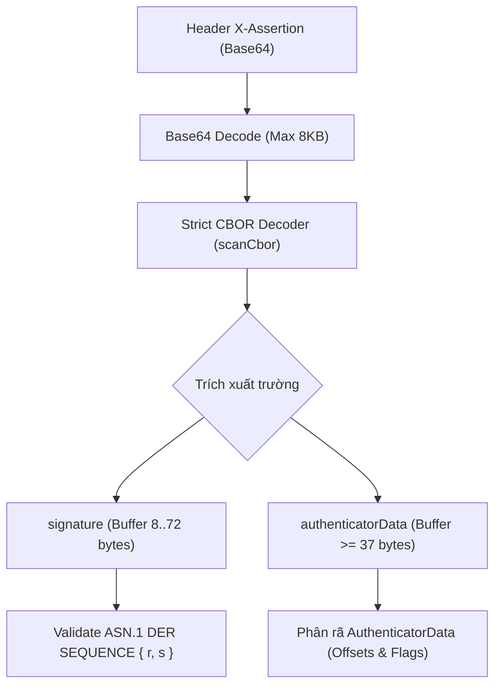
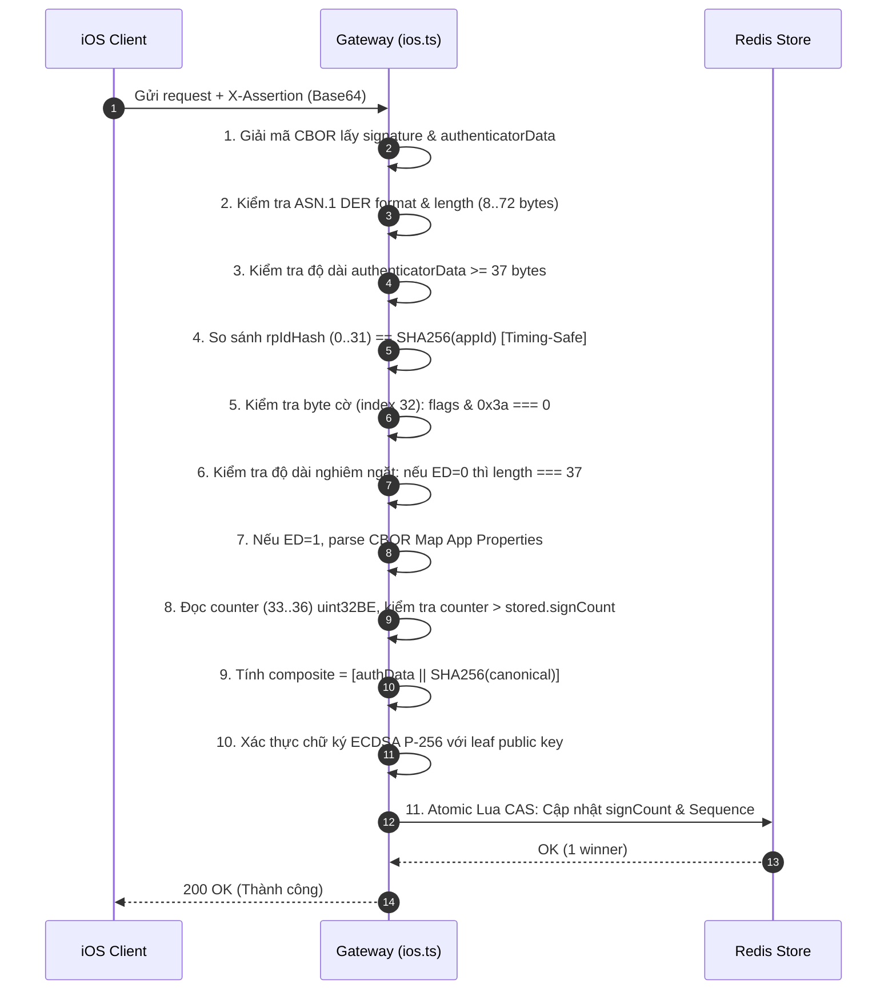

# Đặc tả Kỹ thuật Xác minh Request iOS (Apple App Attest)
*(Official Apple App Attest Assertion & AuthenticatorData Bit-Level Verification Specification)*

Tài liệu này là quy chuẩn kỹ thuật chính thức và chi tiết nhất về cách xác minh request nghiệp vụ từ nền tảng **iOS (Apple App Attest)** trên API Gateway **Node-Secure-API**. Tài liệu quy định chi tiết cấu trúc bộ nhớ, giải mã nhị phân từng bit, thuật toán băm composite và thứ tự kiểm tra đảm bảo nguyên tắc an ninh **Fail-Closed**.

---

## 1. Cơ sở Tiêu chuẩn Kỹ thuật (Official Specifications)

Quy trình xác minh assertion của iOS dựa trên hai tài liệu chuẩn:
1. **Apple Official Documentation:** [Validating Apps That Connect to Your Server](https://developer.apple.com/documentation/devicecheck/validating-apps-that-connect-to-your-server) — Mô tả quy trình kiểm tra assertion được sinh bởi `DCAppAttestService.generateAssertion(keyId, clientDataHash)`.
2. **W3C WebAuthn Level 3:** [Section 6.1: Authenticator Data](https://www.w3.org/TR/webauthn-3/#sctn-authenticator-data) — Định nghĩa cấu trúc byte nhị phân của `authenticatorData`.

---

## 2. Cấu trúc Gói Tin Wire: Header `X-Assertion`

Mỗi request từ client iOS đính kèm chữ ký phần cứng trong HTTP Header:
```http
X-Assertion: <Base64-encoded CBOR Map>
```

Khi giải mã Base64 và phân tích cú pháp **CBOR (RFC 8949)**, payload bắt buộc phải là một CBOR Map chứa chính xác 2 trường dữ liệu nhị phân:

```text
Map(2) {
  "signature" => <Buffer: 8..72 bytes ECDSA P-256 DER ASN.1>,
  "authenticatorData" => <Buffer: >= 37 bytes>
}
```



---

## 3. Cấu trúc Bộ nhớ Chi tiết của `authenticatorData`

`authenticatorData` là một buffer nhị phân được tạo ra trực tiếp bởi Apple Secure Enclave. Bộ nhớ được phân bổ tuần tự theo các offset sau:

| Byte Offset (Index) | Kích thước | Tên trường | Định dạng nhị phân | Mô tả chi tiết |
| :--- | :--- | :--- | :--- | :--- |
| **`0 .. 31`** (32 bytes) | 32 bytes | `rpIdHash` | 32 raw bytes | Mã băm `SHA-256` của `App ID` (`<AppIDPrefix>.<bundleId>`). |
| **`32`** (1 byte) | 1 byte | `flags` | 8-bit unsigned int | Byte cờ trạng thái phần cứng và cấu trúc dữ liệu. |
| **`33 .. 36`** (4 bytes) | 4 bytes | `signCount` | UInt32 Big-Endian | Bộ đếm chữ ký tăng đơn điệu quản lý bởi phần cứng Apple. |
| **`37 .. N`** (tùy chọn) | Biến đổi | `extensionData` | CBOR Map | Dữ liệu App Properties (chỉ tồn tại khi cờ `ED = 1`). |

```text
+------------------------------------+-------+--------------------+-------------------------+
|        rpIdHash (32 bytes)         | flags | signCount (4 bytes)| extensionData (tùy chọn)|
|            Index 0..31             |Idx 32 |    Index 33..36    |       Index 37..N       |
+------------------------------------+-------+--------------------+-------------------------+
```

---

## 4. Giải mã Từng Bit trong Byte Cờ (`flags` - Index 32)

Byte thứ 33 (`authenticatorData[32]`) là một bitfield 8-bit đại diện cho các cờ an ninh.

```text
       Bit 7   Bit 6   Bit 5   Bit 4   Bit 3   Bit 2   Bit 1   Bit 0
     +-------+-------+-------+-------+-------+-------+-------+-------+
     |  ED   |  AT   | RFU2  |  BS   |  BE   |  UV   | RFU1  |  UP   |
     +-------+-------+-------+-------+-------+-------+-------+-------+
Hex:   0x80    0x40    0x20    0x10    0x08    0x04    0x02    0x01
```

### Bảng Đặc tả Chi tiết Từng Bit:

| Bit | Hex Mask | Tên cờ (Flag) | Tiêu chuẩn WebAuthn | Hành vi Phần cứng Apple iOS & Gateway Policy | Trạng thái Chấp nhận |
| :---: | :---: | :--- | :--- | :--- | :--- |
| **Bit 0** | `0x01` | **UP**<br>*(User Presence)* | Bắt buộc chạm vật lý mỗi lần ký | **Apple App Attest:** Cho phép `0` hoặc `1`. Ký assertion cho API nền không yêu cầu bắt buộc prompt người dùng. | **Cho phép (0 hoặc 1)** |
| **Bit 1** | `0x02` | **RFU1**<br>*(Reserved 1)* | Dành riêng cho tương lai, bắt buộc = 0 | **Gateway Policy:** Không được phép bật. Nếu bật, ném `401 UNSUPPORTED_AUTHENTICATOR_FLAGS`. | **Bắt buộc = 0** |
| **Bit 2** | `0x04` | **UV**<br>*(User Verification)* | Đã xác thực sinh trắc học / PIN | **Apple App Attest:** Cho phép `0` hoặc `1`. Bật khi khóa được khởi tạo kèm chính sách Touch ID/Face ID. | **Cho phép (0 hoặc 1)** |
| **Bit 3** | `0x08` | **BE**<br>*(Backup Eligibility)* | Khóa có thể đồng bộ/sao lưu (L3) | **Apple App Attest:** Khóa phần cứng Secure Enclave không bao giờ được phép backup lên iCloud. | **Bắt buộc = 0** |
| **Bit 4** | `0x10` | **BS**<br>*(Backup State)* | Khóa hiện đang được sao lưu (L3) | **Apple App Attest:** Không hỗ trợ cơ chế backup. Bắt buộc phải là 0. | **Bắt buộc = 0** |
| **Bit 5** | `0x20` | **RFU2**<br>*(Reserved 2)* | Dành riêng cho tương lai, bắt buộc = 0 | **Gateway Policy:** Không được phép bật. Nếu bật, ném `401 UNSUPPORTED_AUTHENTICATOR_FLAGS`. | **Bắt buộc = 0** |
| **Bit 6** | `0x40` | **AT**<br>*(Attested Credential)* | Cấm trong assertion (chỉ có ở registration) | **Thực tế iOS:** `DCAppAttestService.generateAssertion` **luôn bật cờ này** dù không có dữ liệu credential theo sau. Apple bỏ qua kiểm tra cờ.<br>**Gateway:** **Chấp nhận cờ 0x40** nhưng **buộc chiều dài đúng 37 byte** (khi ED=0) để chặn credential smuggling. | **Cho phép (0 hoặc 1)**<br>*(với ràng buộc độ dài)* |
| **Bit 7** | `0x80` | **ED**<br>*(Extension Data)* | Báo hiệu có dữ liệu mở rộng CBOR | **Apple App Attest:** Bật khi có Apple App Properties (iOS 27+). Khi bật, sau byte 37 bắt buộc phải là duy nhất 1 Map CBOR hợp lệ. | **Cho phép (0 hoặc 1)**<br>*(với cú pháp CBOR)* |

---

## 5. Quy tắc Kiểm tra Bitwise và Ràng buộc Chiều dài

Đoạn mã xác thực tối ưu trong [src/platform/ios.ts](file:///home/hungvu/Pictures/Node-Secure-API/src/platform/ios.ts#L690-L720) thực hiện tuần tự như sau:

```typescript
const flags = authenticatorData[32];

// Bước 1: Loại bỏ toàn bộ các bit không hỗ trợ hoặc bị cấm (Mặt nạ 0x3a)
// 0x3a = 0b00111010 (RFU1: 0x02, BE: 0x08, BS: 0x10, RFU2: 0x20)
if ((flags & 0x3a) !== 0) {
  throw new SecurityError('UNSUPPORTED_AUTHENTICATOR_FLAGS', 401);
}

// Bước 2: Kiểm tra cờ Extension Data (bit 7 - 0x80)
const hasExtensionData = (flags & 0x80) !== 0;

// Bước 3: RÀNG BUỘC ĐỘ DÀI TUYỆT ĐỐI KHI ED TẮT (ED = 0)
// Ngay cả khi cờ AT (0x40) được bật, độ dài BẮT BUỘC phải là 37 bytes.
// Bất kỳ dữ liệu credential nào bị nhồi thêm sẽ làm độ dài > 37 và bị chặn lập tức.
if (!hasExtensionData && authenticatorData.length !== 37) {
  throw new SecurityError('INVALID_AUTHENTICATOR_DATA_LENGTH', 401);
}

// Bước 4: XỬ LÝ EXTENSION KHI ED BẬT (ED = 1)
let assertExtMap: Map<unknown, unknown> | undefined;
if (hasExtensionData) {
  if (authenticatorData.length <= 37) {
    throw new SecurityError('MISSING_EXTENSION_DATA', 401);
  }
  // Bắt buộc từ byte 37 trở đi chỉ chứa DUY NHẤT 1 Map CBOR, không có trailing bytes
  const assertExts = decodeMultipleBounded(authenticatorData.subarray(37));
  if (assertExts.length !== 1 || !(assertExts[0] instanceof Map)) {
    throw new SecurityError('INVALID_EXTENSION_DATA', 401);
  }
  assertExtMap = assertExts[0] as Map<unknown, unknown>;
}
```

### Bảng Ma trận Kiểm tra Cờ & Độ dài:

| Byte Cờ (`flags`) | Tên Cờ Bật | Độ dài authData | Kết quả Xác thực | Mã lỗi nếu thất bại |
| :---: | :--- | :---: | :---: | :--- |
| `0x00` | Không có cờ | 37 bytes | **HỢP LỆ** | — |
| `0x01` | `UP` | 37 bytes | **HỢP LỆ** | — |
| `0x04` | `UV` | 37 bytes | **HỢP LỆ** | — |
| `0x40` | `AT` (iOS thực tế) | 37 bytes | **HỢP LỆ** | — |
| `0x41` | `AT + UP` | 37 bytes | **HỢP LỆ** | — |
| `0x45` | `AT + UP + UV` | 37 bytes | **HỢP LỆ** | — |
| `0x40` | `AT` | **> 37 bytes** (ED=0) | **TỪ CHỐI** | `401 INVALID_AUTHENTICATOR_DATA_LENGTH` |
| `0x80` | `ED` | 37 bytes (thiếu ext) | **TỪ CHỐI** | `401 MISSING_EXTENSION_DATA` |
| `0x80` | `ED` | $> 37$ bytes (kèm 1 CBOR Map) | **HỢP LỆ** | — |
| `0xc0` | `AT + ED` | $> 37$ bytes (kèm 1 CBOR Map) | **HỢP LỆ** | — |
| `0xc0` | `AT + ED` | $> 37$ bytes (kèm CBOR Array) | **TỪ CHỐI** | `401 INVALID_EXTENSION_DATA` |
| `0x02` | `RFU1` | Bất kỳ | **TỪ CHỐI** | `401 UNSUPPORTED_AUTHENTICATOR_FLAGS` |
| `0x08` | `BE` | Bất kỳ | **TỪ CHỐI** | `401 UNSUPPORTED_AUTHENTICATOR_FLAGS` |
| `0x10` | `BS` | Bất kỳ | **TỪ CHỐI** | `401 UNSUPPORTED_AUTHENTICATOR_FLAGS` |
| `0x20` | `RFU2` | Bất kỳ | **TỪ CHỐI** | `401 UNSUPPORTED_AUTHENTICATOR_FLAGS` |
| `0x42` | `AT + RFU1` | Bất kỳ | **TỪ CHỐI** | `401 UNSUPPORTED_AUTHENTICATOR_FLAGS` |
| `0x48` | `AT + BE` | Bất kỳ | **TỪ CHỐI** | `401 UNSUPPORTED_AUTHENTICATOR_FLAGS` |

---

## 6. Xác minh Bộ đếm Chữ ký Phần cứng (`signCount`)

Từ byte offset `33` đến `36` (4 bytes), giá trị counter được đọc dưới dạng số nguyên không dấu 32-bit Big-Endian:

$$\text{counter} = \text{authenticatorData.readUInt32BE}(33)$$

### Quy tắc Kiểm tra Chống Clone / Replay:
1. **Tăng đơn điệu nghiêm ngặt:** Giá trị `counter` nhận được từ assertion **bắt buộc phải lớn hơn** giá trị `signCount` đã lưu trong database:
   $$\text{counter} > \text{storedDevice.signCount}$$
   Nếu $\text{counter} \le \text{storedDevice.signCount}$, ném lỗi `401 SIGN_COUNT_NOT_INCREASED` (hoặc phát hiện clone khóa).
2. **Cập nhật nguyên tử (Atomic CAS):** Khi request xác thực thành công, giá trị `counter` mới được cập nhật vào Redis thông qua script Lua nguyên tử, ngăn chặn hoàn toàn race condition khi có nhiều request đồng thời.

---

## 7. Cấu trúc Chữ ký ASN.1 DER và Thuật toán Ký Composite

### A. Cấu trúc Chữ ký ECDSA DER ASN.1
Apple App Attest trả về chữ ký số định dạng chuẩn **ASN.1 DER sequence** của 2 số nguyên $r$ và $s$:
```text
30 <len> 02 <lenR> <r_bytes> 02 <lenS> <s_bytes>
```
* **Giới hạn kích thước:** Độ dài hợp lệ bắt buộc nằm trong khoảng **$8 \le \text{length} \le 72$ bytes**.
* Cấu trúc giải mã ASN.1 phải chứa chính xác 2 phần tử `asn1js.Integer`.

### B. Thuật toán Ghép Composite Hashing
Client iOS **không ký trực tiếp** lên canonical string. Thay vào đó, chữ ký được thực hiện trên chuỗi ghép đôi (`composite`):

$$1.\quad \text{clientDataHash} = \text{SHA-256}(\text{canonicalString})$$
$$2.\quad \text{composite} = \text{authenticatorData} \mathbin{\Vert} \text{clientDataHash}$$
$$3.\quad \text{Verify: } \text{ECDSA-P256-Verify}(\text{publicKey}, \text{composite}, \text{signature}) == \text{true}$$

> [!CAUTION]
> **Lỗi thường gặp ở client/test:** Băm `clientDataHash` 2 lần hoặc băm thêm một lần nữa chuỗi `composite` trước khi ký sẽ làm sai lệch chữ ký và bị server từ chối với lỗi `401 INVALID_SIGNATURE`.

---

## 8. Trình tự Xác minh Assertion Hoàn chỉnh (Execution Order)

Để đảm bảo hiệu năng và tính an ninh **Fail-Closed**, thứ tự kiểm tra trong [src/platform/ios.ts](file:///home/hungvu/Pictures/Node-Secure-API/src/platform/ios.ts) được thực hiện theo đúng thứ tự sau:



Tất cả các điều kiện biên và trường hợp vi phạm đều có bộ test hồi quy tự động bảo vệ trong [test/ios-provider.test.ts](file:///home/hungvu/Pictures/Node-Secure-API/test/ios-provider.test.ts).
