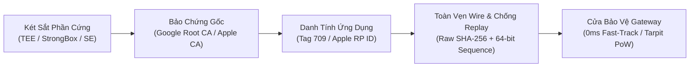
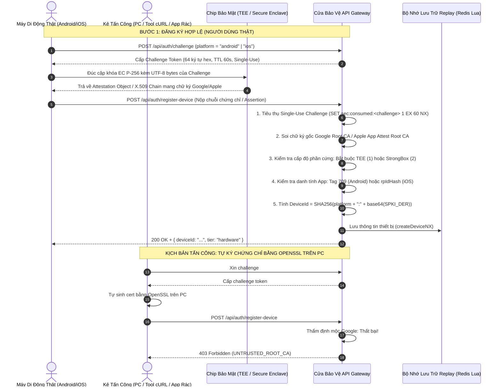
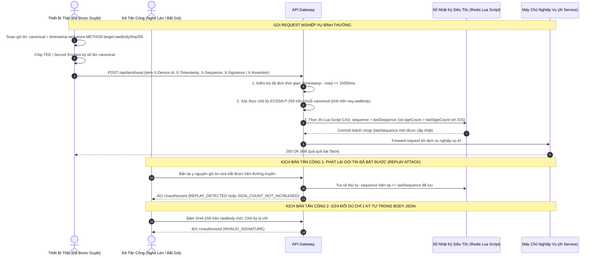
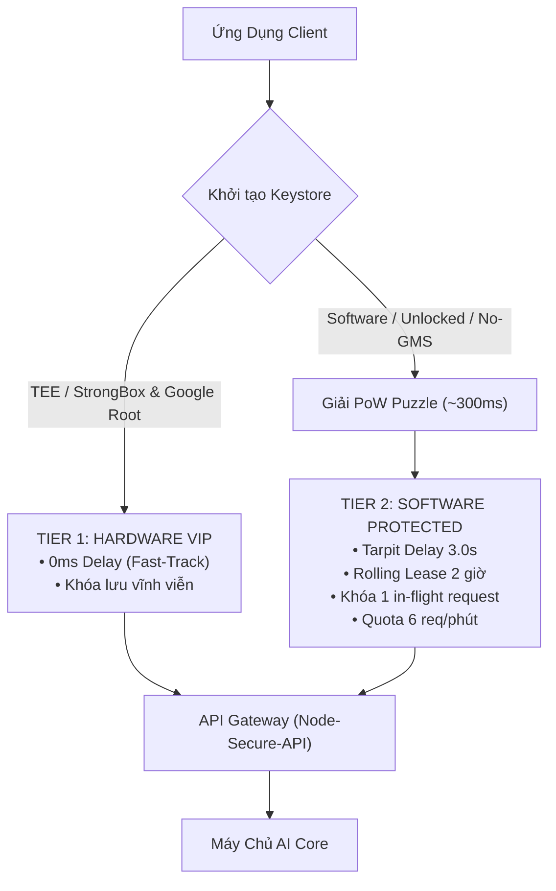

# KIẾN TRÚC AN NINH TOÀN DIỆN & ĐẶC TẢ BẢO MẬT HỆ THỐNG (NODE-SECURE-API)
## XÁC THỰC PHẦN CỨNG MOBILE (ANDROID KEYMINT / IOS APP ATTEST) & CHỐNG REPLAY QUY MÔ LỚN

> **Tài liệu đặc tả an ninh cốt lõi của dự án Node-Secure-API.**
> Tài liệu này hợp nhất toàn bộ các quyết định kiến trúc (ADRs), mô hình phòng thủ Dual-Tier, đặc tả xác minh nhị phân iOS App Attest, phân tích mở rộng tuyến tính & bền vững hóa trạng thái, runbook kiểm thử phần cứng thật (Canary), hướng dẫn triển khai vận hành và căn cứ bảo mật chính thức.
>
> *Tài liệu đồng hành:* Để xem hướng dẫn lập trình chi tiết cho client (Android Kotlin & iOS Swift), tham khảo [docs/CLIENT_INTEGRATION_GUIDE.md](CLIENT_INTEGRATION_GUIDE.md).

---

## MỤC LỤC TỔNG QUAN

1. [Bản Chất Vấn Đề & Triết Lý Bảo Mật](#1-bản-chất-vấn-đề--triết-lý-bảo-mật)
2. [Sơ Đồ Luồng Hoạt Động Cốt Lõi (Sequence Diagrams)](#2-sơ-đồ-luồng-hoạt-động-cốt-lõi-sequence-diagrams)
3. [Các Bất Biến An Ninh & Quyết Định Kiến Trúc (ADRs)](#3-các-bất-biến-an-ninh--quyết-định-kiến-trúc-adrs)
4. [Kiến Trúc Phân Tầng Bất Đối Xứng (Dual-Tier Architecture)](#4-kiến-trúc-phân-tầng-bất-đối-xứng-dual-tier-architecture)
5. [Đặc Tả Xác Minh Nền Tảng iOS (Apple App Attest Specification)](#5-đặc-tả-xác-minh-nền-tảng-ios-apple-app-attest-specification)
6. [Phân Tích Mở Rộng Tuyến Tính & Bền Vững Hóa Trạng Thái (Scaling & Resilience)](#6-phân-tích-mở-rộng-tuyến-tính--bền-vững-hóa-trạng-thái-scaling--resilience)
7. [Triển Khai & Vận Hành Hệ Thống (Deployment & Operations)](#7-triển-khai--vận-hành-hệ-thống-deployment--operations)
8. [Runbook Canary Trên Thiết Bị Thật (Hardware Canary Verification)](#8-runbook-canary-trên-thiết-bị-thật-hardware-canary-verification)
9. [Nguồn Tham Chiếu Bảo Mật & Quy Trình Cập Nhật (Security Sources & Audit)](#9-nguồn-tham-chiếu-bảo-mật--quy-trình-cập-nhật-security-sources--audit)
10. [Tổng Hợp Đo Đạc Hiệu Năng & Nghiệm Thu An Ninh](#10-tổng-hợp-đo-đạc-hiệu-năng--nghiệm-thu-an-ninh)

---

## 1. Bản Chất Vấn Đề & Triết Lý Bảo Mật

### 1.1 Lỗ hổng chí mạng của các cơ chế bảo mật truyền thống
Hầu hết các ứng dụng di động bảo vệ API bằng một trong các phương pháp sau:
* **API Key / Secret nhúng trong ứng dụng:** Kẻ tấn công chỉ cần dùng Jadx, Ghidra hoặc `strings` trên file APK/IPA để trích xuất secret key. Sau đó, hắn viết script (Python, Node.js, cURL) gọi trực tiếp vào API hàng triệu lần mà không cần cài đặt hay mở ứng dụng trên điện thoại.
* **Header HMAC tĩnh / Biến đổi chuỗi (Obfuscation):** Dù mã hóa thuật toán sinh header phức tạp đến đâu, hacker vẫn có thể sử dụng Frida hook hàm sinh chữ ký hoặc dump bộ nhớ lúc runtime.
* **CAPTCHA / OTP bắt buộc:** Làm gián đoạn trải nghiệm người dùng nghiêm trọng, gây tỷ lệ bỏ ứng dụng (churn rate) ước tính lên tới 60% – 80% đối với các tiện ích trải nghiệm tức thì (instant/guest utilities).

### 1.2 Triết lý phòng thủ chiều sâu (Defense-in-Depth)
Node-Secure-API không dựa vào bất kỳ bí mật nhúng nào trong mã nguồn client. Thay vào đó, hệ thống biến chiếc điện thoại thành điểm neo tin cậy phần cứng (Hardware Trust Anchor):



1. **Con dấu mật trong Két sắt phần cứng (Hardware Keystore / Secure Enclave):**
   - Private key được sinh ra trực tiếp trong phân vùng bảo mật của vi xử lý chính (ARM TrustZone / TEE) hoặc chip bảo mật rời (StrongBox, Apple Secure Enclave).
   - Khóa **không bao giờ có thể trích xuất ra ngoài bộ nhớ RAM hay copy sang máy tính khác**.
2. **Bảo chứng bởi Google & Apple (Hardware Attestation Root CA):**
   - Đi kèm khóa là chuỗi chứng chỉ được ký bởi chính Google hoặc Apple, chứng minh khóa được tạo bởi phần cứng thật và thiết bị không bị can thiệp hệ điều hành (`deviceLocked = true`, `verifiedBootState = VERIFIED`).
3. **Thẻ căn cước ứng dụng (App Identity Binding):**
   - Android: Package Name và Signature Digest (SHA-256 fingerprint của certificate ký APK) được phần cứng đóng dấu vào phần mở rộng ASN.1 Tag 709 (`attestationApplicationId`).
   - iOS: App ID (`<AppIDPrefix>.<bundleId>`) được băm thành `rpIdHash` nằm trong `authenticatorData`.
4. **Đóng dấu từng gói tin & Chống Replay:**
   - Mỗi request gửi lên được ký số ECDSA P-256 trên chuỗi byte thô nguyên bản (`req.rawBody`), kèm theo timestamp thời gian thực và số thứ tự 64-bit (`BigInt`) tăng dần một chiều được kiểm soát nguyên tử trong Redis.

### 1.3 Phân Tầng Bảo Vệ & Bảng Đối Thoại Đối Kháng

> [!IMPORTANT]
> **Ranh giới an ninh giữa 2 tầng:**
> - **Tier 1 (Hardware VIP):** Loại trừ 100% script PC, máy ảo và app giả mạo nhờ chuỗi chứng chỉ ký từ phần cứng Google/Apple.
> - **Tier 2 (Software Protected):** Mở cho thiết bị Android không hỗ trợ Key Attestation hoặc máy đã mở khóa bootloader; script PC có thể tham gia nếu chấp nhận chi phí giải PoW nhưng bị kiềm chế chặt chẽ bởi Tarpit Delay 3.0s, Rate Limit 6 RPM và Rolling Lease 2 giờ.

| Câu hỏi của Kẻ tấn công | Hành vi tấn công dự định | Vì sao Hệ thống chặn đứng được? |
|---|---|---|
| **1. "Tôi viết script cURL/Python trên PC để spam hàng triệu request?"** | Giả lập request từ VPS hoặc PC vào endpoint bảo mật. | • **Tier 1:** Bị chặn đứng với `403 UNTRUSTED_ROOT_CA` vì PC không có mộc đỏ Google/Apple Root CA.<br>• **Tier 2:** Bị kiềm chế bởi chi phí CPU giải PoW (~8.3 giờ CPU cho 100k key) kèm Tarpit 3.0s và Rate Limit 6 RPM. |
| **2. "Tôi dùng điện thoại thật, nhưng viết app khác để đúc key nộp lên?"** | Viết app `com.attacker.tool` đúc key phần cứng để bypass mộc Google. | **BỊ BẮT TẠI TRẬN:** Chứng chỉ lá bị ép mang Tag 709. Gateway đọc ra thấy `packageName` không khớp `EXPECTED_PACKAGE_NAME` $\rightarrow$ Ném `403 PACKAGE_NAME_MISMATCH` (hoặc `401 RP_ID_MISMATCH` trên iOS). |
| **3. "Tôi chạy app trên máy ảo giả lập (Emulator / Nox / LDPlayer)?"** | Tự động hóa qua máy ảo Android trên PC. | **BỊ CHẶN Ở TIER 1:** Giả lập chỉ có cấp độ Software (0). Gateway từ chối với `403 HARDWARE_TEE_REQUIRED`. Nếu chuyển sang Tier 2 thì chịu các hạn chế nghiêm ngặt của Tier 2. |
| **4. "Tôi gửi header `X-Test-Mode: mock-ca` để ép server lờ mộc Google?"** | Khai thác cơ chế debug để bypass trust anchor. | **BỊ TRIỆT TIÊU HOÀN TOÀN:** Production entrypoint không chứa bất kỳ cờ client bypass nào; server luôn tuân thủ nguyên tắc Fail-Closed. |
| **5. "Tôi bắt gói tin hợp lệ trên Wireshark rồi bắn lại (Replay Attack)?"** | Thu thập gói tin đã ký và gửi lại liên tục. | **BỊ TỪ CHỐI TỨC THÌ:**<br>• Gửi lại sau 15 giây: Lỗi `401 EXPIRED_TIMESTAMP`.<br>• Gửi lại ngay lập tức: Lỗi `401 REPLAY_DETECTED` (sequence không tăng) hoặc `401 SIGN_COUNT_NOT_INCREASED` (iOS counter). |
| **6. "Tôi cắm cáp USB vào máy thật, dùng Frida biến nó thành máy ký hộ (Signing Oracle)?"** | Biến điện thoại thật thành con rối ký request cho script spam PC. | **RÀO CẢN KỸ THUẬT & KINH TẾ:**<br>1. *Độ trễ phần cứng:* Chip TEE ký mất 15–50ms (tối đa ~20–50 req/s/máy).<br>2. *Xung đột Sequence:* Cơ chế sequence đơn luồng khiến các request song song bị xung đột và dính `REPLAY_DETECTED`.<br>3. *Giới hạn thực tế:* Signing oracle vẫn có thể gửi tuần tự trên 1 máy; hệ thống cần kết hợp quota nghiệp vụ và phát hiện bất thường phía backend để hạn chế lạm dụng. |

---

## 2. Sơ Đồ Luồng Hoạt Động Cốt Lõi (Sequence Diagrams)

### Luồng 1: Đăng ký thiết bị (Chạy 1 lần duy nhất khi cài đặt)



### Luồng 2: Gọi API nghiệp vụ hàng ngày (Chống Replay & Toàn vẹn Wire)



---

## 3. Các Bất Biến An Ninh & Quyết Định Kiến Trúc (ADRs)

Dưới đây là 7 quyết định kiến trúc nền tảng đã được chuẩn hóa và đóng băng (frozen invariants) trong mã nguồn:

### ADR 1: Xác Thực Chuỗi Chứng Chỉ & Root CA (Trust Anchors)
* **Google Root CA (Android):**
  - Hỗ trợ song song cả Google RSA Root truyền thống và EC Root mới từ 2026.
  - Neo tin cậy dựa trên Subject Public Key Info (**SPKI**) kết hợp chữ ký hợp lệ thay vì pin chuỗi nhị phân DER cứng, cho phép chấp nhận các root reissue có cùng cặp khóa.
  - Bắt buộc kiểm tra cả `attestationSecurityLevel` và `keymasterSecurityLevel` thuộc TEE (1) hoặc StrongBox (2) đối với Tier 1.
* **Apple App Attest (iOS):**
  - Tách biệt hoàn toàn chứng thực App Attest với receipt: Chuỗi App Attest neo về Apple App Attestation Root CA; Receipt CMS được xác minh riêng bằng Apple Root CA - G3 với signer mang OID marker `1.2.840.113635.100.12.15`.
  - Phân định môi trường nghiêm ngặt: Chỉ chấp nhận AAGUID `appattestdevelop` ở môi trường dev/staging; production bắt buộc production AAGUID (`appattest` + 7 bytes `0x00`). Cấm client gửi header tự khai để đổi môi trường.
* **Quy chuẩn ASN.1 & CBOR:** Giới hạn độ dài, độ sâu lồng ghép (depth bounds) và số lượng node để triệt tiêu tấn công DoS/ReDoS bằng cấu trúc dữ liệu đệ quy độc hại.

### ADR 2: Định Chuẩn Dữ Liệu Wire Format (Canonical Request Integrity)
Mọi request nghiệp vụ đều phải được chuẩn hóa thành chuỗi UTF-8 không có ký tự newline cuối:
$$\text{canonical} = \text{timestamp} \mathbin{\Vert} \text{":"} \mathbin{\Vert} \text{sequence} \mathbin{\Vert} \text{":"} \mathbin{\Vert} \text{METHOD} \mathbin{\Vert} \text{":"} \mathbin{\Vert} \text{requestTarget} \mathbin{\Vert} \text{":"} \mathbin{\Vert} \text{bodySha256Hex}$$

* **requestTarget:** Bao gồm cả encoded path và query string nguyên bản, không được URL-decode, không sắp xếp lại tham số (no sort), không chuẩn hóa khoảng trắng hay dấu `/` (giữ nguyên `%2F`).
* **bodySha256Hex:** Giá trị hex chữ thường (lowercase) tính trực tiếp trên chuỗi byte thô nguyên bản (`req.rawBody`). Tuyệt đối **không** parse JSON rồi stringify lại (`JSON.stringify`) để tránh kẽ hở biến đổi khoảng trắng (whitespace mutation). Body rỗng (0 bytes) sử dụng hash của mảng rỗng: `e3b0c44298fc1c149afbf4c8996fb92427ae41e4649b934ca495991b7852b855`.
* Từ chối HTTP content encoding nén (`gzip`, `br`) trên các route bảo mật để ngăn ngừa biến đổi byte trong quá trình giải nén của proxy.

### ADR 3: Quản Lý Số Thứ Tự Đơn Điệu 64-bit (Strict Monotonic Sequence)
* **Xử lý số nguyên 64-bit:** Client gửi sequence dưới dạng chuỗi số thập phân trong header `X-Sequence` (miền giá trị từ `1` đến `9223372036854775807`). Cấm số âm, số thực và số có số 0 dẫn đầu (leading zeros). Node.js xử lý bằng kiểu dữ liệu `BigInt`.
* **Thẩm định nguyên tử trong Redis Lua:**
  - Script Lua thực hiện so sánh chuỗi số canonical decimal (đối chiếu độ dài chuỗi trước, sau đó so sánh từ điển lexicographic), **tuyệt đối không dùng `tonumber()` trong Lua 5.1** để bảo toàn 100% độ chính xác cho các giá trị vượt ngưỡng an toàn $2^{53} - 1$ của số thực IEEE 754.
  - Commit đồng thời cả `lastSequence` của ứng dụng và `signCount` của Apple App Attest trong cùng một giao dịch nguyên tử.

### ADR 4: Độ Tươi (Freshness) & Chống Replay
* **Dung sai thời gian (Timestamp Tolerance):** Sai số cho phép tối đa giữa timestamp client và đồng hồ máy chủ là $\pm 15$ giây (`TIMESTAMP_TOLERANCE_MS = 15_000`). Bất kỳ độ lệch nào vượt ngưỡng đều bị từ chối ngay lập tức (`EXPIRED_TIMESTAMP`). Client áp dụng cơ chế bù lệch đồng hồ động (Dynamic Clock Offset).
* **Challenge Nonce ngẫu nhiên & Định dạng:**
  - Cấu trúc Stateless Challenge Token (32 bytes $\rightarrow$ 64 ký tự hex):
    $$\text{token} = \text{randomNonce}_{12\text{B}} \mathbin{\Vert} \text{timestampSeconds}_{4\text{B}} \mathbin{\Vert} \text{platformByte}_{1\text{B}} \mathbin{\Vert} \text{hmacSignature}_{15\text{B}}$$
  - Byte đưa vào Android `setAttestationChallenge` là **UTF-8 của chuỗi 64 ký tự hex**, không phải hex-decode byte thô. iOS `clientDataHash` khi đăng ký là SHA-256 của cùng byte UTF-8 đó.
  - Tiêu thụ Single-Use thông qua lệnh Redis `SET sec:consumed:<challenge> 1 EX 60 NX` (hoặc `GETDEL` với challenge stateful).

### ADR 5: Nguyên Tắc "Fail-Closed" & Không Mock Trong Production
* Không hỗ trợ bất kỳ header, cờ môi trường hay switch từ client (`X-Test-Mode`, `ALLOW_DEV_ROOT_CA`) nào để nới lỏng chính sách CA trong entrypoint production. Mọi mock test chỉ được đưa vào thông qua Constructor Injection trong bộ test độc lập.
* **Kiểm tra thu hồi chứng chỉ (CRL):** Kiểm tra serial number của mọi chứng chỉ qua Google Revocation List. Tôn trọng HTTP `max-age`, tính toán độ tươi hữu hạn. Khi snapshot CRL bị cũ quá hạn (stale) hoặc tải lỗi, server lập tức chuyển sang chế độ fail-closed và từ chối đăng ký mới.
* **Redis Store Fail-Closed:** Bắt buộc kết nối Redis cho runtime production; không tự động fallback sang `MemoryStore` khi mất kết nối Redis để ngăn chặn tấn công mở lại replay window.

### ADR 6: Chiến Lược Thử Lại (Retry) & Tính Bất Biến Nghiệp Vụ (Idempotency)
* Khi gặp sự cố mạng hoặc timeout, client **không được phát lại gói tin cũ**. Mỗi lần retry bắt buộc phải rút số `X-Sequence` mới, cập nhật `X-Timestamp` mới và thực hiện ký số lại.
* Tính không trùng lặp nghiệp vụ (không trừ tiền hay tính toán AI hai lần) được đảm bảo bằng `Idempotency-Key` nằm trong phần thân payload đã được ký và được kiểm soát bởi unique constraint / transaction của cơ sở dữ liệu nghiệp vụ.

### ADR 7: Tính Bền Vững Của Thiết Bị & Chống Ghi Đè (Anti-Overwrite)
* Định danh `deviceId` được server suy ra trực tiếp từ băm SHA-256 có tiền tố nền tảng:
  $$\text{deviceId} = \text{SHA-256}(\text{platform} \mathbin{\Vert} \text{":"} \mathbin{\Vert} \text{base64}(\text{SPKI\_DER}))$$
* Nghiêm cấm ghi đè (Anti-Overwrite / NX): Nếu một thiết bị gửi lại yêu cầu đăng ký cho cùng một public key hoặc cùng deviceId, server từ chối ghi đè hoặc reset counter để chống tấn công replay lịch sử.
* Thiết bị phần cứng đã đăng ký không thiết lập TTL tự hủy trong Redis để tránh việc hết hạn làm mở lại nguy cơ replay. Việc thu hồi thiết bị thực hiện qua quy trình quản trị rekey riêng.

---

## 4. Kiến Trúc Phân Tầng Bất Đối Xứng (Dual-Tier Architecture)

### 4.1 Bối cảnh thực tế & Bài toán Zero-Login Friction
Mặc dù chính sách phần cứng (Hardware VIP) cung cấp mức độ bảo mật cao nhất, thực tế thị trường di động cho thấy có khoảng 15% – 30% thiết bị Android của người dùng chân chính không đáp ứng tiêu chuẩn khắt khe này:
1. Thiết bị đời cũ hoặc giá rẻ chỉ hỗ trợ Keystore mức phần mềm (`attestationSecurityLevel = 0`).
2. Thiết bị xách tay đã mở khóa bootloader để cài ROM quốc tế (`deviceLocked = false`).
3. Thiết bị không có dịch vụ Google Play Services (như Huawei hoặc máy nội địa Trung Quốc).

Đối với các ứng dụng tiện ích tức thời (bói bài Tarot, horoscope), việc bắt người dùng đăng nhập tài khoản / nhập mã OTP SMS khi dùng máy cũ sẽ khiến tỷ lệ người dùng bỏ app (churn rate) tăng cao. Do đó, hệ thống triển khai kiến trúc **Dual-Tier** kết hợp phòng vệ bất đối xứng:



### 4.2 Bảng so sánh chi tiết hai tầng bảo mật

| Tiêu Chí | Tier 1: Hardware VIP | Tier 2: Software Protected |
|---|---|---|
| **Đối tượng thiết bị** | Máy có chip TEE / StrongBox, Google Root CA, bootloader khóa | Máy cũ, chip giá rẻ, unlock bootloader, không GMS |
| **Xác thực khi đăng ký** | Chuỗi chứng chỉ Google Hardware Attestation | Cặp khóa EC P-256 SPKI PEM + Lời giải Proof of Work (PoW) |
| **Thời hạn khóa (Lease TTL)** | **Vĩnh viễn** (gắn chặt với chip phần cứng) | **2 giờ** (`registeredAt + 7200000`, client làm mới ngầm) |
| **Độ trễ xử lý (Latency)** | **Siêu tốc** (0ms delay bổ sung, phản hồi < 50ms) | **Tarpit Delay 3.0s** (chủ động làm chậm kết nối) |
| **Giới hạn tần suất** | Tiêu chuẩn VIP | 6 requests / phút (tối đa 1 request in-flight) |
| **Giới hạn theo IP** | Tiêu chuẩn | Nghiêm ngặt (tối đa 5 đăng ký/giờ, 20 req/phút/IP) |
| **Phạm vi kiểm soát Rate Limit** | Tiêu chuẩn | **In-memory từng process** (xem ghi chú kiến trúc bên dưới) |
| **Toàn vẹn & Chống Replay** | Ký ECDSA P-256 trên rawBody, Sequence 64-bit | Ký ECDSA P-256 trên rawBody, Sequence 64-bit |

### 4.3 Chi tiết 5 trụ cột làm khó hacker trên tầng Software
1. **Dynamic Proof of Work (PoW):**
   - Khi xin challenge, server trả về độ khó `POW_DIFFICULTY_BITS` (mặc định 18 bit 0 dẫn đầu) và chuỗi `salt`. Client phải tìm `nonce` sao cho:
     $$\text{SHA256}(\text{challenge} \mathbin{\Vert} \text{":"} \mathbin{\Vert} \text{salt} \mathbin{\Vert} \text{":"} \mathbin{\Vert} \text{nonce}) \text{ có 18 bit 0 dẫn đầu}$$
   - *Tính bất đối xứng:* Người dùng thật mất ~300ms tính toán ngầm trong màn hình Splash. Hacker muốn sinh 100.000 thiết bị ảo phải tiêu tốn ước tính hơn 8.3 giờ CPU 100% liên tục. Trong khi đó, Gateway chỉ tốn $< 0.001\,\text{ms}$ để xác thực.
2. **Rolling Device Lease (Khóa tự hủy sau 2 giờ):**
   - Thiết bị Software chỉ có giá trị sử dụng trong 2 giờ (`expiresAt = registeredAt + 7200000`).
   - Ngăn chặn việc hacker "đào" sẵn cơ sở dữ liệu hàng triệu key lưu trữ để dùng dần quanh năm. Hết 2 giờ, key cũ bị từ chối và hacker buộc phải tiêu tốn tài nguyên giải lại PoW.
3. **Khóa Concurrency (Single In-Flight Request Lock):**
   - Một thiết bị Software chỉ được phép có duy nhất 1 request đang xử lý tại một thời điểm. Nếu bot spam nhiều request song song trên cùng key, các request phụ bị từ chối ngay với HTTP `429 CONCURRENT_REQUEST_DISALLOWED`.
   - *Lưu ý triển khai:* Hiện tại `RateLimiter` (`src/core/rate-limiter.ts`) quản lý lock và bucket trong bộ nhớ RAM của từng tiến trình API (lock timeout mặc định 30s). Để đảm bảo tính phân tán toàn cụm khi scale multi-replica, cần định tuyến qua NGINX Consistent Hashing hoặc nâng cấp lock sang Redis.
4. **Trễ có chủ đích (Intentional Tarpit Latency 3.0s):**
   - Gateway giữ kết nối 3.0 giây trước khi trả kết quả cho thiết bị Software.
   - Kết hợp giữa Tarpit 3.0s và Khóa Concurrency, tốc độ tối đa của 1 thiết bị Software bị khống chế: $\le 20\,\text{req/phút} \approx 0.33\,\text{req/s}$. Để cào 100.000 quẻ bài, hacker mất hơn 83 giờ liên tục cho mỗi thread.
5. **Bảo toàn chữ ký số & Chống Replay:** Dù ở mức phần mềm, client vẫn ký ECDSA P-256 trên chuỗi canonical và `req.rawBody` SHA-256, triệt tiêu khả năng sửa đổi tham số hoặc phát lại gói tin.

### 4.4 Cấu hình tham số Dual-Tier (`src/config.ts`)
```bash
# Bật/tắt hỗ trợ Software Tier phía Gateway (mặc định: true)
ANDROID_ALLOW_SOFTWARE_TIER=true

# Độ khó Proof of Work (số bit 0 dẫn đầu, mặc định: 18)
POW_DIFFICULTY_BITS=18

# Thời hạn Lease của thiết bị Software (giây, mặc định 2 giờ = 7200)
SOFTWARE_DEVICE_TTL_SECONDS=7200

# Thời gian làm trễ Tarpit Delay (ms, mặc định: 3000)
SOFTWARE_TARPIT_DELAY_MS=3000

# Hạn mức số request/phút cho thiết bị Software (mặc định: 6)
SOFTWARE_RATE_LIMIT_RPM=6
```

---

## 5. Đặc Tả Xác Minh Nền Tảng iOS (Apple App Attest Specification)

Quy trình xác minh request iOS được thiết kế tuân thủ chuẩn kỹ thuật của Apple ([Validating Apps That Connect to Your Server](https://developer.apple.com/documentation/devicecheck/validating-apps-that-connect-to-your-server)) và chuẩn W3C WebAuthn Level 3 ([Section 6.1: Authenticator Data](https://www.w3.org/TR/webauthn-3/#sctn-authenticator-data)).

### 5.1 Cấu trúc gói tin Wire: Header `X-Assertion`
Client iOS gửi assertion trong header HTTP:
```http
X-Assertion: <Base64-encoded CBOR Map>
```
Khi giải mã Base64 và phân tích cú pháp **CBOR (RFC 8949)**, payload bắt buộc phải là một CBOR Map chứa chính xác 2 trường dữ liệu nhị phân:
```text
Map(2) {
  "signature" => <Buffer: 8..72 bytes ECDSA P-256 DER ASN.1>,
  "authenticatorData" => <Buffer: >= 37 bytes>
}
```

### 5.2 Cấu trúc bộ nhớ của `authenticatorData`
Buffer nhị phân do Apple Secure Enclave sinh ra được bố trí theo các offset cố định:

| Offset Byte | Kích thước | Tên trường | Định dạng | Mô tả chi tiết |
|---|---|---|---|---|
| **`0 .. 31`** | 32 bytes | `rpIdHash` | 32 bytes | Băm `SHA-256` của App ID (`<AppIDPrefix>.<bundleId>`). |
| **`32`** | 1 byte | `flags` | 8-bit uint | Byte cờ trạng thái phần cứng và cấu trúc dữ liệu. |
| **`33 .. 36`** | 4 bytes | `signCount` | UInt32BE | Bộ đếm chữ ký tăng đơn điệu quản lý bởi phần cứng Secure Enclave. |
| **`37 .. N`** | Biến đổi | `extensionData` | CBOR Map | Dữ liệu Apple App Properties (chỉ tồn tại khi cờ `ED = 1`). |

```text
+------------------------------------+-------+--------------------+-------------------------+
|        rpIdHash (32 bytes)         | flags | signCount (4 bytes)| extensionData (tùy chọn)|
|            Index 0..31             |Idx 32 |    Index 33..36    |       Index 37..N       |
+------------------------------------+-------+--------------------+-------------------------+
```

### 5.3 Giải mã bitwise trong byte cờ (`flags` - Index 32)

```text
       Bit 7   Bit 6   Bit 5   Bit 4   Bit 3   Bit 2   Bit 1   Bit 0
     +-------+-------+-------+-------+-------+-------+-------+-------+
     |  ED   |  AT   | RFU2  |  BS   |  BE   |  UV   | RFU1  |  UP   |
     +-------+-------+-------+-------+-------+-------+-------+-------+
Hex:   0x80    0x40    0x20    0x10    0x08    0x04    0x02    0x01
```

* **Chính sách kiểm tra mặt nạ bit cấm `0x3a` (0b00111010):**
  - Bao gồm `RFU1` (0x02), `BE` (0x08), `BS` (0x10), `RFU2` (0x20).
  - Khóa phần cứng Secure Enclave không bao giờ được phép backup lên iCloud (`BE=0`, `BS=0`) và các bit dự phòng phải bằng 0. Nếu `(flags & 0x3a) !== 0` $\rightarrow$ Ném lỗi `401 UNSUPPORTED_AUTHENTICATOR_FLAGS`.
* **Cờ `AT` (0x40) & Ràng buộc độ dài nghiêm ngặt khi `ED = 0`:**
  - Trong thực tế iOS, hàm `DCAppAttestService.generateAssertion` **luôn bật cờ AT (0x40)** dù không có credential data theo sau.
  - **Quy chuẩn Gateway:** Chấp nhận cờ `0x40` nhưng **bắt buộc độ dài `authenticatorData` phải đúng chính xác 37 bytes** khi cờ `ED` (0x80) tắt. Mọi hành vi nhồi credential phụ làm độ dài $> 37$ bytes đều bị từ chối với lỗi `401 INVALID_AUTHENTICATOR_DATA_LENGTH` (chặn credential smuggling).
* **Xử lý extension khi `ED = 1`:** Byte 37 trở đi bắt buộc phải là duy nhất một CBOR Map hợp lệ, không có trailing garbage bytes.

### 5.4 Xác minh bộ đếm phần cứng `signCount` & Chữ ký Composite
1. **Bộ đếm `signCount`:** Đọc giá trị 32-bit Big-Endian từ byte 33..36. Giá trị nhận được bắt buộc phải lớn hơn giá trị đã lưu trong hệ thống:
   $$\text{signCount} > \text{storedDevice.signCount}$$
   Nếu không tăng $\rightarrow$ Báo lỗi `401 SIGN_COUNT_NOT_INCREASED` (phát hiện clone khóa hoặc phát lại assertion).
2. **Thuật toán ghép Composite Hashing của Apple:**
   Chữ ký số ASN.1 DER ECDSA P-256 trên iOS được thực hiện trên chuỗi composite ghép đôi:
   $$\text{clientDataHash} = \text{SHA-256}(\text{canonicalString})$$
   $$\text{composite} = \text{authenticatorData} \mathbin{\Vert} \text{clientDataHash}$$
   $$\text{nonce} = \text{SHA-256}(\text{composite})$$
   $$\text{crypto.verify}(null, \text{nonce}, \text{publicKey}, \text{signature}) == \text{true}$$

> [!NOTE]
> Với EC P-256 trên runtime Node.js hiện tại, lời gọi `crypto.verify(null, nonce, keyObject, signature)` tương đương xác minh ECDSA-with-SHA256 trên chuỗi composite nonce; không diễn giải `null` là chế độ nhận digest thô (raw prehashed).

### 5.5 Checklist xác thực đăng ký iOS (Registration Checklist)
- [x] Extension nonce trong chứng chỉ lá (OID `1.2.840.113635.100.8.2`) phải khớp chính xác với $\text{SHA-256}(\text{authData} \mathbin{\Vert} \text{clientDataHash})$.
- [x] `keyId` nhận được phải khớp với $\text{SHA-256}(\text{uncompressed X9.62 public key point})$.
- [x] Credential public key trích xuất từ CBOR COSE Key phải là `kty = 2` (EC), `alg = -7` (ES256), `crv = 1` (P-256).
- [x] `signCount` ban đầu của thiết bị mới đăng ký bắt buộc phải bằng 0.
- [x] Chuỗi chứng chỉ `x5c` phải kết nối về Apple App Attestation Root CA và AAGUID khớp môi trường.
- [x] Receipt CMS là bắt buộc khi đăng ký iOS (thiếu sẽ bị từ chối với `400 MISSING_APP_ATTEST_RECEIPT`), được xác minh độc lập qua Apple Root CA - G3 với OID `1.2.840.113635.100.12.15`, kiểm tra tính tươi (freshness) và ràng buộc App ID/public key. Bước gọi server-to-server sang Apple Fraud Assessment API chưa triển khai.

---

## 6. Phân Tích Mở Rộng Tuyến Tính & Bền Vững Hóa Trạng Thái (Scaling & Resilience)

### 6.1 Bảng Phân Định: Trạng Thái Hiện Tại vs Đề Xuất Mở Rộng Mục Tiêu

| Thành Phần Kiến Trúc | Trạng Thái Đã Triển Khai Hiện Tại | Đề Xuất Mở Rộng Mục Tiêu (Proposal) |
|---|---|---|
| **L1 Local Cache** | LRU Cache trong RAM tiến trình: **4.096 entries** | Tăng lên **32.768 entries** kèm monitoring hit-rate |
| **Tầng L2 Replay Engine** | Redis standalone với Lua Script atomic CAS | Redis Cluster / Sentinel có durable persistence |
| **Tầng L3 Durable Store** | Đã có module `PostgresDeviceStore` & `HybridSecurityStore` | Hoàn thiện pool connection, PITR backup & failover automation |
| **Ingress Load Balancing** | Host port binding / Reverse proxy tiêu chuẩn | NGINX Consistent Hashing theo `$http_x_device_id` |
| **Rate Limiter / Concurrency** | In-process Map trong từng tiến trình API (30s lock) | Distributed Redis Concurrency Lock toàn cụm |

### 6.2 Cân nhắc `appendfsync everysec` & Giới Hạn Của Timestamp Quarantine

| Tiêu Chí So Sánh | `appendfsync always` | `appendfsync everysec` |
|---|---|---|
| **Cơ chế ghi đĩa** | Gọi `fsync()` vật lý chặn luồng chính cho từng lượt commit | Ghi Kernel Page Cache; background thread gọi `fsync()` mỗi giây |
| **Throughput ghi** | Bị trần cứng bởi IOPS đĩa: **1.000 – 3.000 ops/s** (gp3 baseline) | Tốc độ ghi RAM: **50.000 – 100.000+ ops/s** |
| **Độ trễ p99** | **15ms – 100ms+** (rất nhạy cảm với Disk Contention) | **< 1ms – 2ms** (ổn định) |
| **Mất dữ liệu khi sập nguồn (`kill -9`)** | 0 byte (chỉ mất giao dịch chưa ACK) | **Mất dữ liệu trong khoảng 0 – 1 giây cuối cùng** |

#### Đánh giá cơ chế Timestamp Quarantine 15 giây & Giới hạn biên:
Khi chuyển sang `appendfsync everysec`, nếu máy chủ Redis bị sập nguồn đột ngột, trạng thái sequence có thể bị lùi tối đa 1 giây.
- **Quy tắc Kiểm Dịch:** Khi API Gateway phát hiện kết nối Redis mới được khởi tạo lại (`uptime_in_seconds < 15`):
  1. Gateway lưu mốc thời gian $T_{\text{boot}} = \text{Date.now()}$.
  2. Trong suốt 15 giây đầu: Mọi request có `X-Timestamp` $< T_{\text{boot}}$ sẽ bị từ chối với mã lỗi `401 RETRY_WITH_FRESH_TIMESTAMP`.
  3. Mọi request có `X-Timestamp` $\ge T_{\text{boot}}$ được xử lý bình thường.
- **Giới hạn an ninh (Security Boundaries):**
  - Cơ chế này chặn đứng các gói tin phát lại có timestamp trong quá khứ ($T < T_{\text{boot}}$).
  - *Kịch bản biên:* Nếu client có đồng hồ đi trước server (nằm trong dung sai $+15$s, ví dụ $T = T_{\text{boot}} + 5s$) và gói tin đã được chấp nhận trước khi Redis crash, gói tin này sau khi reboot vẫn có $T \ge T_{\text{boot}}$ nên có thể vượt qua quarantine.
  - Do đó, Timestamp Quarantine là **cơ chế giảm thiểu rủi ro (risk mitigation)** hữu hiệu, không nên tuyên bố là triệt tiêu 100% trong mọi điều kiện lệch đồng hồ.

#### Cảnh báo quan trọng về Durability & Eviction:
- **Atomicity không đồng nghĩa với Durability:** Lệnh Lua script đảm bảo tính nguyên tử trên bộ nhớ Redis, nhưng không tự bảo đảm độ bền vững qua failover bất đồng bộ của Redis Cluster hoặc Sentinel.
- **Không tùy tiện bật eviction:** Tuyệt đối không bật `--maxmemory-policy allkeys-lru` hoặc `volatile-lru` bừa bãi cho các key replay (`sec:seq:*`) hay challenge đã tiêu thụ (`sec:consumed:*`). Việc mất trạng thái sequence sẽ mở lại replay window cho kẻ tấn công.
- **Khi phát hiện state rollback / mất dữ liệu:** Phải tạm dừng traffic được bảo vệ, điều tra nguyên nhân và thực hiện rekey/thu hồi các thiết bị liên quan; không coi restore backup cũ là giải pháp tự động an toàn cho replay counters.

### 6.3 Kiến trúc lưu trữ 3 tầng mục tiêu (Target Tiered Storage Architecture)

```mermaid
flowchart TD
    Client["Thiết Bị Di Động"] --> Ingress["NGINX Ingress Load Balancer (Đề xuất)\n• Consistent Hashing: Hash($http_x_device_id)\n• Rate Limit: /api/auth/challenge (20 r/s)"]

    Ingress --> API1["API Replica 1 (L1 RAM LRU)"]
    Ingress --> API2["API Replica 2 (L1 RAM LRU)"]
    Ingress --> API3["API Replica 3 (L1 RAM LRU)"]
    Ingress --> API4["API Replica 4 (L1 RAM LRU)"]

    API1 & API2 & API3 & API4 -->|Hot-Path Replay CAS (<1ms)| Redis["Tầng L2: Redis 8-alpine\n• appendfsync everysec\n• noeviction"]
    API1 & API2 & API3 & API4 -->|Bền vững hóa thiết bị (ACID)| Postgres["Tầng L3: PostgreSQL 16\n• Bảng devices (JSONB metadata)\n• Source of Truth bền vững"]
```

1. **Tầng L1: In-Process LRU Cache:** Giảm thiểu lệnh đọc `HMGET` vào Redis bằng cách cache `KeyObject` EC P-256 và metadata thiết bị trong RAM tiến trình.
2. **Tầng L2: High-Speed Replay Engine (Redis In-Memory):** Chạy Lua script CAS đảm bảo số thứ tự và signCount tăng đơn điệu.
3. **Tầng L3: Durable Source of Truth (PostgreSQL 16):** Lưu trữ vĩnh viễn danh tính thiết bị phần cứng, chứng chỉ public key, receipt Apple và metadata đăng ký. Điểm checkpoint sequence được ghi định kỳ xuống PostgreSQL.

---

## 7. Triển Khai & Vận Hành Hệ Thống (Deployment & Operations)

### 7.1 Môi trường và Docker Compose
Hệ thống chạy trên nền tảng **Node.js 24 LTS (ESM)** và Redis. Cụm dịch vụ chuẩn được triển khai qua `compose.yaml`:

```bash
# 1. Khởi động cụm dịch vụ với cấu hình production
docker compose up --build -d --wait

# 2. Kiểm tra trạng thái sẵn sàng của Gateway
curl -i http://127.0.0.1:3000/ready
```

> [!CAUTION]
> **Quản lý Secrets trước khi lên Production:** File `compose.yaml` và `.env.example` chứa các giá trị cấu hình mặc định phục vụ local testing. Khi đưa lên môi trường production, quản trị viên bắt buộc phải cấu hình biến môi trường với secret thật, đặt mật khẩu Redis mạnh, bật TLS mạng nội bộ và tuyệt đối không công khai cổng Redis ra Internet.

### 7.2 Quy tắc thiết lập Reverse Proxy & TLS Termination
1. **Bảo toàn nguyên vẹn chuỗi byte Wire:** Reverse proxy (NGINX, Cloudflare, Traefik) phải chuyển tiếp nguyên vẹn `request-target` (path + query string nguyên bản, không URL-decode `%2F`, không sort query) và `rawBody`. Bất kỳ sự thay đổi dù chỉ 1 ký tự khoảng trắng cũng làm hỏng chữ ký ECDSA.
2. **Xử lý Forwarded IP an toàn:** Chỉ tin tưởng header `X-Forwarded-For` từ dải IP của các reverse proxy được chỉ định trong cấu hình; không bật `trust proxy` rộng rãi để tránh IP spoofing qua mặt rate-limiter.
3. **Cấm nén Request Body:** Vô hiệu hóa nén HTTP (`gzip`, `br`) trên các route bảo mật để tránh rủi ro giải nén sai lệch byte giữa proxy và backend.
4. **Xử lý file lớn (Ảnh 10MB):** Tuyệt đối không gửi trực tiếp file ảnh lớn qua route ký số. Áp dụng quy trình 2 bước:
   - Bước 1: Gọi API ký số gửi body JSON nhỏ xin đường dẫn Presigned URL từ S3 / MinIO.
   - Bước 2: Đẩy trực tiếp file ảnh nhị phân lên S3 qua Presigned URL mà không cần qua Gateway bảo mật.
5. **Đồng bộ thời gian NTP:** Cài đặt đồng bộ NTP trên tất cả máy chủ Gateway và cảnh báo khi clock drift tiến gần ngưỡng 15 giây.

### 7.3 Quản lý trạng thái Replay & Vận hành Redis
- Cấu hình Redis bắt buộc: `appendonly yes`, `noeviction` cho instance lưu trữ replay sequence (`sec:seq:*`) và challenge đã tiêu thụ (`sec:consumed:*`), kích hoạt ACL tối thiểu. Tuyệt đối không bật eviction trên replay datastore (nếu cần eviction, tách riêng một Redis instance độc lập làm read-only cache).
- Khi Redis gặp sự cố, hệ thống áp dụng nguyên tắc **Fail-Closed** (ném lỗi HTTP 503 `STORE_ERROR`), tuyệt đối không tự động fallback sang bộ nhớ RAM `MemoryStore` để tránh tạo lỗ hổng replay.
- Cấu hình Redis Cluster cần lưu ý: Các key liên quan đến một giao dịch nguyên tử (Lua CAS) bắt buộc phải thuộc cùng một Hash Slot (sử dụng Hash Tags `{deviceId}`).

### 7.4 6 Cạm bẫy thực tế trên Android Client & Giải pháp
1. **Đổi mã PIN / Thêm vân tay làm mất khóa:** Tắt cờ `setUserAuthenticationRequired(true)`. Khóa dùng để xác thực thiết bị, không phải khóa xác thực giao dịch ngân hàng.
2. **Google Drive Auto-Backup làm vỡ phiên:** Cấu hình `data-extraction-rules` (Android 12+) và `full-backup-content` (Android cũ) loại trừ toàn bộ SharedPreferences bảo mật và sequence counter khỏi tính năng backup đám mây và device-to-device transfer.
3. **Request song song bị xung đột:** `AtomicLong` chỉ cấp số duy nhất trong bộ nhớ; để đảm bảo thứ tự request đến server, client bắt buộc phải kết hợp hàng đợi/mutex tuần tự hóa (`RequestSerializationQueue`) bao phủ cả send và response.
4. **Mất mạng gửi lại (Network Retry):** Khi retry, rút `X-Sequence` mới, `X-Timestamp` mới, ký lại chữ ký mới nhưng giữ nguyên `Idempotency-Key` nghiệp vụ trong body.
5. **Máy không có Google Play Services:** Tự động fallback sang Tier 2 (Software Protected với PoW) khi chính sách server cho phép mà không ép người dùng đăng nhập.
6. **Lệch giờ đồng hồ thiết bị:** Lưu `serverTime` từ response challenge, tính toán `clockOffsetMs` và cộng bù vào timestamp của mọi request.

---

## 8. Runbook Canary Trên Thiết Bị Thật (Hardware Canary Verification)

> [!IMPORTANT]
> **Trạng thái hiện tại của dự án:** Chưa thực hiện hardware canary trên thiết bị thật vì chưa có thông tin ký ứng dụng chính thức (signing identity) của sản phẩm. Toàn bộ các test tự động hiện tại sử dụng fixture certificates được inject độc lập trong test environment.

### 8.1 Chuẩn bị môi trường Staging
- **Android:** Xác định chính xác Package Name, SHA-256 fingerprint của **App Signing Certificate** trên Google Play Console (không nhầm với Upload Key) và phiên bản ứng dụng tối thiểu. Chuẩn bị thiết bị hỗ trợ TEE và StrongBox.
- **iOS:** Xác định chính xác App ID Prefix (Team ID) và Bundle ID. Bật entitlement Apple App Attest. Tách biệt rõ ràng môi trường staging (`IOS_APP_ATTEST_ENV=development`) và production.
- **Preflight Check:** Chạy lệnh kiểm tra kết nối staging:
  ```bash
  CANARY_BASE_URL=https://staging.example.com npm run canary:preflight
  ```

### 8.2 Ma trận kiểm thử phần cứng thật (Test Cases C01 – C15)

| Mã Case | Thao tác thực hiện | Kết quả kỳ vọng & Tiêu chí Pass |
|---|---|---|
| **C01** | Xin challenge cho đúng platform, tạo key trong TEE/SE thật, đăng ký trong 60s | **HTTP 200** + deviceId. Backend ghi nhận app identity và public key đã verify vào Redis/DB. |
| **C02** | Dùng lại challenge cũ hoặc challenge đã hết hạn 60s | **HTTP 401** `INVALID_CHALLENGE`. Không tạo thêm bất kỳ record nào. |
| **C03** | Đăng ký bằng key có Package Name / App ID không khớp cấu hình server | Android: **HTTP 403** `PACKAGE_NAME_MISMATCH`; iOS: **HTTP 401** `RP_ID_MISMATCH`. Bị từ chối trước khi ghi record. |
| **C04** | Gửi request ký số hợp lệ với body rỗng, JSON có khoảng trắng, query chứa `%2F` | **HTTP 200**. Chữ ký bảo vệ trọn vẹn từng byte dữ liệu nguyên bản trên đường truyền. |
| **C05** | Giữ nguyên chữ ký, sửa đổi dù chỉ 1 byte trong body JSON hoặc đổi method/query | **HTTP 401** `INVALID_SIGNATURE`. Handler nghiệp vụ không được phép thực thi. |
| **C06** | Gửi lại y nguyên một request đã từng được chấp nhận trước đó (**Replay**) | **HTTP 401** `REPLAY_DETECTED` (Android) hoặc `SIGN_COUNT_NOT_INCREASED` / `REPLAY_DETECTED` (iOS). |
| **C07** | Ký 20 bản có cùng sequence, bắn đồng thời vào Gateway (**Race Condition**) | **Chính xác 1 request thành công 200 OK**, 19 request còn lại bị từ chối với lỗi replay hoặc counter. |
| **C08** | Trên iOS, gửi assertion có counter cũ kèm sequence mới | **HTTP 401** `SIGN_COUNT_NOT_INCREASED`. Cả sequence và signCount trong DB giữ nguyên. |
| **C09** | Gửi request có timestamp lệch quá ±15s hoặc sequence chứa ký tự lạ / số âm | Timestamp lệch: **HTTP 401** `EXPIRED_TIMESTAMP`; Sequence sai format: **HTTP 400** `INVALID_SEQUENCE`. |
| **C10** | Khởi động lại API instance và ứng dụng client, giữ nguyên Redis; gửi request với sequence mới | Request cũ bị chặn, request số tiếp theo thành công **200 OK**; deviceId và public key không đổi. |
| **C11** | Khởi động lại container Redis có cấu hình durability; reconnect ứng dụng client | Toàn bộ trạng thái replay được bảo toàn; request số cũ tiếp tục bị chặn, số mới thành công. |
| **C12** | Dừng Redis có kiểm soát trong khi L1 cache đang nóng | Protected request bị từ chối ngay lập tức (**HTTP 503** `STORE_ERROR`), không fallback RAM. |
| **C13** | Dùng app iOS build development gửi request sang instance production | Đăng ký bị từ chối (**HTTP 403** `AAGUID_MISMATCH`). Cấm dùng header client để đổi môi trường. |
| **C14** | Thiết bị không hỗ trợ Key Attestation hoặc máy đã unlock bootloader | Khi server cho phép Software Tier: chuyển sang Tier 2 (giải PoW $\rightarrow$ chấp nhận với Tarpit 3.0s). iOS không có fallback này. |
| **C15** | Kiểm tra tương thích với Google RSA Root và EC Root mới năm 2026 | Chuỗi chứng chỉ của cả 2 loại root đều được Gateway thẩm định thành công. Nếu thiếu thiết bị, ghi `NOT_RUN`. |

### 8.3 Mẫu biên bản nghiệm thu Canary (Canary Evidence Template)
Dưới đây là mẫu biên bản kiểm thử thiết bị thật chuẩn của dự án:

```json
{
  "runId": "REPLACE_WITH_CANARY_RUN_ID",
  "status": "NOT_RUN",
  "artifactDigest": null,
  "appBuild": null,
  "platform": null,
  "deviceModel": null,
  "osVersion": null,
  "appIdentityVerified": false,
  "hardwareAttestationVerified": false,
  "trustAnchorFingerprint": null,
  "preflightReport": null,
  "cases": [],
  "redisPersistencePolicy": null,
  "proxyRawByteIntegrityVerified": false,
  "observedAt": null,
  "reviewer": null,
  "notes": "No private keys, full receipts, user payloads or credentials. Each case records PASS/FAIL/NOT_RUN, expected/actual error code, sequence/counter before/after and redacted trace IDs."
}
```

> [!NOTE]
> **Quy tắc Rollout & Rollback:** Chỉ xét duyệt rollout khi các test case bắt buộc của platform đều đạt `PASS`, không có skip bất thường, và reviewer ký duyệt. Khi phát hiện lỗi an ninh hoặc state rollback: lập tức dừng canary, giữ nguyên bằng chứng để điều tra, tuyệt đối không mở policy chấp nhận software root hay reset sequence để làm test xanh.

---

## 9. Nguồn Tham Chiếu Bảo Mật & Quy Trình Cập Nhật (Security Sources & Audit)

Hệ thống duy trì việc đối chiếu định kỳ với các nguồn tài liệu và endpoint chính thức từ Google, Apple và W3C:

| Nguồn Tài Liệu | Phiên bản & Nội dung đối chiếu | Ảnh hưởng đến việc triển khai |
|---|---|---|
| [android/keyattestation](https://github.com/android/keyattestation) | Upstream commit `0e3ac2f` (2026-10-30) | Thẩm định chuỗi chứng chỉ X.509, ràng buộc `certificates_issued` (0..2^31-1), xử lý RKP certificates. |
| [Android Developers: Key Attestation](https://developer.android.com/privacy-and-security/security-key-attestation) | Đặc tả KeyMint & Root Rotation | Hỗ trợ Google EC Root mới; xử lý chứng chỉ factory có intermediate hết hạn nhưng root còn hạn. |
| [AOSP Attestation Schema](https://source.android.com/docs/security/features/keystore/attestation) | KeyMint/Keymaster KeyDescription, RootOfTrust, ApplicationId | Phân tích ASN.1 Tag 709 và Tag 704 (`rootOfTrust`), package version giữ kiểu BigInt. |
| [Google Hardware Roots](https://android.googleapis.com/attestation/root) | Endpoint JSON chính thức | Snapshot cặp khóa Google Root CA được kiểm soát nội bộ bởi server. |
| [Google Revocation Status](https://android.googleapis.com/attestation/status) | Endpoint JSON danh sách thu hồi | Kiểm tra serial number của mọi chứng chỉ; fail-closed khi dữ liệu quá hạn. |
| [Apple: Validating Apps](https://developer.apple.com/documentation/devicecheck/validating-apps-that-connect-to-your-server) | Apple App Attest Assertion & Attestation | Quy chuẩn băm composite `[authData \|\| clientDataHash]`, AAGUID, App ID binding, Apple signCount uint32BE. |
| [Apple: Assessing Fraud Risk](https://developer.apple.com/documentation/devicecheck/assessing-fraud-risk) | Receipt CMS & Fraud Risk API | Xác minh chữ ký CMS qua Apple Root CA - G3 riêng biệt với OID `1.2.840.113635.100.12.15`. |
| [W3C WebAuthn Level 3](https://www.w3.org/TR/webauthn-3/#sctn-authenticator-data) | Section 6.1: Authenticator Data | Đặc tả bitfield byte cờ `flags` (offset 32) và cấu trúc dữ liệu CBOR mở rộng. |
| [Node.js 24 LTS Crypto](https://nodejs.org/docs/latest-v24.x/api/crypto.html) | OpenSSL ECDSA P-256 DER | Sử dụng module mật mã native của Node.js, không tự viết lại giải thuật ký số. |
| [Redis Lua Documentation](https://redis.io/docs/latest/develop/programmability/eval-intro/) | EVAL Atomic Scripting | So sánh độ dài và từ điển chuỗi số học decimal, bảo toàn 100% độ chính xác cho số nguyên 64-bit. |

### Quy trình phát hiện Drift và Audit định kỳ
- **Tập lệnh kiểm tra tự động:**
  ```bash
  npm run security:sources
  ```
  Script kiểm tra định kỳ fingerprint của Google Root CA và upstream commit `android/keyattestation` với snapshot đã được thẩm định trong `docs/upstream-snapshot.json`. Khi phát hiện sai lệch (drift), quy trình CI sẽ báo lỗi để đội ngũ an ninh tiến hành đánh giá lại.
- **Giới hạn kỹ thuật:** Script kiểm tra tự động chỉ phát hiện thay đổi commit upstream của Google và root fingerprint; việc đối chiếu các thay đổi tài liệu của Apple App Attest hoặc AOSP vẫn yêu cầu quy trình rà soát thủ công định kỳ.

---

## 10. Tổng Hợp Đo Đạc Hiệu Năng & Nghiệm Thu An Ninh

### 10.1 Kết quả đo tải Grafana k6 (Baseline Thực Nghiệm)
Thực hiện đo tải với k6 executor `constant-arrival-rate`, mỗi request ký số ECDSA DER SHA-256 thật và thẩm định qua Redis Lua thật trong suốt 60 giây (máy chủ AMD Ryzen 7 8845H, 16 CPUs, Redis bền vững cấu hình AOF):

| Cấu hình Runtime | Mức tải xác nhận (60s) | Tổng Request Thành Công | Tỷ lệ Lỗi HTTP | Dropped Iterations | Độ trễ p95 HTTP | Độ trễ p99 HTTP |
|---|---:|---:|---:|---:|---:|---:|
| **1 API Process** | **4.000 RPS** | 240.000 | **0%** | **0** | **6,09 ms** | 12,28 ms |
| **4 API Replicas** | **9.000 RPS** | 540.001 | **0%** | **0** | **5,70 ms** | 8,92 ms |

> [!NOTE]
> Các con số trên là kết quả đo tải thực nghiệm (baseline) trên phần cứng thử nghiệm cụ thể với steady-state Android requests đã seed sẵn. Không coi đây là cam kết công suất cố định cho mọi môi trường production có TLS proxy và AI business workload thật.

### 10.2 Kết quả kiểm định tự động toàn diện
- **305 Test Items trong bộ Test Suite:** **292 PASSED**, **13 SKIPPED**, **0 FAILED** trên 67 test suites.
  - Các test case skip bao gồm kiểm thử kết nối Redis integration thật (khi chạy local không truyền `REDIS_TEST_URL`) và Swift interoperability tests (khi môi trường thiếu Swift toolchain).
- Độ bao phủ kiểm thử: Định chuẩn Wire Format, chống Replay với số nguyên 64-bit BigInt > $2^{53}$, chống biến đổi 1-bit whitespace, kiểm thử tấn công đua tranh (20 race conditions cùng tiêu thụ 1 challenge hoặc 1 sequence), kiểm tra Apple App Attest / Receipt CMS và kiểm định CBOR nghiêm ngặt.
- **Bảo toàn dữ liệu khi Restart Redis:** Script `npm run test:redis-restart` khởi động lại container Redis thật có dữ liệu sequence > $2^{53}$ và counter iOS: dữ liệu hoàn toàn nguyên vẹn sau khi restart, các gói tin cũ tiếp tục bị chặn replay, số tiếp theo được chấp nhận bình thường.

---

## TỔNG KẾT

Hệ thống **Node-Secure-API** thiết lập một phòng tuyến an ninh khép kín và có chiều sâu:
1. **Neo chặt vào phần cứng:** Khóa mật sinh trong TEE / StrongBox / Secure Enclave không thể bị sao chép sang máy tính PC.
2. **Bảo chứng độc lập:** Xác thực nguồn gốc từ Google Root CA và Apple App Attest Root CA, xóa sổ hoàn toàn botnet và máy ảo giả lập ở phân tầng Hardware VIP.
3. **Toàn vẹn tuyệt đối:** Chữ ký số trên chuỗi byte thô nguyên bản (`req.rawBody`) và số thứ tự 64-bit đơn điệu trong Redis Lua script chặn đứng tấn công can thiệp dữ liệu và phát lại gói tin.
4. **Linh hoạt và thực tế:** Người dùng máy thật hưởng trọn trải nghiệm VIP Fast-Track (0ms delay), trong khi các thiết bị không đủ chuẩn phần cứng vẫn được hỗ trợ an toàn qua tầng Software Protected với PoW và Tarpit Delay có kiểm soát.
